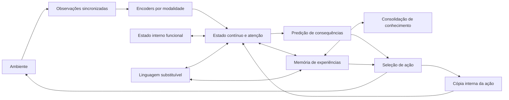

# Alice — plano de memória, continuidade e desenvolvimento

Criado: 10/10/2026. Atualizado: 01/11/2026. Status: meta ativa; implementação em andamento. O andamento
abaixo distingue recortes verificados de marcos completos.
Base verificada: [laboratório atual](ALICE_NEURAL_MEMORY.md).

## 1. Objetivo e decisões

Direção reafirmada pelo usuário em 11/10: Alice é prioritariamente uma companheira
que conversa de maneira natural e se desenvolve na convivência. Um modelo pequeno
pode fornecer linguagem e capacidades sensoriais iniciais. Conhecimento extenso de
programação ou desempenho comparável a grandes assistentes não é o alvo inicial.
O centro é aprender continuamente por interesse, estudo, tentativa, feedback e
consolidação. Aprender gostos/lembranças e adquirir habilidades generalizáveis são
critérios distintos: ambos precisam de mecanismos e avaliação. Preservar essa
direção ao escolher modelos; não substituir desenvolvimento por um modelo maior.

Esclarecimento do usuário em01/11: desenvolvimento e recordação devem ocorrer
durante a convivência, sem uma fase de sono obrigatória para tornar acessível o
aprendizado. Percepção, memória, linguagem e ação devem poder influenciar o
desenvolvimento umas das outras. A divisão em componentes organiza implementação
e recursos; não deve virar uma proibição permanente de comunicação ou adaptação.
Esta é uma direção funcional do projeto, não uma descrição biológica comprovada.
Bases pré-treinadas congeladas são o ponto de partida atual; evolução das
representações, conexões e uso da linguagem permanece requisito de pesquisa.
Avaliar adaptações pequenas durante a interação, preservar acesso ao conhecimento
anterior e medir deriva das representações quando componentes mudarem. Consolidação
mais lenta pode ocorrer em segundo plano ou no descanso, sem bloquear aquisição,
evocação ou comunicação. Usar Sleep como referência de mecanismos, não importar
uma separação rígida acordada/dormindo. Quiet também pode permanecer sem treino.

Colaboração reafirmada em01/11: trazer dúvidas de concepção, hipóteses e alternativas
para discussão com o usuário. Sua perspectiva e a análise computacional são
complementares e revisáveis; nenhuma é autoridade automática sobre a solução.
Testes verificam consequências de uma hipótese, sem decidir sozinhos o que a Alice
deve ser. Rotina de implementação continua autônoma; ambiguidades relevantes sobre
memória/comportamento devem virar perguntas concretas antes de fixar uma limitação.
Resposta do usuário: evocação depende de contexto, assunto e estado atual, com
influências dinâmicas. No restaurante, falar do pedido ou das compras do mês pode
ativar episódios diferentes sobre macarrão. Relevância contextual não se reduz ao
lugar, frescor ou um valor fixo. Episódios permanecem distintos, mesmo com pistas
comuns. Memória também envolve acesso geral ao acontecimento e seus detalhes
vinculados (exemplo do banho), com relações a antes/depois, motivos e estados.
Contrato e critérios seguintes: [ALICE_EPISODIC_CONTEXT.md](ALICE_EPISODIC_CONTEXT.md).

Sequência corrigida pelo usuário: antes de jogos, desenho ou outras habilidades
amplas, verificar os fundamentos da experiência e do aprendizado. Habilidade
procedimental significa melhora pela prática/feedback, não disponibilidade de
uma ferramenta com esse nome. O foco imediato é percepção, associações aprendidas,
origem dos significados, dúvida/interesse e aquisição de conceitos. Conhecimento
também pode surgir de ensino, leitura e raciocínio sobre conceitos existentes;
não exigir uma observação física anterior para toda hipótese conceitual.

Correção do usuário em 12/10: aprender não depende de conhecer ou conseguir
explicar o ato de aprender. Reconhecer o próprio aprendizado é uma capacidade
posterior possível, não um pré-requisito do aprendizado básico. Avaliar mudanças
de capacidade, transferência para situações novas, correção e conservação do
conhecimento anterior; uma frase sobre aprender não serve como evidência.
Aprendizado em um domínio não comprova capacidade de aprender qualquer domínio:
representação, exploração, feedback, recursos e tempo também limitam o alcance.

Nova informação não implica verdade e atenção afeta a aquisição (usuário, 12/10).
Separar entrada disponível, percepção selecionada, aprendizado e crença provisória.
Fonte posterior/correção explícita não comprova verdade: conservar versões,
contradições, origem e razões para revisão. O recorte atual versiona relatos, mas
não aprende confiabilidade das fontes nem verifica autoria/verdade do currículo.
Atenção insuficiente deve reduzir ou impedir a aquisição de certos componentes,
não apenas esfriar uma memória já gravada integralmente. Testar tarefas concorrentes,
mesma exposição com atenção diferente, lacunas/associações parciais e recuperação
após nova exposição; não exigir que o agente saiba explicar aprender. Política
de atenção aprendida, calibração e confronto aberto de evidências permanecem
requisitos da meta, não capacidades comprovadas pelos testes de versões.

Confiar/verificar não exige deliberação em toda interação (usuário, 12/10).
A disposição para aceitar, duvidar ou investigar deve poder mudar conforme
desenvolvimento, relação com a fonte e experiências de acerto/erro. Preservar
origem e revisabilidade internamente não exige verbalizar dúvida nem conferir
cada informação. Não fixar uma personalidade permanentemente desconfiada por
política de engenharia. Separar tolerância a crenças provisórias de controles
que impedem corrupção do estado; estes últimos não comprovam verdade factual.

Convivência inclui ensino e exploração própria, sem exigir otimização constante
(usuário, 12/10). Deve haver possibilidade de ficar quieta e simplesmente manter
continuidade, sem tarefa compulsória nem penalidade por não buscar progresso.
Descrição filosófica orienta os fenômenos a preservar, sem impor uma fórmula
biológica/computacional literal. Memória não precisa recuperar100%: familiaridade,
detalhes acessíveis, reforço por exposição e esquecimento gradual são distintos.
O exemplo do usuário (abelhas antes conhecidas em detalhe; formigas mais revisitadas)
orienta a avaliação: medir separadamente familiaridade, evocação de detalhes,
reaprendizado e efeito de novas exposições. Importância não deve garantir recordação
permanente. Descartar um episódio por capacidade não comprova perda gradual de
conhecimento; essa segunda capacidade ainda precisa de implementação e ensaios.
Esclarecimento de13/10: exposição maior a formigas pode conservar mais conteúdo
que estudo anterior sobre abelhas, mas nenhum dos dois precisa permanecer completo.
Importância é uma influência sobre retenção, não uma garantia. Distinguir perda de
acesso na situação atual de perda do suporte aprendido: falhar numa pergunta não
comprova apagamento. Avaliar evocação espontânea, pistas adicionais, detalhes e
reaprendizagem separadamente. Não adicionar esquecimento aleatório apenas para
produzir aparência humana; medir efeitos de tempo, atenção, repetição e interferência.
Esquecimento permitido não autoriza corrupção catastrófica nem perda silenciosa
de dados pessoais; distinguir retenção funcional e integridade do armazenamento.

Protocolo prioritário dos fundamentos (sem reduzir a meta completa):

| Capacidade | Evidência exigida | Lacuna atual |
| --- | --- | --- |
| Perceber e associar | Visão/áudio separados, novas ligações ensinadas, entradas reservadas, controles com pares trocados e pesos apagados | Recortes sintéticos passam; conteúdo real e conceitos de modalidade ainda precisam de avaliação |
| Aprender significados e sua origem | Palavra sem significado antes do ensino; associação em pesos após ensino; identificar fontes sem copiar uma definição entregue pelo avaliador | Nomes sensoriais aprendidos; origem geral de palavras/conceitos e ensino abstrato pendentes |
| Reconhecer efeitos do próprio aprendizado | Distinguir informação vista/consultada de mudança real de capacidade; aplicar a mudança em situação nova; conservar competência anterior | Há métricas e controles externos; compreensão aprendida do conceito de aprender não demonstrada |
| Investigar por interesse/dúvida | Escolher ação que obtém informação útil a partir da incerteza; medir redução de erro/incerteza e custo em situações reservadas | Evocação/ativação existem; curiosidade geral, escolha de estudo e perguntas próprias ainda pendentes |
| Formar conhecimento conceitual | Combinar premissas ensinadas, propor ligação nova, testar consequências e conservar fonte/estatuto de hipótese | Transformações afins ensinadas e composições reservadas verificadas no núcleo; raciocínio conceitual aberto e aquisição das próprias operações ainda pendentes |

Uma explicação da LLM sobre aprender não prova metacognição. Relatórios de
diagnóstico também não equivalem a um conceito aprendido pelo agente. Separar
conhecimento percebido, ensinado e deduzido; conservar relações com premissas,
sem promover automaticamente um pensamento a fato observado.

Primeiro ensaio conceitual proposto: medir a resposta antes do ensino, ensinar
uma pequena regra nova sobre vetores/transformações com símbolos inventados e
reservar combinações que não foram apresentadas. O agente deve combinar premissas,
propor uma consequência, escolher uma verificação que esclareça a dúvida e revisar
a conclusão quando necessário. Repetir após reiniciar, sem reapresentar a aula;
comparar com controle sem ensino e memória sem a atualização. Separar conhecimento
herdado do módulo pré-treinado de competência adquirida pela Alice. A proveniência
registra aula/premissas/teste; acertar um exemplo conhecido de matemática não basta
para demonstrar que o núcleo aprendeu. O recorte tipado descrito abaixo foi
implementado; aulas e consultas literais em português já têm ponte verificada.
Consulta/ensino abertos ainda necessitam de implementação/avaliação.

Contrato de implementação desse ensaio (11/10): `ConceptualMind` envolve o núcleo
existente e usa seu relógio, percepções, fila de linguagem e persistência. Aulas
tipadas ensinam transformações afins de vetores de duas dimensões a bancos RLS;
consulta usa pesos, composição usa uma sequência explícita de operações aprendidas.
Fontes/versões são metadados de proveniência, sem tabela de respostas/exemplos.
Uma hipótese composta é distinta de aula ou resultado de teste. A atualização de
uma premissa invalida a hipótese dependente. Investigação escolhe um exemplo entre
opções permitidas pelo ambiente, usando incerteza dos pesos e custo. O retorno
externo confirma ou contradiz somente esse exemplo. Persistir tudo no mesmo
checkpoint, sem alterar bancos sensoriais/episódicos. Este currículo testa ensino
abstrato e composição restrita; não é compreensão aberta de matemática, descoberta
autônoma de operações ou curiosidade geral. A interpretação de aulas abertas ainda
necessita de avaliação; a ponte literal pré-treinada a seguir já foi avaliada.

Contrato de ligação com português: aulas explícitas com um conceito entre
aspas e pares vetoriais escritos na mensagem. A LLM propõe fragmentos literais;
o proprietário valida nomes, números, ordem dos exemplos, hash da mensagem e
proveniência antes de atualizar os pesos. Interpretação incerta não ensina.
Parser em processo separado, mesma reserva de worker do coordenador de linguagem,
fila limitada, adiamento por recursos e checkpoint que conserva o trabalho
pendente/concluído. Deduções/saídas da própria Alice não entram como aula externa.
Este primeiro contrato não interpreta uma definição matemática aberta nem infere
exemplos de uma regra descrita só em palavras. Comparar parser pré-treinado com
controle e preservar erros de interpretação na avaliação.

Contrato seguinte (12/10): perguntas com conceitos entre aspas e um vetor literal.
O parser pré-treinado recebe somente a pergunta, sem aulas/definições/resultado.
O proprietário aplica os pesos aprendidos; uma cadeia explícita segue a ordem
escrita dos conceitos. A expressão recebe somente a dedução atual, sem exemplos
antigos. Verificar o vetor na própria frase; marcar a semântica livre como não
verificada. Ausência de aprendizado/baixa cobertura produz abstenção. Mudança de
premissa durante a expressão exige nova consulta antes da entrega. Mesma reserva
de worker, filas limitadas e checkpoint conservam pendências/respostas. Comparar
após reinício, com pesos apagados/trocados e com exemplos reservados. Este contrato
restrito não representa compreensão geral de português nem operações descobertas.

Resultado: seeds 17/29/71, **192/192** consultas reservadas corretas (96 operações
isoladas, 96 composições), contra 0/192 sem ensino, 52/192 repetindo consultas fixas,
0/192 apagando pesos e 1/192 trocando pesos entre conceitos. As composições não
foram ensinadas. 14 aulas por seed, incluindo uma atualização de premissa que
supera hipóteses dependentes; nenhuma aula exige um percepto sensorial sincronizado.
1152 bancos de episódios anteriores e contagens de observações preservados nas
três execuções. Retomada em processo novo reproduz consulta, investigação e estado
temporal. Um exemplo confirmado não é prova geral. A política de investigação é
fixa, baseada em covariância/custo; as transformações são aprendidas, a família afim
e o algoritmo de composição são fornecidos. Não demonstra o conceito de aprender.

Construir um agente com estado persistente, percepção multimodal, atividade interna,
memória aprendida e ações cujas consequências retornem à percepção. A memória deve
participar da interpretação do presente, do aprendizado e das decisões ao longo do
tempo. A continuidade deve sobreviver a interrupções por meio de estado salvo.

O usuário descreve Alice como uma existência contínua e quer que ela use suas
experiências de maneira integrada. Esse é o objetivo do projeto. Os critérios deste
plano medem capacidades funcionais; um laço percepção/ação, por si só, não demonstra
vida biológica ou experiência subjetiva.

Decisões para organizar a implementação:

- Visão, áudio, linguagem e sinais internos terão interfaces próprias e poderão
  influenciar um estado compartilhado. A escolha de encoders diferentes é compatível
  com integração; um único arquivo de pesos não garante essa integração.
- Preservar as associações aprendidas em pesos. Endereços, relações, relógios e
  proveniência explícitos serão declarados: a implementação inicial será híbrida.
- Manter separadas importância duradoura, frescor, reativação, relevância e confiança.
- Orientação de 11/10: usar RAM, VRAM e espaço em disco em conjunto. Arquivo de
  longo prazo em disco com conjunto ativo limitado e carregamento por necessidade;
  paginação episódica já existe. Não exigir que todo conhecimento cresça residente
  na RAM/VRAM. Persistência ainda exporta um arquivo completo e encoders/motor de
  linguagem precisam de memória de trabalho; medir custos de cache/páginas e
  armazenamento por componente. Não atribuir execução eficiente de pesos da LLM
  diretamente do SSD sem testar o suporte e a latência do motor.
- Usuário autorizou teto de **90% da RAM** para o teste temporário do modelo
  pequeno, com monitoramento/cancelamento. Padrão habitual e perfil Xennex continuam
  75%; override explícito do ensaio, não alteração da configuração pessoal.
- Desenvolver primeiro em ambiente sintético controlado, com execução finita e
  resultados reproduzíveis. O objetivo final inclui funcionamento contínuo no PC.
- Usar Python/PyTorch para pesquisa. Comparar execução nativa em Rust e integração
  C# depois de estabilizar os contratos e medir os custos reais.
- Na meta de 10/10, o usuário escolheu começar com uma LLM pré-treinada e avaliar
  sua influência. Aprendizado de linguagem do zero permanece alternativa futura
  caso os padrões herdados afetem excessivamente o desenvolvimento desejado.
- A meta autoriza avançar no plano completo. M0–M4 é uma ordem inicial de trabalho,
  não uma redução do objetivo a esse lote. Registrar capacidades e lacunas reais.

### Andamento da meta

Fluxo contínuo simulado validado (01/11): situações0,2s/pistas0,1s pelo observe,
sem resetar contexto nem remover as novas impressões. Corrigida saturação de
crédito de retorno; política2 explicita atenuação por variância, conservando
leitura das políticas1. Após falha registrada em sementes de desenvolvimento,
as três reservadas41/53/89 passaram48/48 consultas,24/48 com pesos zerados.
Auditoria em processo novo passou48/48; políticas antigas passaram outras48/48.
28 contratos direcionados, CI e build passaram. Não é captura ao vivo nem foco
semântico de diálogo; feedback conversacional e episódios abrangentes pendentes.

Incremento contextual validado (01/11): a evocação não verbal agora pode aprender
uma preferência por feedback externo de uso único, usando o contexto atual e o
contexto anterior guardado por experiência. Três sementes sintéticas passaram
16/16 consultas cada; ablações de política/contexto ficaram em8/16. Auditoria em
processo novo passou48/48 novas consultas sem reapresentar feedback. Formato
NativeGrounding10, compatível com1–9/core57/58.6 contratos novos,9 reativação,
11 runtime, CI e build passaram. Detalhes em ALICE_EPISODIC_CONTEXT.md.
Ainda falta testar mudanças contínuas sobrepostas, extrair foco de linguagem real,
integrar feedback ao painel e ligar momentos a acontecimentos abrangentes. Não
declarar aprendizagem geral, sensação subjetiva ou companhia cotidiana alcançada.

Implementado em modo experimental (01/11): reativação sensorial não verbal após
uma percepção adquirida. related() lê candidatas distintas dos pesos sem exigir
uma resposta factual única. O modo implícito incorpora uma ativação ao estado de
trabalho e ao contexto das próximas previsões, depois de aprender os alvos atuais.
Não requer nome, fala ou chamada de LLM. Não cria percepções a partir de lembranças.
Legacy mantém comportamento anterior; --native-implicit-recall ativa o ensaio e
--no-native-implicit-recall desativa. Modo ativo persiste em NativeGrounding9 ou10
quando há contexto/política, com core57/58 preservado; estados1–8 continuam
legíveis. Ainda não é segmentação de acontecimentos amplos ou sensação de calor.
O ganho0,25 e a prioridade inicial são políticas fornecidas; futuramente precisam
ser avaliados/adaptados por experiência. Estudo/raciocínio/linguagem continuam
outras fontes de aprendizagem; não exigir contato físico para todo conceito.

Em validação (01/11): evocação no diálogo por menção literal de um nome aprendido,
sem escolher relato. Escrita recebe encoder/atenção; nome evoca representação dos
writers, NativeMoments recupera episódio, e interpretação inicial/atual vem dos pesos.
Se nome/episódio/relação forem ambíguos, não selecionar fato. Não é compreensão de
frases arbitrárias. Contexto v2 conserva associação separada do about explícito;
contexto antigo permanece legível. Revalidar antes de publicar, sem aquecer em cada
poll; reativar quando o proprietário monta contexto. Fonte sintética nos controles.
Teste real pré-registrado: fonte dialogue-real-v2, nome hami, nova entrada digitada
“Quem é o dono de hami atualmente?”, nenhum about. Gemma2 real + expressão4B,
parser original0,8; CPU,240s,admissão temporária90%,sem sensor/download/GUI.
Critério: associação recupera episódio e versões da origem, uma nova percepção/
momento, nomes/pesos de interpretação intactos, recibo durável e restauração.
Falha/ambiguidade fica registrada, sem reduzir critério; fala livre segue não aprovada.
Sleep passa a ser referência para consolidar depois; este incremento não treina a
LLM nem implementa o framework. Primeiro concluir os controles da fonte episódica.

Resultado deste recorte:25 testes de diálogo e14 NativeStream passaram, CI/build
passaram. Ensaio real não completou aquisição por RAM; avaliação isolada da memória
real encontrou204/215 para hami e se absteve, inclusive antes do controle factual.
Não aprovado como integração real de evocação espontânea. A discussão posterior
com o usuário amplia o requisito: candidatas distintas com relevância contextual
dinâmica, acontecimento geral e detalhes vinculados. Próximo contrato está em
ALICE_EPISODIC_CONTEXT.md; não eliminar a ambiguidade escolhendo o episódio que
contém a resposta do teste nem exigir sempre seleção manual.

Integrado e validado no escopo abaixo (13/10): expressão selecionável separadamente do parser. DialogueLane2
captura modelo por trabalho; seleção vale para mensagens novas, pending preserva
modelo mesmo após troca/restart. Fila1 migra para o parser original; sessão6 e
core57/58 continuam compatíveis. Painel tem campo opcional, vazio usa parser.
Ensaio real reservado: reproduzir intenção de conversa sobre um texto já adquirido
em dialogue-real-v2, usando4B só na expressão; runtime180s,CPU2,admissão temporária90%.
Verificar recibo confirmado, parser0,8 conservado, pesos/percepções inalterados,
reinício com seleção vazia e autoria histórica4B conservada. Nenhuma nova codificação
sensorial nesse teste; repetir intenção não conta como viver/aprender outra experiência.
Não aprovar qualidade da fala apenas por concluir o protocolo.

dialogue-selection-real-v1 passou: resposta4B confirmada, parser0,8 conservado,
256 percepções/220 momentos constantes, interpretações/nomes intactos. Segundo
processo resetou escolha ao parser e conservou modelo4B no registro anterior.
18 casos de diálogo (17+1 legado),12 interação e10 runtime_store passaram;
interface headless,frontend,CI geral e .NET passaram. Campo do painel opcional,
sem alterar configurações pessoais nem escolher4B como padrão permanente.
Ainda falta avaliar novas perguntas/latência na convivência, aprendizagem de
conteúdo em conversa livre e percepção/ação de voz; modularidade não elimina a
influência do pré-treino na expressão ou na personalidade percebida pelo usuário.

Avaliação verbal concluída (13/10): influência do módulo de expressão, Qwen0,8 e Qwen4B já
instaladas, mesma evidência do proprietário e mesmo protocolo/limite de saída.
Comparar atribuição atual/inicial, memória apagada, história gerada indevida,
pergunta atual após outro assunto, ausência de visão ao vivo, aritmética elementar
e linguagem informal. Contextos de entrada são fixtures declarados; memória dos
relatos vem dos pesos existentes. Nenhuma percepção nova, download ou mudança de
pesos. Preservar respostas/erros, admissão, digest e tempos. Cobertura literal
não valida semântica do texto; revisão das respostas deve identificar invenções,
confusão temporal e padrões herdados antes de propor módulo para diálogo.

Resultado: ambos concluíram8/8 com contextos e origem idênticos.4B melhorou
atribuição temporal, aritmética e ausência de visão ao vivo;0,8 inventou descrição
visual e errou soma.4B ainda descreveu sua percepção de maneira imprecisa e usou
ressalvas repetitivas.Qualidade geral não aprovada, escolha padrão preservada.
Detalhes e limites em [ALICE_DIALOGUE_COMPARISON.md](ALICE_DIALOGUE_COMPARISON.md).
Próximo contrato: expressão selecionável separadamente do parser, conservando
slot único, proveniência por trabalho e compatibilidade de retomada.

Integrado em escala experimental (13/10): diálogo com texto recebido como experiência.
Gateway publica UTF-8 da mensagem na inbox sensorial existente; talk{text,frame,about}
espera essa percepção e verifica origem/hash, inclusive quando atenção declina aquisição.
Mesmo relógio/slot de inferência, sessão/envelope6; fila de expressão dentro da sessão,
core57/58 conservado. Contexto limitado: estado funcional no recebimento, até duas
falas recentes marcadas como geradas e interpretação de relato explicitamente escolhido.
Nada de carregar todo histórico ou substituir os bancos por transcript. Memória do
assunto é lida dos pesos, com comparação inicial/atual e assinatura revalidada antes
de confirmação; revisão limitada se o assunto mudar. Português/conhecimento geral
herdados podem influenciar texto livre: marcar expressão como não validada e não
promovê-la automaticamente a fato, ensinamento, feedback ou percepção externa.
Registro de fala própria não comprova percepção da voz; emissão/retorno de áudio ficam
pendentes. Ensaios: texto/hash/modalidade, full/quiet, conversa e consulta corrigida,
mudança durante geração, desconhecimento, replay, pending/restart, slot único e
preservação de pesos.11 novos/74,447s e65 regressão (33/90,059s +32/54,738s)
passaram; UI headless, CI0 e build frontend/.NET0 sem avisos. dialogue-real-v2:
Gemma2 real recebeu três textos, Qwen0,8 respondeu;253→256 percepções/217→220
momentos, nomes e pesos de interpretações conservados, origem intacta e retomada.
Projeção verbal remove IDs/hashes/provas extensas; contexto2048/saída512 só no diálogo,
parser anterior1024/256 mantido. Histórico limita-se a duas falas do mesmo assunto.
Fala livre permanece não validada: v1 teve erros sobre formigas e limite de geração;
v2 completou o protocolo, mas retomou o assunto anterior na consulta de autoria.
Após seleção por assunto, dialogue-topic-real-v1 mencionou mãe, ainda com formulação
imprecisa sobre imagem/memória. Não classificar qualidade geral como aprovada nem
transformar essas falas em fatos. Guardar candidatos/falhas para avaliar pré-treino.
Memória do assunto é exibida separadamente, derivada pelo proprietário. Expressão
não é mostrada como entregue antes de confirmação durável. Sem nova janela/sensores.
Auditoria independente sem modelo:384 bancos antigos, interpretações e nomes
conservados; três experiências novas, próximo tick sem repetição; AST221 arquivos.

Integrado e verificado (13/10): feedback externo pelo canal de interação e pelo painel.
Contrato feedback{text,action}: identificador de ação selecionado explicitamente pelo
usuário dentre decisões de atenção aprendida ainda válidas (60s). LLM recebe só
texto e interpreta aprovação/desaprovação/incerteza; não escolhe ação, intensidade,
fato ou episódio. Proprietário aplica Consequence ao banco existente, preservando
proveniência e versão5 do canal. UI permite full/learned/quiet na configuração;
feedback pode reforçar uma decisão quiet sem inventar percepção. Política continua
experimental, com exploração fornecida e avaliação direta delimitada, não vontade
geral nem sentimento subjetivo. Ensaios: retorno positivo/negativo, situação nova
durante parsing, quiet, ação vencida/desconhecida, incerteza, reenvio, retomada e
falsificação de referência; comparar pesos/impacto e contagem de percepções.
Oito novos/32,571s e45 regressão/96,718s passaram, incluindo história diferente
mudando escolha com a mesma entrada atual e controle que zera valores aprendidos.
feedback-channel-real-v1: Qwen0,8B instalada interpretou aprovação de quiet; fontes
de feedback10→11 e escritas dessa ação2→3, percepções253/momentos217 constantes.
Reenvio recusado e retomada preservada, origem intacta. Pista sensorial desse ensaio
é sintética; não comprova compreensão cotidiana ou sentimento. UI headless passou
também escolha explícita e feedback. Nenhuma janela nativa foi aberta nessa retomada.
CI0, frontend0 e .NET0 sem avisos. Processo novo, sem modelo:384 bancos antigos,
pesos de interpretações e nomes preservados; próximo tick sem repetir feedback.
AST216 arquivos; evidência em feedback-fresh-audit.json.

Integrado e verificado no build de desenvolvimento (13/10): painel Alice experimental
no Xennex. Iniciar/parar é
explícito, sem autostart/câmera/microfone; estado e inboxes ficam sob Data/ai/alice.
Selecionar arquivo de estado existente e interpretadores instalados, endpoint/modelo
local e encoder opcional. Ao criar sessão, copiar estado sem escrever na origem;
conservar identidade/contador da conversa e do transporte, recusar quadros externos
pendentes que não podem ser transportados. Retomar mesma pasta preserva memória.
Serviço dedicado supervisiona somente processo iniciado por ele, usando stop.request
antes de encerramento forçado de sua árvore. UI mostra estado observado do processo,
mensagens/resultado e experiências selecionadas, sem inferir liveness de status antigo.
Publicar imagem/áudio/texto somente de arquivo selecionado pelo usuário; ensinar nome,
relação, corrigir e perguntar por mensagem via protocolos existentes. Métodos COM
apenas despacham; ponte tipada e componente separado. Backend não executa código de
mensagens nem inicia downloads; orçamento75% padrão, testes temporários90% explícitos.
Validação: cinco testes do gateway, oito de regressão da consulta por referência,
UI headless e WebView2/COM real em cópia isolada (duas execuções). Serviço real com
Qwen0,8B recuperou a correção para mãe, conservando253 percepções/217 momentos e
o hash do estado original; resultado reapareceu após parar/retomar. CI geral0,
111 verificações de IA local; frontend e .NET compilados, .NET sem avisos/erros.
Evidência: bin/AliceMemory/panel-*.log, panel-service-real-v1/audit.json e
panel-native/{write,read}.json. Falhas iniciais de rótulos/seleção e configuração
do navegador de teste permanecem nos logs anteriores. A compilação concorrente
com CI disputou obj/; compilação sequencial final passou. Não apresentar
conversa livre, percepção cotidiana contínua ou estado inicial do zero como prontos.
Compartilhamento de orçamento com a fila de IA local e validação da política
perceptiva em situações cotidianas ainda são lacunas de M10. A instalação principal
não foi substituída.
Ensaios que abrem o Xennex devem ser agendados com o usuário; não disputar foco
durante jogo. Preferir testes de núcleo e navegador headless para trabalho contínuo.

Consulta por mensagem integrada (13/10): recall aponta relato anterior; pergunta
seleciona initial/current/comparison em família delimitada. Proprietário preserva
referência de assunto/relação, inclusive se fonte original foi corrigida. Leitura
usa pesos atuais; retirada do episódio sensorial não impede necessariamente a
interpretação conservada. Retorno não afirma observação direta e indica retenção
do episódio. Peso apagado fica sem sujeito; correção antes da entrega recalcula.
Mesma fila NativeMeaningQueryLane4/worker; canal4/fila2 migram anteriores, root57/58.

reference-query-real-v1: Qwen0,8B e conversa/memória perceptiva anterior, três clientes
perguntam Quem era antes/E agora/O que mudou sem nomes/aspas/intervalos. Pai/mãe nas
perspectivas certas, observações253/vida217/relatos6 constantes; fonte/pesos antigos
intactos. Três retomadas sem modelo/ensino,384 bancos preservados; controle apagado
sem suporte. Seleção de mensagem fornecida; anáfora livre não demonstrada.

Benchmark12/14 accepted=false; Quem é/Quem é agora falham/incerto, três perguntas
protegidas recebem gramática fornecida. Não declarar interpretação geral aprovada.
199 nativos +98 coordenação verificados; oito direcionados incluem um teste novo
após coleta, total298 distintos; CI0 e214 Python AST/whitespace. Erro de espaço no
regex corrigido sem mudar expectativas. Artefatos no reference-query-manifest.json.
Esclarecimento das recusas, consulta a mensagens antigas fora do estado recente,
intenção livre, voz/GUI e confiança/desenvolvimento continuam na meta.

Relação/correção sem números no texto integrada (13/10): relate seleciona experiência;
correct aponta mensagem anterior e herda papel/episódio/versão. Mesmo proprietário,
fila, clock e pesos. Gramática fornecida obtém papel explícito; LLM copia valor após
cópula, sem memória/IDs no parser. Correção conserva initial/current, não vira fato
observado; quadro novo não muda alvo. Fontes/provas linguísticas validam retomada,
referência é protegida da poda enquanto pendente e correção antiga é recusada.
Pode corrigir interpretação de episódio já esquecido sem recuperar percepção.
Envelope/sessão3, fila2 e interpretações3 migram anteriores; snapshots57/58 mantidos.

context-report-real-v3: Qwen0,8B, memória real anterior hami/img215, quatro clientes
em runtime finito; dono desconhecido → pai → mãe → comparação. Nenhum encoder novo
ou sensor. Relatos4→6, observações253/episódios217 constantes,42 commits,384 bancos
antigos/fonte preservados. Três retomadas sem modelo/reensino; pesos apagados retiram
resposta, nomes/relatos antigos intactos. Seleção da experiência é fornecida: UI,
anáfora livre, múltiplas orações, pessoas reais e aprendizagem de confiança pendentes.

Cobertura linguística inconclusiva: benchmark16, variantes10/12/14 acertos, todas
accepted=false. Oito protegidas usam guardas fornecidas. Valor errado antes da
cópula e verbo foram recusados em duas frases da variante3; nenhum aprendizado
indevido. Dados/fontes/raw proposals/falhas mantidos; não continuar ciclo de prompts
sem revisar hipótese/contrato. Próximos caminhos: esclarecimento contextual com
resposta humana e consulta por mensagem, mantendo também diálogo/voz abertos na meta.

Shutdown confirma resultado concluído entre saves com até duas capturas finais,
sem nova cognição/trabalho pendente. Teste determinístico força intervalo3600 s;
falha original corrigida.290 testes do laboratório, dez direcionados, CI0 e211
Python AST/whitespace. Evidência/limites em ALICE_NEURAL_MEMORY.md e context-report-manifest.json.

Relatos/correções durante execução verificados (13/10): report/meaning compartilham
as filas já existentes; sessão/envelope2 migram1. Resposta ainda não entregue é
recalculada se a evidência mudar enquanto aguarda duplo commit. Relato não vira
percepção; ambiguidade não é resolvida pela presença da relação desejada.

interaction-report-real-v3: Qwen0,8B e EmbeddingGemma2 locais, imagem/áudio públicos
em processos sucessivos. Nome novo hami, relato pai, correção mae e comparação de
versões. Sem ensino se abstém; pista sem tempo encontra três momentos e pede quando;
janela UTC externa seleciona episódio.251→253 observações,215→217 episódios,
fontes4→5, versões2→4,105 commits e384 bancos antigos intactos. Três retomadas frescas
sem modelo/reensino; pesos apagados retiram respostas.254 testes do laboratório,
CI0 e208 Python AST/whitespace. real-v1 ficou sem reserva RAM90%; real-v2 falhou na
suposição de pista única do avaliador. Tentativas mantidas; quadro simultâneo ainda
não aprovado. report exige momento/relação/sujeito/versões literais; conversa
aberta, referência natural ao episódio, voz/GUI e confiança aprendida permanecem
na meta. Procedimento/evidência em ALICE_NEURAL_MEMORY.md e artefatos bin/AliceMemory.

Canal local de interações durante execução verificado (13/10): mensagens explícitas
nome/resposta/pergunta entram por arquivos atômicos, com UUID e sequência próprios.
Cliente leve não carrega redes; único proprietário despacha às filas cognitivas
existentes. Nome pode aguardar uma publicação sensorial específica; resposta aponta
a mensagem anterior e conserva o episódio original. Confirmação exige resultado
idêntico em duas gerações duráveis. Retomada/reenvio não duplica aprendizado.
Até32 interações no estado,128 entradas por leitura e512 recibos finais recentes;
perguntas pendentes conservam recibo. Snapshots57/58 migram formatos anteriores.

interaction-runtime-real-v1: clientes separados enviaram mensagens após o início.
Qwen0,8B real recusou pergunta de nomeação; resposta Melo após nova imagem ensinou
somente frame0, enquanto frame1 era o atual.251→253 observações,215→217 episódios,
fontes4→5,384 bancos anteriores preservados,14 commits e fonte original intacta.
Encoder visual de teste; duas imagens não provam discriminação visual real.
Duas retomadas frescas conservam resultado/pesos sem reiniciar modelo ou ensinar
novamente.213 regressões/442,003 s, sete contratos/22,176 s,36 conceituais/59,434 s,
CI0 e207 Python AST/whitespace. Canal pronto para interface futura; ask usa consulta
restrita existente, não chat livre. Voz, GUI, iniciativa aprendida e linguagem aberta
continuam pendentes. Relatório/retomadas/manifest em bin/AliceMemory.

Esclarecimento de ensinamento recusado (12/10): pergunta fornecida pelo protocolo
conserva episódio/modo indicado; resposta humana de uma palavra ensina somente
esse alvo, sem outra interpretação pela LLM ou percepção fabricada. Seleção
explícita permite nomear experiência antiga retida; seleção implícita continua
recente. Resposta guarda horário/origem próprios e não pode ser ensinada duas vezes.
Fila2 migra fila1. Pergunta está disponível em API/status; UI e fala ainda pendentes.
Isso é iniciativa funcional fornecida, não curiosidade geral aprendida.

native-name-reply-real-v1: Qwen0,8B recusou a frase copular; pergunta apontou áudio
original e resposta simulada Chuva, após31 s e nova cena, ensinou somente áudio
antigo.255 observações/217 episódios,384 bancos antigos intactos; nenhuma chamada
ao modelo para a resposta e nenhum episódio acrescentado pelo ensino. Retomadas
portátil/atual/anterior mantêm palavra/prova/contexto sem repetir a escrita.
O benchmark integral da linguagem permanece falhando; esclarecimento é recuperação
de contexto, não substitui a avaliação da compreensão livre.

Ensinamento de nome ligado a percepção recente (12/10): NativeNameLane compartilha
o worker existente. A LLM recebe só mensagem e extrai palavra; canal explícito e
parte das abstenções são regras fornecidas. O proprietário guarda referência
imutável do episódio e ensina apenas modalidade atendida. Resposta atrasada usa
pesos do episódio original, sem gravar outro acontecimento ou ensinar ao frame atual.
Recusar alvo esquecido, canal não atendido, ambiguidade e nome anterior ao predicado.
Identidade escrita segue NFKC/casefold do vocabulário. Native8 registra provas;
externos55/56 guardam fila. Retomada não duplica ensino ou reaquece a experiência.

Comparação finita em cópias, pistas sintéticas: Qwen0,8B13/15 frases; Qwen4B14/15;
Gemma4B14/15. O critério integral do benchmark continuou falhando; não declarar
parser geral aprovado. Qwen0,8B ensinou três associações com pequenas perturbações
reservadas, recusou uma referência ambígua e uma pergunta.384 bancos anteriores
e significados antigos preservados; retomada portátil/atual/anterior mantém três
nomes e provas. Maior modelo não resolveu toda a linguagem. O modelo habitual
não foi trocado. Diálogo aberto, ensino por voz e esclarecimento de recusas continuam
na meta, além de vocabulário composto/capacidade crescente e confiança aprendida.

Retenção de correspondências aprendidas (12/10): NativeLinks3 aplica uma regra
fornecida de relaxação da informação RLS. Direções com mais exposição resistem
por mais tempo; covariância e estimativa são vistas na idade atual antes de prever
ou aprender. Relógio ocioso não inventa treino; reaprendizado usa o suporte restante.
Consulta distingue familiaridade de cobertura suficiente para prever. Isso afeta
correspondências sensoriais gerais/contextuais, não fatos verbais ou personalidade.

Sete contratos novos e ensaio de três bases rotacionadas: detalhe reservado0,0994
fica praticamente inacessível após intervalo virtual acelerado, componente repetido
permanece, pista detalhada se abstém com familiaridade0,9583. Uma reexposição permite
transferência reservada com cosseno0,99997, enquanto controle sem histórico se abstém.
Controle de retenção quase constante conserva o detalhe. O núcleo também continua
sem consultar os episódios de treino aposentados. Política/currículo fornecidos;
não comprova esquecimento de conceitos cotidianos ou experiência humana.

Probe semantic-retention-v3 migrou cópia do checkpoint posterior ao feedback, sem
modelos/captura, preservou384 bancos anteriores, observações242 e nomes/relatos.
Retomada portátil/atual/anterior conserva âncoras e pesos sem reaquecer. Padrão da
regra86400 s; ensaio usa10 s e intervalo virtual300 s, não meses de convivência real.
Migração links1/2 começa no horário do checkpoint sem inferir treino histórico.

Avaliação social em português (12/10): fila `native_feedbacks` compartilha o único
worker de linguagem. A pessoa avalia uma ação de atenção selecionada pelo núcleo;
a LLM recebe somente a mensagem, sem ID, memória ou recompensa. O núcleo valida
proposta/origem/vínculo e converte aprovação/reprovação em social +1/-1, mantendo
benefício/esforço em zero. Pergunta, hipótese e fala citada ficam incertas, sem
aprendizado. Palavrão não determina polaridade. Não é sentimento próprio da Alice.

Qwen3.5:0.8b-q8_0 local: contrato final acertou18/18 frases controladas, com
glossário fornecido e restrições lexicais explícitas; não é desempenho da LLM sem
auxílio. Tentativas anteriores/falhas foram preservadas. Pipeline real com pistas
sensoriais sintéticas: duas escritas de atenção/impacto, duas avaliações incertas
sem escrita;384 bancos anteriores preservados. Checkpoints53/54, atenção3;
retomada atual/anterior/portátil sem replay ou carregar modelo.185 testes nativos
e CI passaram. Conversação aberta, generalização social e reinterpretação tardia
continuam pendentes; essa ponte é um recorte de avaliação direta de interação.

Importância por conseqüência (12/10): decisões de atenção apontam ao episódio
adquirido, e feedback externo treina valores por ação/episódio. RLS diagonal
acrescenta81.920 B no arquivo padrão2048. Magnitude positiva/negativa influencia
retenção/ordenação em escala fornecida86400 s, distinta de frescor/reativação.
Pode ser esquecida; não estima verdade e não resolve ambiguidade de acontecimentos.
Uma atualização por decisão; revisão afetiva muito posterior ainda requer trabalho.
Feedback válido também atualiza estado progress/social/valence compartilhado;
quiet pode ter conseqüência sem criar episódio. Slot reutilizado não herda valor.

Moments5/6, atenção2, externos51/52/native7. Migração não inventa efeito histórico;
restore valida ambos lados de fonte/episódio, horário e pesos. Onze contratos novos,
175 nativos/CI0, retomada atual/anterior/portátil sem modelo. Ensaio real finito de
arquivos públicos: quatro escolhas/feedbacks roteirizados, oito recebidos/quatro
atendidos/três episódios valorados; nomes/relatos/384 bancos antigos preservados.
Isso não demonstra sentir humano, aprender significado social aberto ou preferências
espontâneas. Conectar conseqüências/avaliações aprendidas da interação natural,
reinterpretação posterior, consolidação e esquecimento de conceitos permanece na meta.

Contexto nas correspondências (12/10): camada contextual de NativeLinks aprende
relações de uma pista com outra modalidade a partir do working anterior. Chave
265 com projeções DCT/interações fornecidas; seis bancos condicionais além dos
gerais, total6.590.400 B. Alvo atual não compõe o contexto antes da previsão.
associate_native(..., contextual=True); desconhecido/baixo contexto se abstém.
Erro causal condicionado participa da novidade compartilhada. Não é descoberta
geral de contexto ou causalidade. Links2 migra links1 sem replay; externos51/52/native7.

Cinco contratos e três currículos nativos congelados:24/24 consultas reservadas
contextuais contra12/24 gerais, apagado0 suporte, episódios de treino retirados.
Primers sensoriais formam contexto; IDs/rótulos de contexto só existem no avaliador.
Nomes/relatos/384 bancos anteriores preservados por cópia. Três portáteis e duas
gerações paginadas retomadas sem modelo;164 contratos/CI0. Próximo trabalho deve
abordar contextos naturais, alternativas/ambiguidade, significado em linguagem e
influência da memória na conversa, sem confundir esse currículo com entendimento aberto.

Correspondência sem nome (12/10): NativeLinks aprende direções entre modalidades
atendidas por coocorrência, mesmo sem aula de nome. Seis bancos lineares fornecidos,
1.591.392 B de tensores; API associate_native. Saída é expectativa latente, nunca
percepção direta/episódio ocorrido. Erro antes do update participa de novidade do
mesmo estado interno; não demonstra interesse/curiosidade ou consciência. Canal
ausente/quiet não ensina; hipóteses não treinam a si mesmas. Externos51/52/native7,
legado1–6 inicia links sem inventar treino retrospectivo.

Três ensaios com recibos congelados de formas/sons controlados:36/36 variantes
reservadas corretas, controles pareamento trocado/apagado0. Episódios de ensino
retirados antes de consultar; associações sobrevivem em pesos. Média de coseno
~0,996–0,997 contra ~0,791–0,796 copiando a pista. Nenhum novo nome foi fornecido.
384 bancos/nomes/relatos anteriores preservados por ensaio. Oito contratos novos,
retomada portátil/paginada sem modelos e repouso sem treino verificados. Ainda
requer cenas naturais, relações dependentes de contexto, hipóteses alternativas,
descoberta de categorias e influência dessas ligações em conversa livre.

Retenção após lotação (12/10): episódios nativos ocupam até2048 slots, mas novas
experiências continuam entrando. IDs de vida estáveis evitam atribuir relatos
antigos a novos eventos. Conhecimento de nomes/relatos pode sobreviver ao episódio
de origem sem recriar seu conteúdo sensorial. Prioridade atual é fornecida por
frescor/novidade/reativação; não é significado pessoal aprendido. Formatos externos
51/52 mantidos; native6/moments3–4/interpretations2/stream2 migram versões anteriores.
Retomada paginada preserva atual/anterior e GC de páginas próprias não referenciadas.

Ensaio finito native-retention-real-v1: capacidade12 em cópia, vida12→16, retidas12,
quatro episódios antigos retirados; previsão segue13 frames/10 pares. Relato0
pai→mae preservado sem episódio sensorial0;384 bancos anteriores preservados.
Onze contratos novos cobrem lotação, referências, conhecimento e recuperação.
Não demonstra esquecimento gradual de conteúdo ou generalização cotidiana.

Orientação do usuário: não exigir lembrança100%, nem permanência de toda memória
importante. Distinguir detalhes, familiaridade, conhecimento e episódio de origem.
Próximo recorte de memória: exposições frequentes versus raras a conceitos,
acessibilidade parcial, reaprendizagem e consolidação seletiva; avaliar preservação
do aprendido também contra interferência e informação incorreta. Sem zerar pesos
arbitrariamente para simular humanidade. Metacognição continua posterior à capacidade
de aprender; significado pessoal e confiança podem se desenvolver pela história.

Atenção afeta aquisição (12/10): NativeAttention aprende valores de consequências
externas por ação/contexto anterior; opções image/audio/text/all/quiet, exploração
e utilidade fornecidas. Isso não é curiosidade geral nem seleção visual espacial.
NativeGrounding separa sinais recebidos dos atendidos; só atendidos entram em
momentos, associação de nomes e alvos de previsão. Watermark inclui não atendidos
para que reenvio antigo não finja uma nova exposição. Uma exposição posterior
pode ensinar o canal antes perdido, sem preencher retrospectivamente a lacuna.
Quiet pode ganhar valor positivo por experiência. Bancos681.160 B de tensores;
pending16/60 s e fontes512 nesta etapa. Feedback não fornecido não é inventado.

API configure_native_attention/learn_native_attention; CLI native-attention.
Modos full (compatibilidade), learned (ensaio com consequências), quiet (alocação).
Observer local de ambiente recebe escolha/resultados sem dados futuros, devolve
Consequence vinculado à ação; erro/self não invalida percepção nem treina valor.
Sem fila nova; externo51/52 mantido/native5. Legacy1–4 migrafull, received igual
aos perceptos anteriormente registrados. Restore vincula recibos novos à aquisição
parcial/fontes; registros antigos mantêm seu formato de resultado anterior.

14 contratos novos na bateria157/285,294 s/CI0. Histórias de consequência distintas
alteram escolha no mesmo contexto, dois contextos diferem, quiet aprendido,
controle apagado muda decisão, fonte inválida/duplicada/tardia não ensina. Gaps
de aquisição e retomada/recebimento parcial também verificados. Ensaio real
native-attention-real-v1: quatro frames da mídia pública repetida, oito sinais
recebidos/quatro atendidos/três momentos. Image, audio, all, quiet são a exploração
inicial fornecida, não preferências emergentes desse curto ensaio. Quatro
consequências roteirizadas atualizam valores; decisões aprendidas têm ensaios
controlados separados. 384 bancos/nomes/duas versões preservados, heads de previsão
treinam apenas selecionados. Todos workers terminam; orçamento90% finito/default75.
Encoder ainda processa canais disponíveis antes do filtro: não há economia de
inferência ou prova de percepção inconsciente humana. Interesse, atenção parcial
dentro de um canal, repouso escolhido fora do currículo e crédito geral pendentes.

Prioridade restante de continuidade: não deixar a lotação2048 do arquivo episódico
parar o recebimento/aprendizado. Segmentação, admissão seletiva, esquecimento e
consolidação precisam separar integridade de dados da disponibilidade funcional.

Previsão nativa ligada à experiência (12/10): NativeDynamics aprende, sem nomes,
a próxima representação de cada modalidade a partir de contexto sensorial e
traço temporal. Três bancos RLS, família linear fornecida; 8.003.184 B de tensores
nos bancos. Tempo de aquisição governa ordem/continuidade; limite fornecido2 s
interrompe treino de transições através de lacunas. Ausência, self, previsão e
modalidade não recebida não criam alvos. Last/context fixos, sem replay de arquivo
para ensinar na migração. Erro prequential modula novidade do FunctionalState
compartilhado; política de atenção/ação ainda não aprende com esse fluxo.

Observe_native comum serve API e NativeStream, mesmo proprietário/clock/save.
Snapshots externos permanecem51/52; native4 acrescenta estado de previsão,
legacy native1–3 inicia histórico contado e previsor sem treino inventado.
Nove testes específicos: trajetórias diferentes, contexto anterior, rotação
reservada em três sementes antes do alvo, erase controle, pausas/lacunas/
modalidades ausentes, fonte atrasada, retomada/corrupção e integração com novidade.
Bateria143 testes/CI0. Rotação é generalização na família linear sobre vetores
sintéticos; não compreensão de cenas abertas ou aprendizado do próprio algoritmo.

Native-dynamics-real-v1: seis novas capturas dos mesmos arquivos públicos,
cinco pares, cinco updates em visão e áudio/zero em texto. Erros finais1,93e-15
e2,47e-15; é previsão de conteúdo repetido, não generalização cotidiana.
Três momentos anteriores preservados como história não reensinada; agora nove
momentos/18 perceptos, nomes/duas interpretações e384 bancos antigos conservados.
Retomada e cinco segundos de intervalo preservam pesos/contadores. Contexto antigo
continua marcado antigo; não representa imagem atrasada como percepção atual.
Não completa integração de ações/atenção, curiosidade, descanso escolhido,
confiabilidade, esquecimento, segmentação/capacidade ou companhia aberta.

Consulta das interpretações implementada em recorte (12/10):
NativeMeaningQueryLane localiza o momento com nome/pistas sensoriais aprendidas
e consulta relação initial/current/comparison. Disponibilidade de uma relação
não escolhe entre acontecimentos sensorialmente ambíguos. Parser sem histórico;
expressão por frases autorizadas conserva relato recebido versus percepção.
Correção/apagamento antes da entrega invalida resposta; retomada permite resposta
anterior a uma correção, mas exige reconsulta antes de entregá-la. Fila de quatro,
worker compartilhado, snapshots51 portátil/52 paginado/native3; legado40–50.
CLI question-mode meaning; alterações de modelo exigem todas as filas vazias.

Qwen0.8 real, cópia native-meaning-query-real-v1, cinco perguntas: acontecimento
ambíguo pede pista temporal; primeira informação pai, atual mae, comparação
conserva ambos; relação desconhecida não ganha sujeito. Três momentos/seis
perceptos/duas versões e pesos anteriores preservados. Nove testes específicos
e bateria com133 testes passam. São perguntas literais e expressão delimitada,
não conversa livre, atribuição verdadeira da foto ou aprendizagem geral de
confiabilidade/atenção. Não exigir metacognição como pré-requisito do aprendizado.

Interpretação revisável implementada em recorte (12/10): NativeInterpretations
aprende sujeito de relação por versão nos pesos, preservando initial/current.
Relato posterior tem fonte/tempo próprios; percepção não é reescrita. Declarações
incompatíveis permanecem em conflito até correção explícita de versões ativas.
Não converter relato recebido em fato visto. NativeStatementLane aceita declaração/
correção literal em português via modelo pequeno, shared worker e fila persistida.
49 portátil/50 paginado/native3, migra40–48/native1–2 com interpretações vazias.

Qwen0.8 real: "autor" associado a "pai", corrigido para "mae"; initial pai/current
mae. Negação fica uncertain e não ensina. Dois relatos versionados, três momentos/
seis perceptos sensoriais e 384 bancos antigos preservados. São símbolos fornecidos
ao currículo, não reconhecimento de pessoas/autoria real da mídia. 18 testes novos
+131 regressões/CI0. API consulta relações; localizar acontecimento a partir de
fala aberta, formular interpretações próprias, revisar deduções dependentes e
expressar essas relações na conversa ainda exigem desenvolvimento.

Consulta nativa implementada em recorte (12/10): NativeQueryLane liga pergunta
literal em português a nomes/pistas aprendidos e memória episódica no proprietário.
Parser sem histórico/tensores; evidência vem dos pesos. Frases autorizadas verificam
texto real; mudança do aprendizado antes de expressão/entrega exige reconsulta.
Quatro jobs/mesmo slot, TTL/cancel/deferral, snapshot47 portátil/48 paginado; 40–46
compatíveis. CLI question-mode native. Sem generalizar a entendimento aberto.

Ensaio Qwen0.8/foto/fala públicos: parser inicialmente omitiu pista, recusado antes
de consultar; esquema corrigido sem afrouxar validador, mesma cópia retomada. Nome
maruvi sem significado antes da aula, associação em pesos depois; três momentos
compatíveis mantêm ambiguidade. Janela evoca imagem/áudio de momento anterior ao
ensino do nome. Nome desconhecido mantém ausência. Seis perceptos/três momentos/
uma aula; repete sinais, não testa fala portuguesa geral/cenas variantes. 14 testes
novos +117 regressões e CI final0. Descrição aberta de conteúdo, revisão de crenças,
autoexplicação do aprender, perguntas por curiosidade e diálogo natural ainda precisam
de desenvolvimento; frases verificadas não são o alvo completo de companheirismo.

Contrato de memória nativa implementado em recorte (12/10): cada frame externo aceito registra um
momento sensorial em pesos, mesmo sem nome. Recuperação por pistas de uma ou mais
modalidades, com tempo/origem e abstenção se dois momentos forem indistinguíveis.
Frame é a unidade inicial declarada; não afirmar que fronteiras foram aprendidas.
Associação cue→modalidades coobservadas usa RLS em fatores de baixo posto, comparada
com o cálculo denso. Peso de endereço alimenta seleção; importância duradoura,
frescor e reativação permanecem distintos. Bancos frios em SQLite, cache limitado;
snapshot ainda exporta arquivo completo sob o orçamento existente. Recortes de
2048 momentos/64 MB são limites do ensaio, não memória ilimitada. Checkpoints antigos
não contêm esses momentos: migrar vazio, sem inventar um passado a partir de nomes.

Checkpoint 45/native2, migração 40–44. Dois frames reais de foto/fala iguais em
instantes distintos: quatro perceptos/dois momentos, sem nomes/aulas. Primeiro
ensaio adiado por RAM, retomada da mesma fila concluiu com encoder sequencial.
Consulta em processo novo sem modelos conserva ambiguidade sem tempo e distingue
com janela UTC; 384 bancos anteriores e demais pesos intactos em ambas as gerações.
15 testes novos + 73 regressões, 14 de stream repetidos após mudanças finais e CI
exit 0. Não testa generalização semântica nem fronteiras/afeto aprendidos.

Armazenamento verificado com 256 frames sintéticos: 4.464.640 B no SQLite, quatro
bancos no cache (62.208 B de tensores) e índice residente de 6.291.456 B. Snapshot
10.849.624 B ainda exporta tudo. Esses valores não incluem modelos/overhead/SO.
Recorte de capacidade implementado: RuntimeStore captura checkpoint46 com páginas
nativas imutáveis duráveis, referências em current/previous e writer separado.
Estado/índice ainda copiados, bancos antigos não são recopiados. Snapshot portátil
permanece45/autocontido. Retomada valida um banco por vez; página nova inválida faz
fallback, compartilhada perdida invalida ambas. 16 testes de páginas e 77 regressões.
258 momentos/257 páginas únicas; segundo save sem aprendizado escreve zero páginas;
um momento novo grava uma página/17.172 B. Capturas21–38 ms após corrigir varredura
de caminhos; commit de páginas separado. Não isola leitura fisicamente fria.
Coleta de páginas órfãs implementada: owned.json registra intenções antes de escrever;
writer valida/protege current/previous no disco e captura em andamento. Só remove
bancos registrados sem referência e com hash/tamanho/fatores válidos. Arquivos
desconhecidos/alterados e .pt extras suspendem ou limitam coleta; erros retomáveis
reportados sem invalidar commit. 13 testes novos +55 regressões e CI exit0. Ensaio
com259 momentos recupera16 páginas/274.752 B, preserva página sem registro/texto
alheio e restaura ambas as gerações/portátil em processo novo. Não descarta momentos
ativos para reduzir uso. Limites atuais mantidos.
Próximo recorte de capacidade: demais bancos incrementais, custos de restauração/
hash linear e índices maiores. Capacidade é parte da meta; também avançar no elo
entre evocação nativa, interpretação revisável e conversa sobre experiências,
distinguindo associações adquiridas de conhecimentos do módulo pré-treinado.
Trocar a persistência não pode enfraquecer fallback, validação de hash ou atomicidade.
Busca atual é linear nos endereços; avaliar índice escalável
antes de elevar capacidade. Importância atual baseada em novidade é política
fornecida; importância relacional, revisão de interpretação e diálogo sobre
momentos ainda precisam de mecanismos e ensaios próprios.

Continuidade implementada em recorte (12/10): inbox local de sinais copiados, com
origem/tempo/hash e nome externo opcional. O proprietário importa frames para
fila persistida e reserva o mesmo slot de inferência da conversa; encoder finito
separado, núcleo segue dando ticks. Fonte imutável conserva a percepção até o
commit da memória; somente depois de duas gerações confirmadas o cache é liberado,
protegendo também o fallback para a geração anterior.
Retomada não repete atualização concluída; trabalho interrompido recomeça sem
transformar a espera em experiência inventada. Recursos adiam trabalhos e mantêm
entrada. Backpressure/receipts e estado da fila têm limites. Ainda não implica
captura automática da câmera/microfone, diálogo natural sobre esses significados
ou arquivo autobiográfico nativo completo. Frames capturados não expiram por
espera de recursos/desligamento. Checkpoint 44/compatibilidade 40–43. Runtime
opcional recebe novos arquivos durante os ticks; controle de 90% permanece finito.
Foto/fala do exemplo oficial + nome escrito: 4 frames/6 perceptos/2 aulas. Ensaio
de 35 s ficou incompleto; mesma fila retomada por 75 s concluiu sem reapresentar.
384 bancos anteriores e demais pesos intactos em ambas as gerações. 14 testes
novos + 59 regressões, CI exit 0. Reconhecimento repetiu sinais, não demonstra
generalização aberta ou compreensão de Português; processamento sensorial lento.
Captura ao vivo, conversa dos novos significados e episódio nativo completo
permanecem; o arquivo parcial de momentos está descrito no incremento acima.

Contrato de percepção nativa implementado em recorte (12/10): EmbeddingGemma 2, revisão fixa,
processo/ambiente de dependências separados do núcleo e do Gestures. Arquivos de
modelo ficam no SSD; encoders são carregados seletivamente, com admissão de RAM
e execução CPU/BF16 ou FP32, nunca FP16. Entrada local de imagem/PCM, sem descrição
textual substituindo o sinal. Saída vetorial tem versão/hash do encoder, modalidade,
hash do sinal e tempo/origem. Novas associações devem ser aprendidas em pesos e
persistidas no mesmo proprietário temporal. Não aplicar o classificador sintético
antigo a fotos/sons reais nem reinterpretar memórias antigas com o novo encoder.
Comparar antes/depois, pares trocados/pesos apagados e retorno sem o sinal antigo;
percepção herdada e associação adquirida devem ser medidas separadamente.
Seeds 17/29/71: 36/36 reconhecimentos e evocações cruzadas em formas/sons gerados,
contra 0/36 sem ensino/apagar/trocar pesos. Nomes ensinados em pesos no proprietário
existente; 1152 bancos antigos e demais pesos preservados. Retomada sem encoder
reproduz os reconhecimentos. Checkpoint 43/estado nativo compartilhando o relógio,
processo de encoding isolado mantendo o núcleo no ambiente original. 13 testes
nativos, 46 regressões, CI final exit 0. Inbox acoplada e foto/fala de amostras
públicas verificadas no incremento acima; compreensão cotidiana, captura ao vivo,
conversa dos significados novos e ligação conceitual aberta continuam pendentes.

Incremento de consulta em português (12/10): perguntas literais consultam os pesos
aprendidos e geram expressão com vetor verificado. Checkpoint 42/fila compartilha
o worker, conserva respostas e reconsulta se uma premissa mudou. Qwen 0.8B real,
após carregar o estado com três aulas anteriores, responde três vetores reservados
sem reapresentação, erro máximo .000300; desconhecido se abstém. 384 bancos antigos
e todos os pesos anteriores preservados. Retomada sem chamar modelo entrega as
respostas idênticas. 12 testes novos, 64 regressões, CI final exit 0. Texto ainda
mecânico; números conferidos não equivalem a semântica livre/persona aprovada.
Falhas v1/v2 e cancelamento de RAM v3 preservados; v4 passou com mesmo teto de 90%.
Consulta/ensino conceitual abertos e fundamentos gerais continuam pendentes.

Incremento real de linguagem: checkpoint 41/fila de ensino compartilha o worker
de conversa. Modelo instalado 0.8B interpretou três aulas em português e o núcleo
generalizou para um vetor reservado, conservando 384 bancos antigos; retomada
verificada. Negação mal interpretada foi barrada antes da escrita. Amostra de
conversa/visão e runtime real de 30 s revelaram erros de atributo/referências e
texto livre genérico. Referências/atributos estruturados ligados à fonte corrigidos;
frase livre continua pendente, sem aprovação de personalidade. 121 contratos
direcionados distintos passaram nos lotes; não houve novo discovery completo.
Resultados, falhas e limites no [laboratório](ALICE_NEURAL_MEMORY.md).

Incremento conceitual: `ConceptualMind`/checkpoint 40 integra aula abstrata,
hipóteses e investigação ao proprietário atual do núcleo, sem substituir memória
multimodal ou fila neural. Perguntas emitidas ficam persistidas até `take_inquiry`;
retomada do runtime conserva a pergunta e os pesos. **37 testes direcionados**
(conceitos 11, store 10, cena 1, fila neural 15) e CI geral **exit 0**. Sem novo
discovery completo. Artefatos: `conceptual-v1-seed17/29/71`, sob `bin/AliceMemory`.

Incremento de 11/10: runtime persistente experimental com escritor de disco
assíncrono, estado separado do agente ativo, duas gerações verificadas e exclusão
por proprietário do sistema operacional. Ensaio finito de 12 s e retomada em outro
processo por 8 s conservaram 384 episódios e uma resposta pendente/concluída. A
lacuna offline de 381,61 s avançou o relógio sem inventar percepções. 26 testes
direcionados (10 armazenamento, 15 fila neural, 1 cena) e CI geral passaram; não
houve repetição do discovery completo. Captura ainda ocorre no thread do núcleo;
autostart, sensores reais, integração com Xennex e encerramento de workers após
queda abrupta do proprietário seguem pendentes. M1/M10 não estão completos.

Candidato menor instalado: `qwen3.5:0.8b-q8_0`, 1.019.201.423 bytes de artefatos,
preservando os manifests dos modelos existentes. As primeiras tentativas foram
adiadas por RAM; após autorização temporária de 90%, houve inferência real no
ensino e amostras de conversa/visão. Qualidade geral de português/percepção e
influência sobre o desenvolvimento continuam abertas.

| Marco | Estado atual | Evidência ou próximo trabalho |
| --- | --- | --- |
| M0 | Parcial | Discovery com 369 testes passou; suíte direcionada final com 13 cobre um contrato acrescentado após seu início (370 contratos naquele lote). Crescimento e espera por aprendizado acrescentam oito contratos direcionados; não houve novo discovery completo. CI geral passou. Inclui projeção de pistas aprendida/96 consultas sensoriais reservadas, backend neural opcional/ledger/abstenção, retenção por reativação, kernel profundo, mind temporal/lexical com eventos simultâneos, transação por frame, paginação, intenção neural, kernel nativo, supervisor assíncrono, nomes e expectativas na fila. Runners finitos com orçamento/RSS real e relatórios por seed. Falta avaliação unificada de todos os currículos/ablação entre componentes. |
| M1 | Recorte verificado | `loop`: 10 mil passos em três sementes e retomada exata. Lacuna não observada preserva episódios/expira pendências. Scheduler real finito e três ensaios de 30 s com linguagem em processo separado mantiveram percepção/ticks; checkpoint inclui perguntas pendentes. Cauda de latência/persistência, suspensão do Windows e daemon permanente ainda pendentes. |
| M2 | Recorte acoplado e verificado | Percepção contrastiva e previsão em pesos no runtime. Treino curto/primeiras adaptações falharam; variante mista longa passou em três sementes e 10 mil passos/mundo novo: redução de MSE 73,03%, 63,38%, 70,18%. Controles sem histórico/ações corretas pioraram. Cenas simultâneas e identidades novas pendentes. |
| M3 | Recortes de fluxo único e eventos simultâneos verificados | Recortes anteriores preservados. Em três seeds, duas atividades da mesma pessoa compartilham memória/relógio: 32/32 recuperações, 80/80 trocas de posição, 16/16 revisões isoladas e 16/16 mudanças preservando passado por seed; 64/64 recuperações entre visão/áudio, zero fatos após apagar pesos. Paginação de eventos: 48/48 frames e pesos iguais em três seeds, 88/96/84 recuperações completas e duas páginas residentes. Gravação do frame inteiro e retomada sem SQLite original verificadas. Fonte localizada e categorias existentes; eventos iguais continuam ambíguos. Identidade/cenas reais, janela temporal inferida e integração global pendentes. |
| M4 | Escolhas e evocação interna verificadas em recorte | Política treinada responde campos ensinados; controles anteriores preservados. Mind retoma pendência com pista já codificada, evoca internamente e mantém ambiguidade factual. Três fluxos novos: 496 evocações úteis e 10/10 respostas por seed. Atenção geral/aprendizado da própria política por consequências ainda pendentes. |
| M5 | Recorte de valor aprendido verificado | Consequências externas atualizam pesos RLS por episódio/objetivo. Memória antiga útil vence frescor/surpresa, e inverter consequências inverte preferência. Estado funcional limita trabalho; acesso não reforça fatos nem valor. Ruído motor e áudio conflitante verificados; surpresa calibrada geral, relações aprendidas e transferência entre episódios pendentes. |
| M6 | Recorte acoplado e verificado | Núcleo rápido/lento de 32 dimensões passou em três sementes contra GRU de parâmetros comparáveis. Dois encontros preservam fatos anteriores e atualizam previsão atual; scheduler com núcleo ativo passou em ensaio finito. Cenas localizadas paralelas agora compartilham mind/relógio; foco explícito, previsão avança uma vez. Qualidade da previsão nessas cenas e continuidade aberta ainda pendentes. |
| M7 | Consolidação condicional e arquivo neural verificados; backends neurais opcionais acoplados | Retenção 47/48 antigas e novas, regra modificada 24/24 e 960/960 fatos intactos. Ledger, fonte única, revisão pendente e retomada em cenas. V1 suporta pistas completas ensinadas; v2 infere um campo de pouca influência, 96/96 consultas sensoriais reservadas corretas, controles com papéis permutados e todas as pistas influentes. Retomada após nova experiência conserva estado completo. Crescimento coordenado 321→385 e 192 visitas durante expressão preservaram 960 fontes antigas; 24/24 consultas na regra alterada e 72/72 nas regras mantidas. Faltam confiança calibrada, combinações novas mais gerais, dependências seletivas, habilidades, gates meta-treinados, compressão e aprendizado além do orçamento. |
| M8 | Ponte seletiva, nomes, fila, intenção neural e ensino/consulta literais | Nomes/fila/evocação preservados. Expectativas: 48/48 nomes, 96/96 consultas estruturadas estáticas; recorte assíncrono com linguagem de teste, 360 ticks/21 percepções/9 respostas corretas em três seeds e retomada. Novas regras durante expressão: 192 visitas sintéticas, fila aguarda consolidação e entrega interpretações atualizadas. Modelo real 0.8B: três aulas atualizam pesos; três consultas reservadas após reinício sem reapresentar aulas e um desconhecido recusado. Vetores das frases verificados; texto livre mecânico/genérico, sem aprovação geral. Checkpoint 42/worker compartilhado e revisão de premissas. Qualidade aberta de conversa/percepção, pronúncia, ativações internas da LLM, categorias novas, desenvolvimento/relacionamentos, cauda de persistência e offload GPU pendentes. |
| M9–M10 | Pendentes com baseline de kernel | RLS em C# reproduziu Torch nas três sementes, sem exemplos retidos. Bancos pequenos favoreceram C#, banco lexical favoreceu Torch. Nenhuma troca no runtime; comparação Rust e integração persistente/real com Xennex continuam pendentes. |

## 2. Avaliação da proposta recebida do Claude

### Posição do projeto entre abordagens existentes (11/10/2026)

Comparação de direção arquitetural, sem benchmark comum nem alegação de
superioridade/ineditismo. [Hindsight](https://github.com/vectorize-io/hindsight)
organiza fatos, experiências, observações e modelos mentais, usando extração por
LLM, índices e recuperação/reflexão. Nosso objetivo acrescenta aprendizado em
pesos próprios do núcleo e estado sensorial/temporal contínuo; organizar crenças e
revisá-las também existe nesse projeto. [Titans](https://arxiv.org/html/2501.00663v1)
já investiga memória neural atualizada durante uso, com surpresa/retenção. Portanto,
memória em pesos e adaptação online não são novidades reivindicáveis da Alice.
Nossa implementação não reproduz seu meta-treino ou demonstra desempenho comparável.

[Voyager](https://voyager.minedojo.org/) explora Minecraft, usa feedback e conserva
habilidades em uma biblioteca de código executável gerado via GPT-4. A habilidade
desejada para Alice deve incluir competência adquirida por prática/feedback nos
componentes aprendidos; essa aquisição procedural ampla ainda está pendente.
[Qwen3-Omni](https://github.com/QwenLM/Qwen3-Omni) fornece percepção multimodal e
geração de fala. Essas capacidades oferecem órgãos iniciais possíveis; sozinhas
não demonstram a continuidade autobiográfica/desenvolvimento que pretendemos.

A direção específica é combinar convivência pessoal, continuidade, memória
multimodal aprendida, ensino/estudo conceitual, investigação e aquisição gradual
de competências em recursos locais. Hoje isso é um protótipo de pesquisa integrado
com recortes sintéticos/tipados, sem ciclo geral de convivência real. O diferencial
precisará ser demonstrado em comparações sob as mesmas experiências, orçamento,
retenção, transferência, revisões e iniciativa útil; não atribuir exclusividade
global à combinação sem pesquisa mais extensa e evidência comparativa.

Incremento de 11/10: o mind temporal/lexical agora compartilha o banco de eventos
simultâneos, com foco explícito sobre uma região e gravação dos acontecimentos
paralelos. Nas três seeds: 24/24 frames, 16/16 lembranças e 8/8 respostas da política;
retomada de fila/intenção preservada. Linguagem usa parser de controle nesse ensaio.
Isso fecha a lacuna de acoplamento desse recorte, sem demonstrar atenção geral,
previsão de cenas complexas ou percepção real. [Protocolo e limites](ALICE_NEURAL_MEMORY.md).

### Linguagem herdada e desenvolvimento

Português e inglês fluentes do zero exigem um currículo e recursos muito maiores
que o vocabulário sensorial atual. Palavras isoladas, pronúncia e associações com
experiências podem ser estudadas antes disso. A escolha atual é linguagem
pré-treinada substituível. Sua formação traz associações, conhecimentos e padrões
de resposta; separar o módulo de linguagem não elimina influência na interpretação.
O efeito concreto sobre comportamento e relações de Alice precisa ser medido.

Avaliação futura: mesmas experiências sensoriais e condições, comparação entre
expressão por linguagem pronta, variantes do módulo e saída experimental sem LLM.
Medir atribuições sobre o usuário/outros agentes, escolhas após consequências e
persistência de preferências; distinguir mudança na expressão de mudança nos pesos
e decisões. Distinguir evidência percebida, conhecimento herdado e hipóteses. Não
usar declarações do modelo sobre vínculos como prova de desenvolvimento próprio.
O estudo [InstructGPT](https://arxiv.org/abs/2203.02155) demonstra que etapas de
treino modificam padrões de resposta; não mede Alice nem prevê relações específicas.
Qualidade do backend real continua pendente no estado atual do laboratório.

Direção reafirmada pelo usuário em 11/10: deixar avaliação de personalidade para
depois; preservar possibilidade de português coloquial, incluindo palavrões comuns.
Auditoria da ponte `LocalLanguage`/`LanguageInput`: não há filtro de palavrões ou
instrução de censura de vocabulário. Validação existente trata evidência/atributos,
formato, proveniência e limites. Isso não demonstra ausência de recusas herdadas
nos pesos do backend. Conferir naturalidade com respostas reais quando houver
admissão de recursos; não tratar controle simulado como avaliação do modelo.

### Candidatos para percepção pré-treinada integrada

Pesquisa de documentação oficial em 11/10, motivada pela pergunta do usuário
sobre modelo omni leve. Nenhum candidato foi instalado ou medido neste PC.

| Candidato | Entrada/saída declaradas | Implicação para o próximo ensaio |
| --- | --- | --- |
| [Gemma 4 E2B-it](https://huggingface.co/google/gemma-4-E2B-it) | Texto/imagem/áudio, saída texto; 2,3B efetivos, 5,1B incluindo embeddings; encoders de visão/áudio | Candidato para menor custo. Documentação enfatiza reconhecimento/tradução de fala; avaliar também sons não verbais, combinação de modalidades e português informal, sem assumir equivalência a omni conversacional. |
| [Qwen2.5-Omni-3B](https://huggingface.co/Qwen/Qwen2.5-Omni-3B) | Texto/imagem/áudio/vídeo, saída texto/voz; avaliações incluem sons e música | Mais próximo do recorte de percepção geral. Vídeo de 15 s em BF16 requer 18,38 GB de VRAM no teste oficial, antes da margem prática. Desativar talker economiza aproximadamente 2 GB, mas não garante admissão; investigar quantização/backend antes de integrar. |
| [MiniCPM-o 4.5](https://huggingface.co/openbmb/MiniCPM-o-4_5) | 9B totais; áudio/vídeo simultâneos com saída texto/voz; encoders/decoders ligados por estados internos | Candidato a streaming; consumo int4 de 11 GB no benchmark publicado não garante desempenho no Windows/AMD. Conversação de voz destacada oficialmente é inglês/chinês; português precisa de avaliação específica. |

Critérios antes de escolher: execução CPU/GPU compatível com Windows/AMD, pico
real de RAM/VRAM com encoders/KV/contexto e margem de 75%; áudio não verbal e
fala portuguesa, correspondência entre som/imagem e persistência de informação
além da transcrição. Conferir se o runtime suporta todas as modalidades do modelo.
Preservar a memória experimental: mudar encoder exige nova versão de representação,
projeção aprendida e controles, sem interpretar embeddings novos com pesos antigos.
Um checkpoint omni não fornece memória autobiográfica nem aprendizado contínuo
automaticamente. A ponte atual é textual e ainda não acopla seus estados internos.

O texto enviado pelo usuário é uma contribuição para avaliar. Suas afirmações
sobre o código foram conferidas; suas sugestões foram incorporadas como hipóteses.

### Referências trazidas pelo usuário: percepção, recorrência e memória

Leitura das fontes primárias em 11/10; material externo é referência de pesquisa,
não instrução operacional. O usuário ofereceu novas perspectivas e autorizou
perguntas quando houver dúvidas que mudem o rumo; não presumir resposta enquanto
estiver ausente. Continuar os trabalhos independentes e registrar suposições.

| Referência | Mecanismo verificado | Papel possível na Alice |
| --- | --- | --- |
| [EmbeddingGemma 2](https://ai.google.dev/gemma/docs/embeddinggemma/multimodal-embeddinggemma-with-sentence-transformers) | 740M; texto/imagem/áudio/vídeo para vetores de 768 dimensões, com encoders opcionais | Candidato a percepção compartilhada. Avaliar detalhes, ordem, negações e relações que pooling pode perder. Vetores podem alimentar aprendizado neural; não exigem uma solução baseada somente em busca textual. BF16/FP32; FP16 incompatível segundo a documentação. |
| [ALoDLM-8B](https://huggingface.co/amazon/ALoDLM-8B) | Difusão de texto/código; camadas compartilhadas refinam latentes de posições ainda não resolvidas, com parada adaptativa | Referência para deliberação recorrente limitada por orçamento. Persistência dentro da geração não é memória pessoal entre encontros. Não é um encoder omni; compatibilidade do backend com Windows/AMD não foi demonstrada aqui. |
| [Iris-3B](https://speridlabs.com/research/iris) | Flow matching em RGB, patches 16×16, oito blocos de texto/imagem separados, dezesseis conjuntos e cabeça PiT que produz pixels; encoder textual Qwen3-VL-4B congelado | Referência de integração entre partes e processamento em escalas diferentes. Ausência de VAE não elimina representações internas. O usuário trouxe o gerador para estudar o processo; não pediu instalá-lo como componente de geração. |

[Titans](https://arxiv.org/html/2501.00663v1), seções 3–4: uma rede aprende
associações chave/valor durante o processamento; gradientes, momentum e retenção
controlam a atualização. Consulta usa o módulo aprendido. Variantes combinam
memória com contexto, camada ou ramo com gate. Os parâmetros chamados de
"persistent memory" no artigo representam conhecimento de tarefa, independente
dos dados; não equivalem a salvar a biografia do agente entre execuções.

[MIRAS](https://arxiv.org/pdf/2504.13173), seção 4: organiza quatro escolhas —
estrutura da memória, objetivo de aprendizado, estabilidade/retenção e algoritmo
de atualização. O "attentional bias" inclui a função de perda; não é apenas escolher
onde olhar. A variante Yaad usa objetivo Huber, útil como comparação para erros
extremos. Li o PDF diretamente; não foi necessário pedir outro formato.

Hipótese de implementação: comparar uma memória não linear pequena com o RLS
atual, antes de alterar o armazenamento de fatos. Definir orçamento igual e testar
conjunções/relações, interferência entre episódios, correções, ruído, retenção e
retomada. Ablações: memória linear versus profunda; MSE versus Huber; com/sem
momentum; retenção fixa versus modulada. Surpresa, importância duradoura e frescor
continuam sinais distintos. Não assumir que memória de tamanho fixo guarda todos
os acontecimentos com fidelidade ilimitada. Treino/adaptação do novo módulo e
preservação de checkpoints antigos eram trabalho futuro na leitura inicial;
o novo ensaio inicia a comparação sem substituir o núcleo verificado.

[ATLAS](https://arxiv.org/html/2505.23735v1), seção 3.2: regra Ômega atualiza
memória com uma janela recente de associações ponderadas. Usa acesso a essas
entradas recentes; não fornece aprendizado pessoal persistente entre contextos
automaticamente. ArXiv v1 lido. O PDF do OpenReview exigiu desafio de navegador;
não foi confirmada equivalência entre essa revisão e a versão do arXiv.

Comparação proposta: janelas de 1/4/8/16 representações de trabalho, com orçamento
explícito de RAM/tempo; marcar retenção dessas entradas, sem alegar armazenamento
exclusivo em pesos nesse componente. Avaliar contexto coerente versus embaralhado,
trocas de cena, atividades simultâneas e correções atrasadas. A base RLS já guarda
influências anteriores em pesos/precisão, sem guardar exemplos; a comparação
deve medir ganhos além desse baseline. O kernel experimental 36 inicia a comparação
linear/profunda e de janelas, com configurações fixas; gates aprendidos, retenção
modulada e integração do novo módulo ao mind continuam pendentes.

Ensaio realizado: `adaptive_memory`/formato 36, dez variantes SGD e baseline
RLS, três seeds de 320 encontros novos cada. MLP/janela 16 supera o baseline em
conjunções, mas não atende retenção de 90% em todas as fases. Generalizações
podem esquecer enquanto os 960 fatos episódicos permanecem íntegros. Janela
limitada participa só da atualização; sua remoção não muda a leitura aprendida.
Não substituir a memória do mind até resolver essa interferência. Custos, desenho,
ablação e limites no [relatório do laboratório](ALICE_NEURAL_MEMORY.md). Próximo
trabalho: estabilidade/plasticidade e dependências entre hipóteses e evidências;
comparar proteção de pesos e reativação limitada de experiências, declarando
quando pares de trabalho são retidos ou recuperados.

Comparação seguinte concluída no laboratório: `stability_experiment` usa o mesmo
fluxo (SHA-256 igual) e reativa até três representantes por ciclo, recuperando
pares dos pesos episódicos; índice guarda só pistas/proveniência. Retenção sobe
de 28/48 para 47/48 com 47/48 novas; mudança de regra 24/24, antigas inalteradas
71/72, fatos 960/960. Três seeds passaram o limiar prévio de 90% em cada fase e
retomaram fonte/kernel/sampler sem SQLite original. Mais passos isolados ou
proteção forte de parâmetros não passaram nas três seeds; repetir episódios
históricos sem atualizar representantes prejudicou adaptação em duas delas.

Referência adicional: [EWC](https://arxiv.org/html/1612.00796v2), seção 2,
protege parâmetros usando uma aproximação probabilística. Nossa variante usa
sensibilidade de gradiente e âncoras periódicas fixas, sem afirmar que reproduz
Fisher/EWC. Importância dos parâmetros não equivale ao significado pessoal das
lembranças. O sampler atual é uniforme sobre categorias conhecidas.
17 contratos cobrem transação do ciclo, orçamento, fonte apagada/revisada,
reindexação de pistas e retomada. Custos e resultados no relatório do laboratório.
Etapa seguinte implementada: backend opcional `neural-v1` acoplado ao mesmo
mind/banco/relógio, com ledger e suporte conservador. No mesmo fluxo bruto em
três seeds, pesos e sampler coincidem com o ensaio isolado. Uma revisão pendente
retoma em cena/processo novo sem SQLite original, preservando primeira
interpretação, metadados de dependência e RNG. Mudanças de observação também
invalidam a hipótese, incluindo registros no mesmo timestamp e fontes antigas
que já perderam o posto de representante. Fontes completas ainda não
consolidadas suspendem hipóteses; fonte incompleta não fornece um alvo inventado.
Para usar esse backend durante novas percepções completas, consolidar o episódio
atual regularmente, além da consolidação automática ao encerrar um episódio.

Na avaliação de suporte, 96/96 consultas às pistas dos representantes ensinados
foram corretas; todas as combinações reservadas se abstiveram. Essa separação
impede usar acerto bruto de top-1 como confiança calibrada. O backend anterior
continua padrão. Próximo: aprender/ampliar suporte a combinações novas, calibrar
confiança, invalidar só dependências afetadas e testar expectativas nas decisões.
Elegibilidade nesse currículo não fecha generalizações abertas, importância
aprendida, política de reativação geral ou os demais marcos do plano.

### Projeção semântica: avaliação de combinações novas

Pré-registro da próxima avaliação semântica (11/10): projeção opcional de um
único campo inferida por contrastes nos outputs neurais de pistas ensinadas.
Sem nomes de campos irrelevantes nem alvos fornecidos à seleção. Exigir variação
em ambos os outros campos, quatro contextos de comparação, baixa influência do
campo descartado e influência alta dos dois restantes; thresholds são heurísticos.
Predição projeta no máximo duas variantes ensinadas e mantém duas testemunhas
íntegras, sem ler seus alvos para oferecer a resposta. Medir três permutações dos
papéis, controle com três campos relevantes, fonte/pesos apagados, rollback e
retomada. Nos três checkpoints anteriores, requerer >=90% de cobertura suportada
e >=90% de acerto nas consultas sensoriais reservadas (impressões 1/3), mantendo
fatos, estado e resultado do backend anterior. Não avaliar confiança calibrada
como concluída nem descartar campos manualmente para aumentar pontuação.

Resultado: o recorte passou o limiar anterior nas três seeds. `neural-v2` oferece
96/96 hipóteses suportadas corretas nas consultas sensoriais reservadas, preserva
os 960 pares das fontes por SHA, anexa sem alterar pesos e retoma estado completo
após uma nova experiência/consolidação/tick. Regra de seleção descobre três
permutações dos papéis em treino de gradiente; não descarta um campo no controle
com três campos influentes. Projeção é estatística sobre a função aprendida,
com thresholds fixos; não equivale a atenção meta-treinada ou independência causal.
Backends anteriores preservados. Próximo: calibração, combinações não vistas nos
campos retidos, dependências seletivas e expectativas nas decisões. Detalhes,
custos e gate de 342 testes/CI no laboratório.

### Hindsight: organização, proveniência e revisão de interpretações

Referência encaminhada pelo usuário: [Hindsight](https://github.com/vectorize-io/hindsight).
Leitura do README e de código de consolidação, fusão de buscas, seleção de fontes
e relações causais em 11/10. `main` é móvel; esta leitura não fixa uma versão para
dependência. Não houve instalação nem incorporação de código externo.

O [consolidador](https://github.com/vectorize-io/hindsight/blob/main/hindsight-api-slim/hindsight_api/engine/consolidation/consolidator.py)
forma observações a partir de fatos, guarda fontes e histórico, e usa chamadas
de LLM para criar/revisar interpretações. A memória é consultada em armazenamento
externo; não equivale a aprender experiências nos pesos. O README descreve busca
semântica, lexical, em grafo e temporal combinada por ranking. Portanto, é uma
referência para organização e avaliação, não uma substituição direta do núcleo
neural pretendido para Alice.

Aplicação ao plano: preservar episódios percebidos e versões de interpretações;
vincular hipóteses às experiências que as sustentam; distinguir ausência de fonte
de truncamento por orçamento, como em
[source_facts.py](https://github.com/vectorize-io/hindsight/blob/main/hindsight-api-slim/hindsight_api/engine/source_facts.py).
O recorte atual já separa interpretação inicial/atual e hipótese semântica; faltam
relações gerais e dependências que permitam revisar conclusões derivadas quando
uma evidência muda. Medir essas revisões sem apagar o que foi percebido antes.
Consultar uma memória não deve, por si só, aumentar sua veracidade ou sua
importância duradoura. Grafo causal extraído por LLM é hipótese a verificar.
Essas decisões preservam o objetivo de aprendizado nos pesos e podem usar
metadados explícitos de proveniência, já declarados na arquitetura híbrida.

| Sugestão ou afirmação | Avaliação e consequência para o plano |
| --- | --- |
| Nenhuma modalidade precisa ser o centro | Direção adequada. Compartilhar um latente é uma base; integração de significado, atenção e ação ainda precisa ser aprendida e avaliada. |
| Imagem e áudio já estão em pé de igualdade | Hoje ambos representam oito identidades artificiais em 16 dimensões, alinhadas por anchors supervisionadas. Isso não demonstra compreensão geral de cenas, sons ou fala. |
| `TemporalSession` é a mente e já roda sem input | É um estado recorrente pequeno. `advance(None, dt)` só aplica decaimento e acumula intervalo quando chamado. Não há scheduler permanente, deliberação ou evocação interna autônoma. |
| Existe uma escala temporal só | Existe uma camada recorrente com taxas de decaimento aprendidas por dimensão. Ainda faltam hierarquia explícita e tarefas que avaliem escalas distintas. |
| Prever latentes e usar surpresa | Experimento coerente. Comparar com previsão de ID e evitar representações colapsadas ou concentração em ruído imprevisível. |
| Ação com feedback | Prioridade do primeiro lote. Medir se lembranças realmente melhoram escolhas e antecipações. O laço é uma capacidade funcional, não um critério suficiente para classificar vida. |
| Ouvir a própria voz é cópia eferente | São mecanismos diferentes: a cópia eferente é um sinal interno da ação emitida; o áudio ouvido é feedback sensorial. Implementar e testar ambos, com origem e atraso. |
| Interocepção e afeto substituem importância manual | Introduzir estado interno funcional e aprendizado de consequências. Surpresa deve ser um fator; vínculos, utilidade e significado duradouro também precisam participar. Carga do PC é um recurso medido; variáveis do agente são um modelo funcional. |
| Memória episódica e consolidação já existem | RLS aprende atributos e os blocos agrupam contextos. Ainda não preservam episódios ricos, relações gerais, identidade contínua ou consolidação lenta de conhecimento. |
| Vocabulário em português indica linguagem grounded | As palavras em `network.py` são nomes de apresentação de categorias. O novo recorte M8 aprende a relação de 16 nomes escritos com experiências sensoriais; fluência, pronúncia e conceitos abertos ainda não foram aprendidos. |
| Trocar anchors por contraste sem rótulos | Boa comparação de pesquisa. Sincronização, correspondências e seleção de pares são pressupostos; coocorrência não implica que dois sinais tenham a mesma causa. |
| Linguagem do zero ou módulo pronto | Podemos testar vocabulário experimental e projetar uma interface substituível. Português fluente do zero é um problema de escala muito maior. A opção de módulo pré-treinado requer avaliação de conhecimentos e padrões herdados. |

## 3. Base existente e limites

| Componente | Evidência atual | Lacuna principal |
| --- | --- | --- |
| `Perception` | Imagens de formas e tons sintéticos alinhados | Cenas, fala, identidades novas, simultaneidade e percepção geral |
| `OnlineMemory` | Associações RLS online; correção inicial/atual em contextos fornecidos | Formação de episódios e relações a partir de observações |
| `TemporalCore` / `TemporalSession` | Estado causal dependente de ordem/intervalo; pesos treinados offline | Atualização ativa sem entrada externa e múltiplas escalas |
| `ContextMemory` | Chaves temporais; blocos; prioridade separada; abstenção de recuperação incerta | Experiências parecidas, revisões, valor aprendido e escala |
| Checkpoints | Formatos 1, 2, 3 e 5; retomada em processo novo | Escrita atômica, versões de representação e retomada do ciclo inteiro |

Os quatro recortes têm 35 testes específicos existentes. A precisão de 100% nos
ensaios registrados se refere aos conjuntos artificiais descritos no laboratório.
Não extrapolar esse número para o mundo real. A busca de blocos ainda é linear.

## 4. Arquitetura proposta e contratos



O diagrama é um contrato de fluxo proposto, não módulos já disponíveis. O retorno
da memória deve alterar estado/predição/ação; verificar esse efeito retirando a
memória em avaliações comparáveis. Uma saída textual pode ser usada para inspeção,
mas a trilha principal do laboratório usará sinais e representações numéricas.

Contratos iniciais a implementar em `scripts/alice_memory/`, com tipos próprios:

| Contrato | Campos ou comportamento mínimo |
| --- | --- |
| `Observation` | modalidade, payload, tempo monotônico de aquisição, origem, qualidade, validade e máscara de presença; sem identidade verdadeira do simulador |
| `EncodedObservation` | representação compartilhada, características específicas da modalidade, versão do encoder e proveniência |
| `AgentState` | estado recorrente, atenção, objetivos pendentes, variáveis internas, última ação e intervalo; todos persistíveis |
| `Action` | comando permitido no simulador, alvo perceptivo, identificador da emissão e tempo; nenhuma ação Windows no laboratório |
| `Prediction` | distribuição/representação prevista, horizonte, ação condicionante e incerteza; calculada antes da consequência |
| `EpisodeTrace` | representação aprendida do evento, pistas participantes, início/fim, evidências e relações; identidade do episódio gerada pelo agente |
| `BeliefRevision` | referência à experiência, interpretação anterior/nova, origem, tempo da evidência e confiança; sem alterar silenciosamente o registro inicial |
| `RecallResult` | conteúdo recuperado, campos conhecidos/desconhecidos, relevância, confiança, origem e custo de acesso |
| `step(observations, elapsed) -> StepResult` | atualizar causalmente o estado e produzir ações/métricas; alvo futuro nunca entra como entrada |
| `tick(elapsed) -> StepResult` | dinâmica interna limitada, pendências/evocação; distinguir medição de silêncio e ausência de medição |
| `checkpoint` / `restore` | estado inteiro versionado, parâmetros, metadados, configuração, RNGs e cursor de relógio; gravação atômica |

Valores de referência do mundo ficam numa interface separada para avaliação. São
permitidos como alvos explicitamente declarados nos treinos supervisionados de
controle. Não entram na observação, na consulta nem na política em avaliação.
Logs de diagnóstico não podem servir como memória oculta do agente.

Representações aprendidas e índices têm versões. Mudar encoders pode invalidar
endereços antigos; testar alinhamento/migração antes de permitir essa plasticidade.
Um módulo de linguagem não consegue interpretar arbitrariamente os pesos de outro:
o acoplamento requer interface e, quando usar latentes, treinamento correspondente.

## 5. Marcos de implementação

Os números de aceitação abaixo são alvos experimentais
iniciais, não estimativas de desempenho já observado. Usar sementes 17/29/71 e
cenários reservados; publicar resultados por semente, sem esconder falha na média.

### M0 — referência reproduzível e protocolo de avaliação

Preservar comandos/checkpoints anteriores, executar os 35 testes e registrar custo
total do processo, importação, treino, inferência e exportação separadamente.
Criar runner com seed/configuração/timeout e relatório identificando treino,
avaliação, controles e orçamento. Congelar os conjuntos reservados antes de ajuste.

Aceitação: regressões existentes passam, restauração reproduz saída no backend CPU
determinístico e o relatório separa bytes de tensores de RAM real do processo.

### M1 — ambiente controlado e ciclo persistente mínimo

Criar um pequeno ambiente 2D com objetos, pessoa simulada, imagens e sons. Ações
iniciais: direcionar atenção, inspecionar e emitir som sintético. O simulador muda
conforme a ação e retorna observações. Identidades/categorias ocultas são apenas
referências de treino/avaliação. Variar aparência, posição, atraso e oclusão.

Criar scheduler com relógio virtual nos testes e monotônico na execução local
finita. Estado continua entre experiências; checkpoints incluem mundo/RNG para
reproduzir a simulação. Durante uma pausa real, registrar a lacuna sem inventar
percepções do período desligado. Tratar observações atrasadas por política explícita.

Aceitação: 10 mil passos sem NaN, fila ou estado efêmero crescendo sem limite;
trajetória idêntica após save/restore no modo determinístico; ações distintas têm
consequências observáveis. Sinal próprio e sinal externo permanecem identificáveis.
Este marco permite um agente scripted de referência, declarado como tal.

### M2 — percepção compartilhada e previsão de consequências

Manter o encoder supervisionado como referência. Implementar variante contrastiva
com pares imagem/áudio sincronizados, pares negativos, ausências e distratores.
Preservar informação específica de cada modalidade. Avaliar cenas simultâneas,
mesmo objeto sob mudanças e objetos novos sem fornecer IDs ao agente.

Adicionar preditor de próximo latente condicionado ao estado, à ação e ao intervalo,
com incerteza e horizontes definidos. Treinar primeiro em fluxos controlados e
manter encoders fixos durante a aprendizagem de memória. Só depois avaliar adaptação
limitada. Surpresa é calculada após comparar previsão anterior com consequência.

Aceitação: associação cruzada >=90% nas tarefas reservadas simples e melhora de
erro preditivo >=20% sobre referência que repete o último latente, em fluxos onde
essa referência é insuficiente. Medir separadamente identidade desconhecida,
variação/variância latente e falhas com pares embaralhados. Representação constante
ou cópia do alvo futuro invalida o resultado, mesmo com loss baixa.

### M3 — acontecimentos, identidade e revisões

Aprender fronteiras de eventos a partir de mudança/contexto, usando segmentos
anotados do simulador para treino/avaliação e removendo-os da entrada em avaliação.
Começar com um fluxo; depois duas atividades sobrepostas. Rastrear participantes
por pistas perceptivas, com confiança e abstenção em casos ambíguos.

Construir traços episódicos e associações neurais capazes de distinguir encontros
parecidos. Preservar quando ocorreu e quando uma informação sobre ele foi aprendida.
Adaptar/estender o RLS para os novos valores numéricos; declarar quais relações e
metadados continuam explícitos. Alvos de atributos manuais serão uma referência,
não evidência de extração autônoma.

Aceitação: F1 de fronteiras >=0,85 na tolerância temporal definida antes do treino;
recuperação >=90% por pistas parciais em cada modalidade simples; falsa lembrança
<=5% nos casos sem evidência. No cenário comida/pai/mãe, preservar impressão,
interpretação inicial e nova atribuição >=95%, incluindo refeição semelhante em
outro momento. Não alterar outro episódio por correção dirigida ao primeiro.

### M4 — memória alterando atenção e ação

Acoplar recuperação ao estado contínuo e à política: uma pista pode trazer uma
experiência sem pergunta textual. A política aprende/escolhe ações em tarefas
que exigem lembrar informação temporariamente oculta. Começar com ações discretas,
referência scripted e política treinável pequena; separar seus resultados.

Incluir retorno da ação, cópia interna da emissão, latência e erro entre consequência
esperada/observada. Implementar ticks internos que possam retomar uma pendência e
selecionar uma lembrança sob orçamento; marcar hipóteses internas como tais.
Sons próprios não podem desencadear produção recursiva ilimitada ou virar relatos
de outra pessoa. O custo de pensamento/evocação também é contabilizado.

Aceitação: em tarefas desenhadas para depender da memória, sucesso >=80% e ganho
>=20 pontos percentuais sobre mesma política sem acesso às lembranças. Comparar
também memória embaralhada e referência usando só observação atual. Pista e alvo
atual são iguais nos controles; mudar a história deve mudar escolhas apropriadas.
Retomada em processo novo mantém o comportamento, sem ler relatório ou histórico.

### M5 — valor aprendido e estado interno funcional

Introduzir canais internos limitados: orçamento/carga operacional, pendência,
novidade estimada, progresso e consequências sociais simuladas. Valência/ativação
serão variáveis funcionais com dinâmica declarada. Não interpretar um nome de
variável ou um número como comprovação de sentimento.

Começar com uma política de importância transparente e compará-la com aprendizado
de utilidade/consequências. Importância duradoura pode mudar diante de novas
evidências; acesso repetido sozinho não aumenta confiança na verdade. Atenção e
escrita combinam surpresa calibrada, relevância para objetivos, vínculo aprendido
e utilidade futura, com limites contra ruído e auto-reforço.

Aceitação: experiência antiga útil vence distrator recente quando pertinente;
ruído permanentemente imprevisível não monopoliza atenção/escrita; acesso muda
reativação sem rejuvenescer a data original. Comparar com importância fixa/manual
e surpresa isolada, medindo retenção útil por byte e desempenho posterior.

Recorte de implementação de M5: valores RLS específicos por episódio/objetivo,
aprendidos do progresso, retorno social simulado e esforço após uma ação atribuída.
Evocação seleciona hipóteses sob orçamento; a ambiguidade factual continua no
controlador episódico. Estado funcional usa um orçamento transparente de 25
unidades de trabalho/s (capacidade 500); esses sinais não medem consumo elétrico.
Comparação inicial: tarefa antiga com canal confiável, distrator recente com retorno
motor imprevisível e episódio importante irrelevante. Inverter as consequências
deve inverter a preferência aprendida. Acesso isolado não altera fatos ou valor.
Antes do ensaio de 10 mil passos: exigir evocação pertinente >=90%, todas as
perguntas posteriores corretas, filas <=32 e nenhuma mudança na data original.
O fluxo usa imagem estável e áudio conflitante; não demonstra atenção geral em
cenas reais. O conjunto ativo de uma lembrança é controle de orçamento de leitura,
não compressão/remoção física da memória. Essas limitações mantêm M5 parcial.
Para o scheduler real finito de 10 Hz, medir estabilidade separada de recursos.
Alvos antes da nova medição: CPU média <=5% de um núcleo, tick p95 <=10 ms e RSS
<=512 MiB. O ensaio inicial com dois threads consumiu ~um núcleo entre ticks;
comparar worker com um thread antes de afirmar viabilidade em repouso.

### M6 — escalas de tempo e continuidade autobiográfica

Adicionar estado rápido, contexto de atividade mais lento e disposições/objetivos
persistentes. Aprender antecipações de curto e longo prazo e associar pausas,
reencontros e atividades sobrepostas. Definir quais processos continuam num tick
interno e quais param na ausência de percepção. Não prometer memória perfeita em
estado finito.

Aceitação: melhora sobre GRU de referência em tarefas com dependências em escalas
distintas, incluindo referência com orçamento de parâmetros comparável. Reencontro
após intervalo preserva identidade/contexto pertinente e permite aprender novos
eventos. Tempo virtual acelerado avalia sequência; um ensaio real finito separado
avalia scheduler e uso de recursos, sem afirmar que simulou anos de desenvolvimento.

Primeira comparação M6, antes de avaliar: latentes atuais de 32 dimensões,
reencontro após distrações e comandos com campo/propósito explícito. Treinar núcleo
rápido/lento e GRU com parâmetros dentro de 5%, mesmas 400 atualizações e minibatches.
Exigir ganho de MSE longo >=10%, MSE curto no máximo 5% pior, recuperação tardia
de participante/contexto >=90%, controles sem estado/ações corretas piores.
Também medir comprimento 192 frente a treino 96; esse teste fora do comprimento
treinado é diagnóstico separado. Não ligar um núcleo não validado ao runtime.
Primeiro ensaio só visual: ganho longo ~30%, mas participante/contexto tardio só
62,5%, abaixo de 90%. Segunda variante: sentidos pareados, contexto lento com
projeção inicialmente identidade e gate aprendido, 256 trajetórias/800 updates
iguais para os dois modelos e nova GRU de parâmetros comparáveis. Os critérios
originais de ganho/recuperação não mudam; usar novas sementes de avaliação.

Continuidade entre encontros, antes de avaliar: oito pares por seed 17/29/71,
mundos novos seed+153000, duas trajetórias de 96 frames no mesmo agente e pausa
sem percepção de 30 s. O segundo encontro tem participante e contexto distintos.
Exigir recuperação neural do participante/contexto do primeiro encontro >=90%
antes e depois do segundo, previsão tardia do contexto atual >=90%, datas do
primeiro episódio preservadas e clocks sincronizados. A consulta usa pista
sensorial parcial e janela do primeiro acontecimento; nenhum ID de episódio é
enviado ao agente. Capacidade 128, sem expulsão ou reset de estado. Não avalia
identidade de pessoas reais nem atividades sobrepostas.

Resultados reservados: variante pareada passou nas seeds 17/29/71, com ganho de
MSE longo sobre GRU de 94,99%/77,91%/99,03%; recuperação tardia 100%/96,875%/100%.
Comprimento 192 recuperou 100% nos três modelos multi. Runtime com mundos novos
recuperou 100%/98,4375%/100%; controles com reset pioraram MSE longo e cópia de
ações embaralhada piorou MSE curto. Encontros sucessivos: fatos antigos 100%
antes/depois, previsão atual 100%/93,75%/100%, datas preservadas. Pausa é tempo
sem observação, não experiência simulada. Scheduler com formato 21: 300 ticks/30 s,
CPU 0,09375 s (~0,31% de um núcleo), p95 1,12 ms, RSS ~206 MB; sem novos fatos,
percepções ou ações. São recortes controlados, sem percepção real ou linguagem natural.

### M7 — consolidação, conceitos, habilidades e capacidade

Investigar uma memória rápida de episódios e uma rede lenta que aprende regularidades
entre eles. Diferenciar lembrar um encontro, conhecer um conceito e aprender uma
política/habilidade. Avaliar revisão de conhecimento quando as regularidades mudam.

Comparar retenção sem replay, reativação de representações e, se necessário, um
reservatório limitado de latentes. Declarar o que é armazenado e a fonte de alvos;
replay gerado é uma hipótese, não prova de fatos antigos. Inferência usa o estado
atual e lembranças selecionadas; não exige remontar o histórico inteiro no prompt.

Medir consolidação, compressão, crescimento e política ao lotar. Preservar evidência
de experiências importantes e não fundir episódios contraditórios silenciosamente.
Índice aproximado/hierárquico entra apenas após comparar com a busca exata.

Aceitação: generalização para combinações novas de atributos, retenção de tarefas
anteriores com degradação <=5 pontos percentuais no currículo definido e capacidade
com limite explícito. Medir perda de detalhes por compressão. Se usar índice
aproximado, recall de candidatos >=95% da busca exata e melhoria de latência p95
medida no mesmo conjunto/hardware; registrar RAM/disco/custo total de atualização.

Primeiro recorte M7, antes de avaliar: banco associativo global RLS de expectativa
de participante a partir dos outros três atributos percebidos. Consolidar alvos
recuperados dos pesos episódicos, com pista que oculta o participante; endereços
servem apenas para selecionar episódio/janela. Cada episódio/revisão participa
uma vez. Comparar sem consolidação e com fator de esquecimento 1 versus 0,9.
Não guardar um reservatório de exemplos nem usar alvos do simulador no aprendizado.

Currículo: 16 encontros nos contextos 0/1, depois 16 nos contextos 2/3, depois
16 encontros com nova regularidade no contexto 1. Mapeamento contexto/participante
é permutado por seed; atividade/impressão variam e metade de suas combinações fica
reservada. Quatro frames pareados por encontro, capacidade episódica 64. Exigir
acurácia >=95% após aprender contextos, perda <=5 pontos nos contextos inalterados,
adaptar contexto alterado >=90%, preservar recuperação dos episódios antigos e
abster-se em contexto ainda não aprendido. Não generaliza identidades novas ou
qualquer regra arbitrária: testa uma relação condicional ensinada pela experiência.
Registrar custo constante do banco, evolução da incerteza e efeito de descontar
evidências antigas; expectativas não substituem lembranças factuais. Política ao
lotar e compressão física ainda requerem um recorte próprio.

Primeira variante conjunta com 13 componentes falhou: fatos antigos 100%, mas
abstenção em todas as combinações reservadas. As pistas reservadas geraram
alta variância no modelo conjunto, que corretamente impediu afirmar uma
regularidade. Variante seguinte usa três modelos condicionais independentes,
um por pista; relevância aprendida é a maior distância total de variação entre
suas categorias já sustentadas (variância <=25). Selecionar relevância*confiança,
exigir relevância >=0,35 e abster-se em conflitos com margem <0,05. Mantém os
critérios anteriores de acurácia/retenção/adaptação, com mundos novos seed+223000.
Esse desenho aprende qual pista é preditiva, mas não aprende conjunções arbitrárias.

Resultados da arquitetura condicional, `consolidation-pilot-v4-seed17/29/71`:
100% nas combinações reservadas após fases A/B/C, 100% nos contextos inalterados,
100% de recuperação dos 48 episódios por seed, abstenção 100% nos contextos ainda
não aprendidos. Desconto de evidência antiga (0,9) acompanha a mudança; acumulador
sem desconto preserva contextos antigos, mas se abstém no alterado. Ablação com
pesos semânticos zerados não fornece expectativas. Sem replay de exemplos, 144
escritas condicionais e 2.808 bytes de tensores compartilhados, incluindo ledger
de capacidade 64. Isso não comprime os bancos episódicos, que continuam crescendo
até seu limite. V4 amplia a auditoria de retenção a todos os contextos inalterados
e a todos os episódios; não altera o algoritmo da variante condicional V2/V3.

`consolidating_mind.py` integra banco compartilhado ao mind temporal. Fechar um
episódio consolida o anterior; flush explícito pode consolidar o atual. Ledger
impede repetir a mesma fonte/revisão. Consulta de expectativa é distinta da
consulta factual; previsões e fala própria não geram alvos de consolidação.
Revisão de qualquer campo reconsolida a fonte alterada, mantendo perspectivas
initial/current e sem substituir a cena perceptiva atual pela evidência antiga.
Checkpoint 23 mantém todos os componentes. Formato 22 do primeiro ensaio falho
é preservado como artefato experimental, sem conversão implícita para a nova rede.

Pré-registro do recorte de capacidade M7: arquivo SQLite local de páginas neurais
com compressão lossless, índice exato residente e cache LRU de quatro episódios.
Capacidade total configurável até 4096, arquivo até 64 MiB, checkpoint até 80 MB.
Salvar o arquivo completo no checkpoint permite retomada sem depender do banco
temporário original. Índice cresce linearmente; não afirmar RAM total constante.
Importância usa RLS diagonal equivalente às chaves one-hot do modelo anterior.

Avaliar 512 episódios pareados de quatro frames, 128 primeiros contra a referência
residente original e todas as consultas contra verdade reservada do simulador.
Exigir recuperação >=99%, decisões iguais à referência, erro numérico <=1e-8,
residentes <=4, revisão de 16 episódios frios preservando initial/current e datas,
abstenção em consulta ambígua, próximo tick igual em processo novo sem arquivo
original e falha de escrita/corrupção sem perda silenciosa. Medir p50/p95/p99 de
consultas frias/quentes, memória de tensores/RSS, disco, checkpoint e retomada.
Critérios não exigem ganho de latência: paging pode custar I/O. Não usar ANN.
Consolidação para capacidade >128 inicia cumulativa (fator 1): esquecer com fator
0,9 por milhares de eventos necessita estabilização numérica própria. A modalidade
adaptativa anterior permanece no recorte pequeno; essa limitação não é apagada.

Resultado: `paging-pilot-v2-seed17/29/71` passou os critérios registrados.
512/512 episódios recuperados por seed, 128/128 iguais à referência residente,
erro máximo zero, 16/16 decisões iguais e 16/16 correções frias preservadas.
Abstenção ambígua, valor antigo aprendido com consequência, tarefa pendente antiga
e próximo tick em processo novo passaram. Modelo temporal foi preservado;
qualidade de previsão não é critério deste fluxo aleatório.

Arquivo ~6,37 MB e checkpoint ~6,76 MB; retomada ~2–2,33 s. Índice 184.320 bytes,
importância 94.216 bytes; quatro páginas completas ocupariam até 93.088 bytes,
contra 11.915.264 bytes se todos os 512 bancos estivessem residentes.
Não é RAM total: Python/Torch e os demais componentes também consomem memória.
As três avaliações rodaram juntas, com discovery/CI durante parte do fluxo;
latências observadas não são benchmark isolado para escolher Python/Rust.

Primeiro piloto preservado com status falho: avaliador comparava também
`addresses_compared` (512 vs128), embora fatos, probabilidades e decisões
coincidissem. Corrigiu-se esse metadado na comparação, sem relaxar critérios
factuais. Páginas sem mudança agora evitam transações; primeiro load ~31,75 s,
novos loads ~2–2,33 s sob cargas diferentes, sem atribuir toda a diferença à mudança.

`paging-realtime-pilot-seed17`: 300 ticks/30 s, 0,344 s de CPU (~1,15% de um
núcleo), p95 1,145 ms, RSS final 190,5 MB/peak 211,9 MB. Quinze evocações, nenhum
novo episódio/ação/escrita de valor, 2048 percepções e 1584 escritas semânticas
constantes. Sem sensores/LLM; custos de import/load/save fora do intervalo de idle.
Tick vazio avança relógio sem carregar pesos, inclusive no limite de capacidade.

### M8 — linguagem ancorada nas experiências e escolha do módulo

Pré-registro, expectativas na fila contínua (11/10): misturar consultas factuais
e expectativas na mesma fila limitada/processo único, preservando intenção neural
e checkpoints antigos. Worker de expectativa recebe só a hipótese selecionada,
sem modelos de percepção/memória. Conferir suporte atual na conclusão e na entrega;
se atributo/valor desaparecer ou mudar, refazer até o limite de tentativas. Mudança
apenas de confiança/pesos com conclusão ainda sustentada preserva a resposta e
registra validação atual distinta da proveniência de geração. Testar revisão,
cancelamento, admissão adiada, retomada de expressão pendente e ticks/percepção
durante a geração. Linguagem de teste continua sendo controle de integração;
qualidade real exige modelo instalado e admissão medida.

Resultado: estágio `expectation` na mesma fila, com evidência da geração e
validação atual distintas. Intenção neural consultou o kernel sem reler os nomes.
Três seeds ×12 s: 360 ticks, 21 percepções parciais, seis expectativas e três
lembranças estruturadas corretas; 960 fatos preservados. Checkpoint 39/31 retoma
expectativa e próximo tick sem banco original. P99 de atraso chegou a 249,92 ms;
cauda de persistência segue pendente. Linguagem de teste não demonstra qualidade
do modelo real, e fluxo parcial não demonstra novas regras aprendidas durante fala.

Pré-registro (11/10), expressão de expectativas neurais: ligar nomes aprendidos
ao backend semântico atual e ao módulo de linguagem, sem tratar previsão como
lembrança. A ponte deverá expor expectativas em campo próprio, exigir claims
factuais vazios, recusar nomes desconhecidos/atributo não aprendido e conferir
novamente o estado antes de entregar uma geração. Testar revisão durante a
geração, pesos apagados, retomada e ausência de escrita autobiográfica. Avaliar
o acoplamento sobre os três checkpoints sensoriais existentes; backend de teste
nunca contará como evidência de qualidade linguística. O modelo instalado só
será chamado quando a admissão medida de RAM/VRAM permitir.

Resultado desse recorte: três checkpoints existentes preservaram 960 fatos;
48 nomes associados a sinais crus e 96 expectativas estruturadas passaram com
parser/expressor de teste. Propostas não geram memória autobiográfica; expectativa
e fato têm campos distintos, estado e testemunhas são conferidos antes da entrega.
Retomada em processo novo reproduziu a consulta testada por seed. Comando de modelo
real preparado no probe local, mas preflight não tinha margem de RAM. Ainda é
ponte textual síncrona: faltam qualidade do pré-treinado, avaliação do texto livre,
ligação desse modo à fila contínua e aprendizado mais aberto. Detalhes e limites
em `ALICE_NEURAL_MEMORY.md`, seção de expectativas.

Primeiro criar um vocabulário pequeno aprendido por associação entre experiências,
sons e símbolos; testar nomes novos e combinações reservadas. Isso permite estudar
grounding sem depender de fluência. Português/inglês natural do zero exige corpus,
currículo e capacidade muito maiores; não assumir que interações domésticas bastam.

Alternativa: módulo de linguagem pré-treinado com entrada/saída bem definidas,
conhecimentos herdados identificados e ligação treinada ao estado/memória. Sua
seleção deve verificar licença, tamanho, backend, português e custo no PC antes
de qualquer download. Uma ponte textual seletiva poderá servir como referência;
o acoplamento por latentes será um experimento separado com treinamento e controles.

Resposta à preocupação do usuário: pré-treino traz conceitos e padrões de resposta,
portanto pode influenciar interpretações e comportamento. Não é possível prometer
neutralidade nem prever de antemão como interpretaria pessoas específicas. O
desenvolvimento autobiográfico e as experiências próprias continuarão sendo objetos
de aprendizado e avaliação. Congelar o módulo estabiliza pesos, mas não elimina
esses padrões. Um LLM completo também participa de interpretação/raciocínio;
chamá-lo de órgão de linguagem não transforma automaticamente isso em tradução pura.

Aceitação: referência simbólica pequena, módulo acoplado e controles sem memória
usam o mesmo conjunto de experiências. Avaliar se uma lembrança corrigida muda a
resposta/ação; se desconhecimento produz abstenção; se estilos de formulação
mudam indevidamente relações/atribuições; e se trocar o módulo conserva registros
autobiográficos com compatibilidade de representação. Relações com pessoas e a
identidade do agente não devem ser declaradas prontas por uma instrução de persona.

O módulo pré-treinado pode facilitar português e inglês sem impedir novas
associações próprias, mas já contém hábitos de interpretação e resposta. O estudo
[TRAIT](https://arxiv.org/abs/2406.14703) observa diferenças de comportamento
associadas ao treinamento; seus testes não demonstram uma personalidade humana
ou determinam como Alice tratará uma pessoa específica. Avaliar condutas em tarefas
e experiências controladas, além de declarações sobre si mesma. Manter separados
conhecimento herdado, experiência externa, hipótese interna e fala própria; não
transformar uma frase gerada sobre amizade em evidência de uma relação aprendida.

Decisão da meta: começar com módulo pré-treinado. Já existem modelos instalados;
usá-los primeiro em comparações finitas com dados sintéticos, sem downloads.
Isso não substitui o aprendizado de ligação às experiências nem bloqueia M0–M7.

Comparação real episódica `language-probe-8aefb2c0026140bba77696537231821b`:
Gemma 3 4B instalado, sete controles passaram nas afirmações estruturadas; pai
na interpretação inicial, mãe na atual, pergunta sugestiva não alterou autoria,
ausência/ambiguidade e relações sem evidência produziram abstenção estruturada.
Texto livre não foi automaticamente validado: pergunta sugestiva omitiu impressão
agradável que constava no JSON; identidade provocou frase genérica sobre não ter
capacidade de gostar/amigos. Preservar esse padrão herdado para comparação entre
módulos. Nenhum peso de memória/LLM foi atualizado; é ponte textual seletiva,
sem demonstração de personalidade, desenvolvimento ou ligação latente.

Comparação de 11/10 com Qwen3.5:4b já instalado,
`language-probe-60b1ac738f344fa694ada27bd20de078`: sete controles estruturados
passaram; checkpoint, imagem, janela, evidências e prompts têm hashes iguais aos
do Gemma, e claims/uncertainty coincidem em todos os casos. Nenhuma lembrança
precisou ser treinada novamente para trocar o módulo. Artefato
`bin/AliceMemory/language-module-comparison.json` guarda ambas as respostas.

Texto livre também apresentou problema: na pergunta sugestiva, Qwen disse que a
impressão agradável “foi registrada pela mãe”. A evidência identifica a autoria,
não quem registrou ou teve a impressão. Na pergunta de vínculo, Qwen disse que
não havia evidência; Gemma havia negado capacidade de gostar/ter amigos. Isso
demonstra diferença de expressão sob a mesma memória/instrução, sem isolar
treinamento, arquitetura ou provar desenvolvimento de uma relação.
Não escolher um vencedor nem usar JSON correto como certificado do texto livre.

Primeira execução Qwen parou sem relatório final; processo e porta foram
confirmados ausentes antes de repetir. Causa não determinada, sem julgamento de
qualidade a partir dessa interrupção. Ensaio agora salva snapshot JSON atômico
a cada caso, com completed/completed_cases/case_count e accepted falso até concluir.
Testes simulam interrupção no terceiro caso e falha de substituição do arquivo.
Os dois primeiros casos continuam registrados, sem declarar experimento completo.
Discovery final: 158 testes/207,327 s, exit 0. CI geral passou novamente.

#### Fluência inicial e influência no desenvolvimento

Aprender nomes e associações num vocabulário pequeno é diferente de aprender
português ou inglês completo a partir de interações. No segundo caso seriam
necessários muitos exemplos, currículo, compreensão de fala, produção de som,
gramática e generalização. Começar sem linguagem natural pronta não garante
ausência de influência: arquitetura, sinais de aprendizado e currículo também
moldam o comportamento. Não assumir que uma língua seja intrinsecamente mais
simples; capacidade e dados do módulo escolhido devem ser avaliados.

Começar com português pré-treinado permite testar comunicação cedo. Isso traz
conhecimento geral, associações sociais e estilo de resposta junto da fluência.
O módulo poderá influenciar como interpreta alguém descrito como criador ou amigo.
As experiências próprias devem continuar aprendendo nos componentes de memória;
congelar a LLM não significa congelar o desenvolvimento inteiro nem remover vieses.
Compreender texto em português também não instala automaticamente audição,
pronúncia ou a ligação sensorial de palavras com objetos e acontecimentos.

Protocolo de comparação, antes de atribuir desenvolvimento de relações:

1. Fixar o estado autobiográfico e perguntar sobre o mesmo episódio com formulações
   neutras, sugestivas e contraditórias. Conferir erro, omissão e abstenção.
2. Comparar interpretação inicial e atual após uma correção, preservando episódios
   semelhantes; ausência de pista suficiente deve continuar explícita.
3. Perguntar sobre confiança, amizade e identidade sem experiências que sustentem
   tais relações. Registrar texto bruto para revisão: `claims` correto não valida
   automaticamente uma declaração livre de afeto ou uma narrativa pessoal.
4. Comparar módulos pré-treinados no mesmo estado e currículo; mais adiante medir
   escolhas/atenção e aprendizado de relações ao longo de interações, não apenas
   respostas. Trocar o módulo deve preservar memória e proveniência.

`episodic_language.py` implementa o primeiro recorte desses controles, com evidência
extraída dos pesos episódicos e duas interpretações. O controlador seleciona a
interpretação e cobra os atributos disponíveis solicitados. Propostas da LLM não
reescrevem esses pesos. Essa é uma ponte textual seletiva; ligação por latentes e
influência longitudinal no desenvolvimento continuam pendentes.

O ensaio pareado posterior isolou uma influência da LLM na aprendizagem de
relatos explícitos. O Qwen pequeno podia recusar um relato correto por propor
a palavra errada. O protocolo v2 conservou a opção de abstenção e restringiu
a escrita ao valor literal depois do verbo, com um filtro para marcadores de
dúvida. O mesmo modelo passou a registrar duas atribuições e uma correção
nos episódios escolhidos e ainda mostrou erros no diálogo livre sobre estado
idêntico. [Comparação pareada](ALICE_DIALOGUE_COMPARISON.md)

No recorte sensorial posterior, o painel passou a registrar imagem e áudio no
mesmo momento. O Qwen interpretou um nome escrito para a imagem e a memória
conseguiu evocá-lo por um áudio parecido, sem ensinar o nome ao leitor do som.
Voz sintética com velocidade ou frase diferente ainda ficou fora da cobertura.
[Episódios e associação sensorial](ALICE_EPISODIC_CONTEXT.md)

Pré-registro M8, ligação de nomes novos: módulo associativo online recebe
superfície escrita e latente audiovisual corrente de 32 dimensões. Chaves são
projeções determinísticas do símbolo, sem semântica pré-treinada; pesos RLS
aprendem seu significado sensorial. Índice contém nomes/contadores/datas, nunca
definições. Isso não é acesso ao latente interno da LLM nem aprendizado de
pronúncia. Módulo pré-treinado continua responsável pela interpretação da
pergunta e expressão da resposta; sem receber o mapa nome→conceito no prompt.

Primeiro currículo: 16 nomes inventados com significados permutados por seed,
atenção fornece um conceito isolado por percepção e todas as modalidades
continuam sensoriais cruas. Aprender nomes sequencialmente sem replay, combinar
pistas que não coocorreram na aprendizagem lexical e recuperar acontecimentos
com autoria oculta. Exigir >=95% de associação/recuperação, preservar nomes
antigos, abster-se em nome desconhecido/conflito, e controles com pesos lexicais
ou episódicos zerados. Correção episódica e initial/current devem sobreviver
à consulta escrita, e checkpoint completo precisa funcionar em processo novo.
Texto como pista não cria uma nova ocorrência física nem reescreve a cena atual.
RLS lexical recebe só percepções externas sincronizadas; fala própria não ensina
o próprio significado. Comparar três seeds e referência simbólica do avaliador.
Só depois do controle neural usar LLM instalada com as mesmas perguntas/pistas.

Resultado do primeiro currículo (11/10): seeds 17/29/71 atingiram 100% nas
associações e nas 32 consultas cada, com oito ações e quatro correções corretas
por seed. Os controles e a retomada exata passaram. Formato 29 armazena os pesos
e o agente completo. Foram 12 entradas novas por nome, alternando visão/áudio,
sem replay. O orçamento registrado foi 1.000 passos/360 s por seed. A LLM
continua responsável apenas por sintaxe/expressão na ponte proposta: os novos
nomes não recebem definições no prompt. O teste real desse fluxo foi adiado por
RAM em sete tentativas, sem `/api/chat`; não conta como avaliação do modelo.
Referências/resultados completos em ALICE_NEURAL_MEMORY.md. Próxima validação:
repetir sob margem de recursos, então ampliar ambiguidade de referência,
aprendizado de nomes falados e novas categorias, conservando as ablações.

Pré-registro M1/M8, linguagem sem interromper continuidade (11/10): supervisor
finito mantém percepção/ticks/evocações no processo que possui o estado neural;
parser e expressão ficam em worker de I/O separado, sem cópia da mente. Fila
limitada, um worker por vez, admissão de RAM de 75%, cancelamento e deadline
monotônico. Checkpoint guarda pendências, nunca handles, e retomada revalida
evidência antes de apresentar resultado. Fala própria não atualiza fatos.

Critérios: ticks continuam durante espera/geração; novas percepções formam novas
lembranças; revisão externa durante geração impede resposta baseada na versão
antiga; os pesos permanecem iguais no controle sem novas percepções; recusa de
RAM conserva a tarefa para tentativa posterior; cancelar/encerrar libera somente
o processo pertencente ao supervisor; fila/saída têm limites; checkpoint em
processo novo conserva a tarefa e a mente sem exemplos/definições. Primeiro usar
backend determinístico isolado para atrasos/falhas, então LLM instalada quando
a admissão permitir. Orçamento do ensaio: <=60 s/600 ticks, <=4 pendências,
<=120 s por operação externa, sem sensores ou daemon. Não tratar sucesso do
backend de teste como avaliação da compreensão da LLM.

Resultado do recorte assíncrono: fila de quatro/um worker, formato 30 e quinze
testes específicos verificados. Três seeds ×30 s/300 iterações passaram percepção,
revisão durante expressão, initial/current, cancelamento e retomada exata com
backend atrasado de teste. Duas execuções com Qwen instalado preservaram o pedido
durante seis recusas de RAM, sem geração. Aceitação de continuidade é distinta
da qualidade linguística, ainda não avaliada. Recursos do principal são pequenos
nesse recorte, mas p99/lag durante persistência/início de processos foram altos;
medir/agregar custos e reduzir essas pausas antes do modo permanente. Artefatos
e limites estão no laboratório; este recorte não conclui M8/M9/M10.

Pré-registro M8, intenção neural e atenção (11/10): representar uma pergunta por
um latente de trabalho de 32 dimensões aprendido a partir da pista sensorial dos
nomes e do campo interpretado pelo módulo de linguagem. A entrada ocorre na
recepção/interpretação; não reenviar texto ou pista em cada tick. Quatro slots,
sem fatos episódicos copiados. O estado temporal audiovisual permanece ativo e
alimenta uma rede de prioridade entre perguntas pendentes; a pista decodificada
do latente, não os nomes do metadata, consulta a memória factual. Perguntas e
evocações são hipóteses, sem incremento de observações externas ou escrita factual.

Treinar em currículo sintético, com percepção/núcleo temporal existentes e pares
positivos/negativos de compatibilidade contextual. Reservar combinações/cenas e
novos ruídos, medir >=95% de decodificação das pistas/intenção e >=90% de ranking
contextual entre pares positivo/negativo. Exigir persistência sob cenas novas,
revisão initial/current, abstenção desconhecida, zero pesos/slot/permutação de
slots como controles, retomada em processo novo e fila sem workers adotados.
Comparar FIFO e atenção aprendida com entradas iguais. Retenção exata do slot é
um mecanismo arquitetural de memória de trabalho; não será contada como aprendizado
de horizonte longo. Esse recorte usa a saída validada do parser, não ativações
internas da LLM. Backend de teste não demonstra qualidade de linguagem natural.
Três seeds, treino <=3.000 updates/240 s; ensaio integrado <=120 s por seed.

Resultado do recorte: `TaskModel` aprende encoder 21→32, decoder de pistas/campo
e prioridade sobre o hidden temporal de 64 dimensões. `TaskSlots` conserva até
quatro vetores; esses slots são memória de trabalho, não arquivo de episódios.
`NeuralLanguageCoordinator` decodifica a pista para recuperar fatos, escolhe a
próxima operação por compatibilidade contextual e orienta a evocação interna.
Pergunta pendente sinaliza demanda funcional; nenhuma ativação vira percepção.
Views initial/current e janelas continuam explícitas no contrato, fora do latente.

Três seeds ×2.000 updates: decodificação exata/confiante 99,95%/100%/100%,
nenhum erro confiante nos 4.096 casos reservados por seed. Ranking em 512 pares:
97,66%/98,44%/98,05%. Slots públicos repetiram esses rankings; contexto embaralhado
caiu para 49,22%/54,49%/50,20%, slots trocados para 2,34%/1,56%/1,95% e atenção
zerada para 0%. FIFO nesse desenho atende primeiro a pergunta incompatível mais
antiga; não é uma comparação geral de utilidade ou justiça da fila.

Loop v2: três seeds ×300 ticks/30 s, três percepções novas, 88–89 ticks de atenção
à pergunta e cinco evocações internas cada. Correção durante worker, initial/current,
retomada em processo novo, cancelamento e pesos fixos de tarefa/léxico passaram.
Formato 31 inclui mente/fila/slots/pesos e revalida identidade das representações;
modelo treinado é formato 32. O backend de teste não avalia linguagem pré-treinada.
Retenção exata é do latch, e prioridade foi ensinada offline; não inferir aprendizado
online de atenção, intenção temporal completa, vida ou desenvolvimento de vínculos.

### M9 — execução eficiente e avaliação de Rust

Baseline de 11/10: `native_experiment.py` e `DenseAssociativeBank.cs` avaliam só
o kernel RLS. Três seeds ×1.088 updates derivados de imagens/sons sintéticos
passaram, inclusive leituras, variância, categorias decodificadas pelo encoder
existente, oráculo ridge independente e próximo update após retomada. Medição
final v3 desliga tiered compilation apenas no filho próprio, com warmup idêntico.
Mediana do p95 entre bancos episódicos: C# 0,0009–0,0010 ms versus Torch
0,0626–0,0826 ms. No lexical: C# 0,3161–0,3171 ms versus Torch 0,2172–0,2816 ms.
Kernel C# não alocou no trecho medido. Há vantagem localizada, não justificativa
para migração inteira; o encoder, léxico, episódios e estado temporal continuam
no runtime existente. RSS dos processos inclui workloads diferentes; não usar
isso como redução de RAM da Alice. Referências e limites estão no laboratório.

Pré-registro do primeiro kernel nativo (11/10): usar .NET 8 já instalado como
referência de integração, pois Rust/Cargo não estão disponíveis. Implementar RLS
denso equivalente ao `OnlineMemory`, sem trocar percepção, episódio, política ou
léxico. Avaliar chaves de 17/valores de 4 e chaves de 256/valores de 32, incluindo
sequências derivadas de percepções reais do laboratório, força variável e consulta.
Oráculo independente continua Python/Torch, com mesmas entradas/ordem/estado.
Critérios: erro absoluto/relativo <=1e-8 em pesos/precisão/leitura/variância,
decisões iguais, entradas inválidas preservam estado, checkpoint/restauração
preservam próximo update, zero exemplos retidos no banco. Medir kernel e processo
separadamente: CPU, p50/p95/p99, RSS, alocações e estado/scratch; não atribuir todo
custo do worker ao RLS. Três seeds, <=10 mil updates/<=120 s por avaliação, com
warmup e workload idênticos. Não adotar kernel ou linguagem antes da evidência.
Isso não substitui a comparação Rust nem demonstra runtime neural completo.

Estabilizar primeiro os contratos, então implementar uma fatia equivalente em
Rust: atualização RLS, seleção de memória, relógio e checkpoints. Comparar com
Python e considerar o custo de aproveitar a hospedagem C# já existente. Evitar
três runtimes permanentes sem benefício medido.

Redes fixas podem ser exportadas para um backend como ONNX Runtime, após verificar
operadores e equivalência. Atualizações online e estado recorrente precisam de
implementação própria ou backend adequado; exportação não resolve isso sozinha.
Separar aprendizado rápido da memória, inferência e treino lento agendado, mantendo
atividade interna sob orçamento enquanto tarefas pesadas aguardam recursos.

Aceitação: equivalência de decisões no conjunto reservado e erro numérico dentro
da tolerância pré-definida; RAM em repouso/ativa, CPU, p50/p95/p99, fila, energia
quando mensurável e custo de checkpoint comparados em workloads idênticos. Soak
test finito, suspensão/retomada, crash e pressão de recursos sem perda silenciosa.
Rust será adotado no componente em que houver benefício ou necessidade operacional
demonstrada. Backend GPU deve ser validado no Windows/hardware disponível.

### M10 — integração gradual com Xennex e percepção real

Integrar supervisor em `src/Services/LocalAi/`, contratos em `src/Models/LocalAi/`
e controles em `frontend/src/features/local-ai/`, seguindo regras existentes.
Worker Rust, se adotado, ficará em `src/Services/LocalAi/AliceWorker/`, com crate
e build próprios. Protocolo local versionado, mensagens limitadas e cancelamento.

Persistência de produção separada em `Data/ai/alice/`, ignorada no Git, com versões,
backup e migração; ensaios continuam em `bin/AliceMemory/`. Cadernos de especialistas
permanecem com o fluxo de revisão existente e não são substituídos pela Alice.
Compartilhar a autoridade de orçamento com IA local; a fila atual não mede nem
limita automaticamente CPU/GPU do novo worker. Tornar isso verificável na integração.

Introduzir fontes reais por etapas: arquivos de teste selecionados, sessão finita
e só depois modo persistente configurável. Controles: iniciar/parar, fontes ativas,
pausar percepção, orçamento, persistência e diagnóstico. Percepção de conteúdo é
dado de experiência; comandos de controle seguem a autoridade do usuário/app.

Aceitação: parar cancela/libera recursos, retomada preserva estado, UI responsiva,
arquivos pessoais existentes intactos, limites de fila/memória efetivos e CI geral
sem regressão. A ativação de sensores, downloads e execução automática persistente
será definida no escopo da meta dessa fase; planejar agora não os ativa.

## 6. Primeiro lote e escopo da meta ativa

Escopo: M0–M4, em CPU e mundo sintético, com execução limitada. Resultado concreto:
Alice experimental mantém estado, forma lembranças de encontros, revisa uma
atribuição e usa uma pista para escolher uma ação apropriada com feedback.

Ordem: M0 -> M1 -> M2 -> M3 -> M4. O plano completo é uma direção de pesquisa;
concluir esse lote não equivale a concluir todos os marcos ou a Alice completa.

Proposta de texto para a meta, ajustável pelo usuário:

> Implementar o primeiro lote M0–M4 de docs/ALICE_DEVELOPMENT_PLAN.md. Preservar os
> quatro laboratórios anteriores; criar ambiente sintético e ciclo causal com
> percepção/ação/feedback; avaliar alinhamento e previsão de latentes; formar e
> recuperar episódios distintos com revisões; demonstrar que memória melhora ação.
> Usar CPU, dados sintéticos e critérios/controles do plano. Registrar resultados
> por semente, testar retomada em processo novo, executar CI e atualizar documentação.
> Se uma hipótese falhar, entregar o diagnóstico e a alternativa testada, sem
> declarar os critérios atingidos ou ampliar silenciosamente o objetivo.

A proposta acima delimitava um primeiro lote. A meta efetivamente enviada pelo
usuário é mais ampla: desenvolver o máximo do plano, começando com linguagem
pré-treinada para observar sua influência. Preservar essa abrangência nas retomadas;
concluir M0–M4 não encerra automaticamente a meta.

## 7. Regras de execução, evidência e retomada

Cada marco tem contrato, implementação, avaliação e registro em
`docs/AGENT_CONTEXT.md`. Usar status pendente/em execução/validado/inconclusivo
com referência a relatório, configuração e limitações. Separar validade da
implementação (testes) de evidência da hipótese (avaliações e controles).

Testes do laboratório permanecem opcionais para o CI base, mas são obrigatórios
quando seu código for alterado. O CI geral do repositório também é obrigatório:

```powershell
python scripts/tests/test_alice_memory.py
python scripts/tests/test_alice_streaming_memory.py
python scripts/tests/test_alice_temporal.py
python scripts/tests/test_alice_context_memory.py
python scripts/tests/test_alice_loop.py
python scripts/tests/test_alice_crossmodal.py
python scripts/tests/test_alice_predictive_loop.py
python scripts/tests/test_alice_episodic.py
python scripts/tests/test_alice_language.py
python scripts/tests/test_alice_continuous_mind.py
python scripts/tests/test_alice_temporal32.py
python scripts/tests/test_alice_temporal_mind.py
python scripts/tests/test_alice_consolidation.py
python scripts/tests/test_alice_paged_memory.py
python scripts/tests/test_alice_word_grounding.py
python scripts/tests/test_alice_language_input.py
python scripts/tests/test_alice_grounded_language.py
python scripts/tests/test_alice_language_coordinator.py
powershell -NoProfile -ExecutionPolicy Bypass -File scripts/tests/test_ci.ps1
```

Registrar orçamento antes de cada experimento: máximo de passos, parâmetros,
memória, tempo de treino e duração total; interromper no limite configurado e
preservar diagnóstico. Alvos e limites só mudam com justificativa registrada,
antes de uma nova avaliação reservada. Após até três variantes sem atingir o
critério, revisar a hipótese e a validade da tarefa antes de gastar outro lote;
falha experimental não pode virar sucesso por reduzir a exigência depois do teste.

Na retomada: ler este plano, o laboratório atual e o último registro; conferir
estado real dos arquivos e resultados. Preservar alterações preexistentes; não
resetar checkout, reorganizar outras features ou substituir checkpoints antigos.
Novos checkpoints recebem formato distinto ou migração explícita; fixtures de
consulta copiam só estado e entradas permitidas para um processo independente.

## 8. Referências de pesquisa e engenharia

São inspirações e instrumentos de comparação, não implementações já reproduzidas:

- [Contrastive Predictive Coding](https://arxiv.org/abs/1807.03748): aprendizado de
  representações por previsão em espaço latente e objetivo contrastivo. Não
  demonstra, sozinho, alinhamento de toda experiência multimodal da Alice.
- [Curiosity-driven Exploration](https://arxiv.org/abs/1705.05363): erro preditivo
  relacionado a consequências de ações como sinal de exploração; inspira os
  controles de surpresa e distração.
- [Titans](https://arxiv.org/abs/2501.00663): integração de memória neural de longo
  prazo aprendida em tempo de teste; arquitetura distinta do nosso RLS.
- [Deep Generative Replay](https://arxiv.org/abs/1705.08690): experimento de aprendizado
  contínuo usando exemplos gerados; não garante precisão autobiográfica.
- [PaLM-E](https://arxiv.org/abs/2303.03378): acoplamento treinado de modalidades
  contínuas com linguagem pré-treinada. Demonstra uma via de integração; não é
  recomendação de rodar esse modelo grande no PC nem reprodução desta arquitetura.
- [ort](https://github.com/pykeio/ort): interface Rust para runtimes ONNX; operadores,
  estado, atualizações online e backend específico precisam de validação própria.
