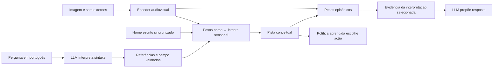

# Alice - laboratorio de memoria e continuidade temporal

## Evocação durante aquisição contínua simulada (01/11/2026)

continuous_recall_experiment recebe cada pista pelo observe real do núcleo,
sem esvaziar working/contexto entre situações:0,2s até ambiente/assunto e0,1s até
pista visual, no relógio simulado. Todas as pistas viram impressões distintas;
evocações automáticas excluem o momento atual. O feedback usa a primeira memória
efetivamente evocada; o avaliador não troca a candidata pela resposta esperada.

O ensaio revelou saturação de16 créditos sem retorno. A política agora substitui
o crédito mais antigo e conserva a disponibilidade recente, sem alterar fatos.
Após essa correção, o currículo ainda falhou em17/71; a inspeção encontrou
penalização de uma memória útil com pouco suporte no contexto reservado. A nova
regra atenua simetricamente a contribuição por1/(1+variância), dentro do limite
de cobertura anterior. Não é estimativa probabilística calibrada.

Política2 registra read_rule variance-damped-v2; política1 restaura com leitura
covered-linear-v1 e conserva essa regra ao salvar. Formato externo10/core57/58
inalterado. Regressão em arquivos antigos passou48/48 consultas, sem replay.

Sementes reservadas41/53/89,96 feedbacks por semente:48/48 consultas corretas,
24/48 com os pesos zerados, inclusive conflito e combinação reservada. Auditoria
em processo novo passou outras48/48 consultas dos três snapshots sem feedback.
Estados contêm196 impressões antes da avaliação; cada avaliação adiciona32.
Fatores originais iguais, novas pistas somente visuais, sem áudio fabricado.
8 contratos contextuais,9 reativação,11 runtime, CI e build Release passaram.
Protocolo/falhas/provas em ALICE_EPISODIC_CONTEXT.md e bin/AliceMemory/continuous-recall-*.
Ainda não é fluxo ao vivo, compreensão semântica real, feedback pela conversa ou
episódio integrado com acesso geral/detalhes. Continua laboratório experimental.

## Preferência de evocação aprendida durante a interação (01/11/2026)

RecallContexts registra o contexto de trabalho anterior à experiência em pesos
RLS por endereço episódico. RecallPreference aprende a relevância da evocação
principal efetivamente feita, por benefício externo com crédito único/TTL60s.
Chave bilinear DCT16 do contexto atual/anterior, mais prioridade/modalidades;
não recebe nomes de lugares, assuntos ou o ID da resposta como características.
Contexto ou suporte insuficiente conserva a prioridade anterior. Atualização de
preferência não reescreve fatos e não cria experiências.

NativeGrounding10 persiste os dois componentes, incluindo créditos pendentes e
proveniência. Validação rejeita identidades alteradas, estado oculto em linhas
desconhecidas e covariância inválida. Estados antigos não ganham contexto
retroativo. Formatos1–9 continuam legíveis; core57/58 preservado. Desligar a
reativação conserva os pesos e o registro contextual já iniciado.

Ensaio sem linguagem: seeds17/29/71,96 feedbacks online por semente,16/16 acertos
em cada uma, incluindo combinação reservada e assunto contrário ao ambiente.
Controles sem política ou contexto:8/16; sem fatores episódicos: nenhum conteúdo.
Auditoria separada restaurou os três arquivos e acertou48/48 novas consultas sem
reaprender a preferência. Passaram6 contratos novos,9 reativação,11 runtime,
CI geral e build Release. Protocolo/provas em ALICE_EPISODIC_CONTEXT.md e
bin/AliceMemory/contextual-recall-*.

Isso demonstra uma preferência contextual pequena aprendida em vetores sintéticos,
com intervalos simulados120s. Não avalia fluxo sobreposto nem extração semântica
real, não integra esse feedback ao painel e não resolve episódios abrangentes
ou ambiguidade factual do diálogo. Projeção e ganhos0,5/0,25 são fornecidos;
não há sensação térmica implementada ou afirmação de experiência subjetiva.

## Reativação sensorial implícita antes da linguagem (01/11/2026)

NativeMoments.related separa localizar candidatas de responder consulta factual
única. Lê até2 bancos entre4 candidatos, verifica variância/conteúdo e preserva
cada representação e referência. recall estrito conserva ambiguous_moments.
Rotas/meta sem fatores não recuperam conteúdo. Contador de evocação satura em1M,
mantendo último instante atualizado e checkpoint válido; não limita a evocação.

NativeGrounding opcional chama native_reactivation após aceitar percepção e
aprender alvos atuais. Mistura não verbal altera working e dynamics.last.context
para próximas operações; não altera last.values/máscara observada. Próxima
atenção e associação contextual recebem esse estado. Não usa palavras ou LLM,
não cria novas percepções e exclui o próprio momento recém-capturado. Idle/quiet/
saída sintética não dispararam esse mecanismo nos controles. Falha de leitura fica
visível sem rejeitar estímulo já adquirido. Ganho0,25/prioridade são fornecidos,
não provaram seleção contextual aprendida. União de detalhes num acontecimento
maior e estado térmico continuam lacunas.

NativeGrounding9 guarda modo ativo;1–8 migram sem ativação silenciosa. Core57/58
inalterado. Runtime --native-implicit-recall ativa; negativo desativa; ausência
preserva checkpoint. Novos testes incluem associação imagem/som antes dos nomes,
dois nomes para a mesma representação, ativação/atenção sem alvo vazado, ablação,
reativação limitada, saturação, retomada e leitura antiga. Provas em
bin/AliceMemory/native-reactivation-* e nonverbal-reactivation-real-20261101-v2.

Ensaio na fonte real recuperou204/215 e os manteve distintos, com vetores visuais
iguais. Pista veio do writer aprendido de hami; nenhum novo encoder/LLM foi chamado,
nenhuma experiência foi fabricada. Pesos factuais/nomes/contadores/origem intactos;
working e contexto interno mudaram e foram restaurados. Sem resolver a pergunta
de dono ou alegar compreensão geral/experiência subjetiva.

## Evocação delimitada no diálogo e limite observado (01/11/2026)

dialogue_recall.py usa menção literal de nome aprendido para evocar writers e
NativeMoments, depois consulta interpretações nos pesos. dialogue_context_v2 guarda
associação separada da seleção explícita, sem substituí-la. Mantém leitura de
contexto antigo, fila2/sessão6/core57/58, modelo por trabalho e mesmo slot. Novos
controles verificam ablações de nome/episódio/interpretação, quiet/nomes/episódios
ambíguos, relato ausente/relações múltiplas, revisão durante expressão, pending,
proveniência após retirar job e validação leve sem Torch. Montar contexto reativa;
revalidar não reaquece. Nomes da associação devem corresponder ao retrato recebido.

25 testes/94,186s e14 NativeStream/54,006s, CI e build passaram. Fixtures de diálogo
usam RAM sintética somente para processo de encoder falso; runtime real conserva
medição/limites. Uma rodada anterior teve seis timeouts sob carga alta. Arquivos e
logs de falha preservados, sem mudar expectativas de aprendizado.

dialogue-auto-real-20261101-v1 não concluiu: nova entrada publicada e aguardando,
19 adiamentos por resource_limit_crossed, nenhuma aquisição. Ensaio isolado de
lookup, com atenção declaradamente sintética, encontrou duas impressões da mesma
imagem (204/215); bloqueio por ambiguous_moments, sem ler dono.204 não tem relato,
215 tem autor/dono. Controles positivos não aprovados; abstenção não prova perda
dos pesos. Isso exige rever a seleção de candidatas com contexto, não reduzir o
teste a uma resposta já endereçada. Fonte e provas em bin/AliceMemory/dialogue-auto-*.

O usuário explicou evocação contextual dinâmica (lugar e assunto podem divergir)
e acesso geral/detalhado ao mesmo acontecimento. ALICE_EPISODIC_CONTEXT.md registra
esse contrato. O código atual ainda não representa acontecimentos integrados com
todos os detalhes/estados/motivos/antes e depois, nem adaptação geral da linguagem.
Aquisição e evocação continuam online; descanso não será condição para aprender.

## Expressão selecionável, memória e parser preservados (13/10/2026)

DialogueLane2 guarda seleção opcional e modelo por trabalho. Operação/validação
usam o modelo capturado, não a seleção futura. Restore aceita fila1 migrada com
parser original, incluindo completed; fila2 conserva pending e proveniência.
Session6/core57/58 permanecem. CLI --dialogue-model omitido mantém a seleção do
checkpoint; vazio volta ao parser. Painel usa campo opcional vazio por padrão.
Work slot, owner e memória continuam únicos; parsers não passam para4B por essa
escolha. Runtime adapta checkpoints LanguageCoordinator antes de configurar a fala.

18 testes de diálogo (17/94,299s +1 legado/8,529s),12 interação/27,931s e10
runtime_store/18,510s passaram. CI geral (116 IA local), UI headless e builds
passaram. Falha inicial de navegador no sandbox ficou no log; reexecução headless
com TEMP normal passou. Nenhuma janela nativa foi aberta.

dialogue-selection-real-v1: intenção replay sobre texto já adquirido,4B gerou
fala confirmada em10,895s,0,8 continuou parser. Novo processo com seleção vazia
preservou a resposta4B antiga;256 percepções/220 momentos constantes, pesos de
interpretação/nomes intactos, origem não reescrita. Sem novo encoder/sensor/download.
Esse ensaio valida seleção e persistência, não uma nova experiência ou qualidade
geral de conversa. Falas seguem self e não são ensinamento automático. Padrão e
configurações pessoais preservados. Influência verbal do pré-treino continua.

## Texto sensorial e diálogo pré-treinado (13/10/2026)

Entrada digitada publica um frame UTF-8 real e talk espera receipt NativeStream;
SHA/modalidade/origem vinculam intenção e experiência. Quiet permite diálogo sem
afirmar episódio adquirido. DialogueLane ocupa o mesmo slot e relógio, com fila4,
TTL300s e três revisões. Sessão/envelope6 migram1–5, core57/58 mantido. Relato
escolhido fornece interpretação inicial/atual lida de RLS; assinatura revalidada.
Histórico de trabalho:2 respostas do mesmo assunto, marcadas self_generated_response.

Linguagem recebe projeção de contexto, não IDs/provas/todos os pesos. Budget de
diálogo2048/512, parser1024/256 preservado. Fala própria tem origem self e dois
flagsfalse (factual_text_verified/autobiographical_write). Não ensina fatos nem
registra percepção da própria voz. Texto de memória vem do proprietário, separado
da fala; UI não apresenta proposta como entregue antes da confirmação durável.

11 novos/74,447s +65 regressão: texto multilinha preservado, slot serial, aquisição
full/quiet, hash errado recusado, nova interpretação durante geração, pending e
durabilidade/replay, fala falsa sem reescrita, fraude após retirar job, histórico
limitado/assunto e protocolo sem Torch. UI headless/CI/builds passaram.
dialogue-real-v2: Gemma2 real e Qwen0,8 instalada, três mensagens realmente
codificadas;253→256 percepções,217→220 momentos. Nome/interpretation_weights
conservados, arquivo de origem intacto, diálogos restaurados.

Integração não valida texto livre: v1 errou fatos sobre formigas; v2 confundiu o
assunto anterior com a pergunta de autoria. Leitura do proprietário continuou mãe.
Filtro por assunto e prioridade à pergunta: dialogue-topic-real-v1 mencionou mãe,
ainda sugerindo imagem apresentada/agregando afirmação imprecisa sobre memória.
Resultados brutos/falhas preservados. Próximo: avaliar coerência e desconhecimento
sem tratar uma referência correta no JSON como prova de prosa correta.
Processo novo sem modelo conservou384 bancos antigos, nomes/pesos de interpretações;
três experiências textuais e próximo tick sem repetir aquisição. AST221 arquivos,
dialogue-fresh-audit.json. Sem alteração da instalação principal nem versão do app.

## Feedback externo no canal de interação e no painel (13/10/2026)

feedback{text,action} liga seleção explícita de uma escolha recente de atenção ao
NativeFeedbackLane existente. Só texto entra no parser de reação; ação, episódio e
efeito vêm do proprietário. Sessão/envelope5 migram1–4, core57/58 preservado. Job
liberado após duas confirmações mantém resultado verificável pela fonte aprendida.
Estado publica escolhas válidas e origem no frame quando disponível. Painel permite
full/learned/quiet e avaliação; observações não atendidas não viram episódios.

8 casos novos/32,571s +45 regressão/96,718s passaram. Mesma entrada, retorno anterior
favorável a imagem ou quiet produz escolhas diferentes; zerar valores muda controle
quiet para imagem. Mudança de situação durante parsing conserva ação/episódio de
origem. Recusa incerteza, ação inválida/vencida, fraude de referência e reenvio.
Retomada pending/concluída e backpressure4 preservam uma atualização por ação.

feedback-channel-real-v1: Qwen3.5:0.8b-q8_0 instalada, pista sensorial sintética,
canal publicado após runtime iniciar. Escolha quiet: aprovação externa aumentou
fontes10→11 e escritas2→3.253 percepções/217 momentos constantes; nenhuma memória
sensorial de algo não adquirido. Predição social0,999800 é valor funcional aprendido,
não confiança calibrada nem medida de sentimento. Duplicação recusada, restauração
confirmada, nomes anteriores e hash de origem conservados. Feedback negativo tem
cobertura de laboratório; esta integração real examinou aprovação de quiet.

Painel anterior também passou no WebView2/COM real com salvar/retomar. UI nova de
feedback foi verificada headless sem disputar foco com o jogo; COM genérico não
mudou. Orçamento compartilhado, atenção cotidiana e conversa livre ainda faltam.
CI0, frontend0 e .NET0 sem avisos; auditoria independente sem modelo conservou384
bancos antigos, nomes e pesos de interpretações. Uma atualização de feedback
persistida, próximo tick sem repetição; AST216 arquivos. Evidência em
bin/AliceMemory/feedback-fresh-audit.json e feedback-channel-real-v1/report.json.

## Alice — consulta por mensagem e interpretação sem episódio sensorial (13/10/2026)

recall aponta UUID de relato aprendido; pergunta contém apenas Quem era antes,
E agora ou O que mudou. Proprietário captura versão de origem, referência imutável
do episódio e relação. Parser recebe só pergunta e seleciona perspectiva; não escolhe
referente nem recebe valor antigo/ID/memória. NativeMeaningQueryLane compartilha
worker/clock/fila4 entre consulta nominal antiga e consulta por mensagem. Resposta
lê pesos das interpretações, mantendo relato distinto de observação direta.

Mensagem substituída continua válida como referência do assunto: consulta atual
usa versões atuais, comparação conserva primeira/atual. Retirar episódio sensorial
não elimina necessariamente interpretação: consulta sem imagem/som se mantém e
informa ausência de retenção do episódio; não inventa percepção ou incrementa vida.
Peso de interpretação apagado retira sujeito da resposta, mesmo com texto/nomes
conservados. Mudança de conhecimento antes de entrega obriga recalcular. Poda
protege mensagem referenciada enquanto query está pendente. Envelope/sessão4 e
fila de meaning2 migram anteriores; externos57/58 mantidos. Mistura de consultas
nominais e referenciadas passa e formato antigo da fila migra sem replay.

reference-query-real-v1: Qwen0,8B, clientes separados em cópia da conversa perceptiva
real anterior, referenciando relato do dono já corrigido. Quem era antes → pai;
E agora → mãe; O que mudou → ambas. Sem nome/relação entre aspas nem janela no texto.
Seleção da mensagem é fornecida pelo cliente, não anáfora livre aprendida. Nenhum
encoder novo/sensor/ensino; observações253/episódios217/relatos6 constantes, fonte
intacta. Três retomadas portátil/atual/anterior sem modelo/reaprendizado preservam
pesos e384 bancos; controle apagado fica sem suporte.

Benchmark parcial12/14 accepted=false: Quem é recebeu perspectiva errada e Quem é
agora ficou incerto. Três perguntas fora da família/contraditórias usam restrições
fornecidas. A integração selecionada passou; não aprovar português geral por esse
resultado. Falha inicial nos testes veio de espaço ausente no regex de era/foi;
corrigida mantendo expectativas e log. Sem novo ciclo de prompts neste recorte.

199 nativos/424,114 s e98 coordenação/216,800 s passaram; novo teste de fila mista
adicionado depois e oito direcionados/28,525 s passaram (298 casos distintos).
CI0,214 Python AST/whitespace. Manifest reference-query-manifest.json preserva
fontes/artefatos/falha/retomadas. Meta ampla ativa: esclarecer recusas, intenção
aberta, pessoas, voz/GUI, confiança e desenvolvimento geral permanecem pendentes.

### Perguntar usando o contexto de um relato

Com o runtime iniciado e a mesma pasta de mensagens, o UUID é o retornado por
relate/report/correct. Pode apontar o relato original mesmo depois de sua correção:

```powershell
python -m scripts.alice_memory.send_alice_message --inbox <pasta> recall <uuid-do-relato> 'Quem era antes?'
python -m scripts.alice_memory.send_alice_message --inbox <pasta> recall <uuid-do-relato> 'E agora?'
python -m scripts.alice_memory.send_alice_message --inbox <pasta> recall <uuid-do-relato> 'O que mudou?'
```

O cliente escolhe mensagem; o texto não precisa de episode ID, relação, nome
sensorial nem UTC. Contexto ainda não aprendido aguarda o relato pendente; referência
inexistente/recusada ou pergunta fora da família retorna falha explícita. A resposta
sobre interpretação não significa recuperar todos os detalhes da imagem ou áudio.
Referências ainda limitadas à conversa recente conservada no estado; consulta de
mensagens antigas paginadas e interface de seleção não foram implementadas.

## Alice — relação e correção sem IDs no texto (13/10/2026)

relate liga uma frase sobre experiência selecionada à NativeStatementLane existente;
correct referencia o UUID da mensagem anterior. Papel literal é obtido por gramática
fornecida; LLM propõe apenas valor copiado da mensagem. Enum contém palavras dos dois
lados da cópula, sem fornecer a resposta correta. Proprietário valida palavra depois
da cópula, captura referência imutável e escolhe versão a corrigir. Modelos não recebem
IDs, memória ou valores antigos no parser. Nova cena não muda alvo; declaração de
imagem não pode apontar implicitamente um evento atendido somente por áudio.

Correção de relato sobre episódio sensorial já esquecido usa proveniência conservada,
sem recriar percepção. Referência substituída, papel diferente, sujeito inventado,
hipótese/negação/pergunta e alvo ausente são recusados. Pai permanece em initial;
mãe fica em current. Mensagem referenciada é protegida da poda enquanto correção
aguarda confirmação. Resultado confirmado, mesmo após job ser retirado, precisa
coincidir com fonte/versão/hash do relato. Envelope/sessão3, fila de relatos2 e
interpretações3 migram anteriores; externos57/58 continuam. Fontes contextuais
guardam hashes/modelo/prompt/plano, sem tabela de valores ou frase na interpretação.

context-report-real-v3: Qwen0,8B local, clientes separados durante execução e cópia
da memória perceptiva real anterior (hami/img215). Não carregou novos encoders nem
sensores. A informação dono era desconhecida; frase O dono dessa imagem é meu pai,
correção Na verdade, foi minha mãe e consulta comparativa por janela UTC aprendem
nos pesos e conservam ambas as versões. Texto não carrega episódio/versões; seleção
de experiência e referência da mensagem são fornecidas pelo cliente. Relatos4→6,
observações253/episódios217 constantes,42 commits e384 bancos antigos preservados.
Checkpoint fonte intacto. Três retomadas portátil/atual/anterior sem modelo/reensino,
nomes/relatos anteriores intactos; apagar só novos pesos retira o suporte das respostas.

Benchmark integral permanece accepted=false: variantes1/2/3:10/16,12/16,14/16.
Oito casos protegidos recebem restrições fornecidas. Variante3 ainda escolhe dono
em Porra, o dono disso é João e era em Corrigindo, era João; validação recusa,
sem aprender esses erros. Integração selecionada passou; português geral não está
aprovado. Tentativas/falhas/fontes antigas/raw proposals preservadas. Sem outro
ciclo de prompts após três variantes; esclarecimento por resposta humana e perguntas
por referência à conversa são próximos caminhos, além de intenção livre/voz/GUI.

Regressão também revelou resultado concluído após última captura periódica: uma
única captura final conservava aprendizado, mas não confirmava liberação da cópia.
Shutdown agora faz no máximo duas capturas finais quando falta confirmação, sem
avançar cognição/lançar worker. Teste força save_every3600 e exige duas gerações
antes de ack; passa. Teste inicial usou atributo inexistente para reduzir arquivo:
corrigido o fixture para NativeMoments(1,1) antes da primeira percepção; log mantido.

199 nativos/420,396 s +91 de coordenação/185,717 s =290 testes; dez contextuais
específicos/23,565 s, CI final0 e211 Python AST/whitespace. Manifest context-report-manifest.json
preserva artefatos/fontes/provas, incluindo falhas. Meta ampla segue ativa: formas
linguísticas abertas, identidades, confiança, consolidação, ações e convivência.

### Usar o contexto selecionado

Com runtime iniciado e mesma pasta --interaction-inbox, o cliente pode enviar:

```powershell
python -m scripts.alice_memory.send_alice_message --inbox <pasta> relate 'O autor dessa imagem é meu pai.'
python -m scripts.alice_memory.send_alice_message --inbox <pasta> response <uuid-de-relate>
python -m scripts.alice_memory.send_alice_message --inbox <pasta> correct <uuid-de-relate> 'Na verdade, foi minha mãe.'
```

Sem seleção, relate exige última experiência atendida e recebida recentemente.
--moment ou --frame-stream/--frame-sequence selecionam experiência retida específica
fora do texto; não combinar os dois seletores. correct recebe somente a referência
da mensagem e texto novo. Esperar resultado do primeiro relato; se foi substituído,
referenciar a correção mais recente. Pai/mãe são rótulos do ensaio, não identificação
de pessoas reais. Esta família cobre papel explícito e um valor canônico; múltiplas
orações, nomes compostos, papéis implícitos e interpretação geral ainda não passam.
Consulta meaning continua pedindo nome/relação/perspectiva literais e pista temporal
quando houver episódios semelhantes. Interface de seleção e diálogo aberto pendentes.

## Alice — relatos e correções por mensagens durante execução (13/10/2026)

O canal local agora encaminha report para NativeStatementLane e meaning para
NativeMeaningQueryLane, no mesmo proprietário/relógio/fila de inferência. Relato
atualiza pesos de interpretações versionadas; não vira percepção nem comprova
verdade. Consulta evoca nome sensorial aprendido e recupera a relação pelos pesos.
Correção conserva a atribuição inicial. Envelopes/sessão2 migram1; configuração e
recibos continuam1, snapshots externos57/58 preservados. Retomada valida vínculo
com a fila e igualdade do resultado cognitivo; cliente continua sem Torch.

Resposta calculada que espera confirmação em duas gerações é revalidada antes da
publicação. Correção, perda de suporte ou novo episódio que invalide a evidência
obriga recalcular/expressar; resposta já entregue conserva seu estatuto histórico.
Fila cheia aguarda, sem converter backpressure em erro terminal. Nenhum relato
recebido é usado para escolher sozinho entre episódios sensoriais ambíguos.

interaction-report-real-v3 passou com Qwen0,8B e encoder EmbeddingGemma2 instalados,
CPU, arquivos públicos bridge.png/speech.wav, fontes/manifestos verificados, teto
90% temporário. Imagem e áudio em dois processos/frames sucessivos. Antes do nome
hami a consulta se abstém; após ensino e relato ao pai, pista sem tempo encontra
três momentos semelhantes e pede quando aconteceu. Janela UTC externa seleciona
o frame: resposta inicial pai; correção explícita para mae; comparação conserva
pai/mae como relatos recebidos. Nome permanece ligado à imagem apesar do áudio
posterior.251→253 observações,215→217 episódios, nomes/fontes4→5, relatos2→4,
105 commits,384 bancos antigos e checkpoint fonte preservados. Não verifica
identidade humana do áudio nem interpretação aberta do conteúdo dos arquivos.

Três retomadas frescas do portátil/atual/anterior mantêm pesos, nomes anteriores,
versões e resultado sem modelo ou reensino. Apagar pesos das interpretações retira
os sujeitos da resposta; apagar pesos do episódio retira o suporte sensorial.
Tentativas preservadas: real-v1 sem reserva de RAM para quadro conjunto; real-v2
percebeu/ensinou, mas falhou no avaliador que assumia pista única. Não apresentar
esses ensaios como aprovados nem afirmar que resolveu captura simultânea contínua.

199 nativos/452,501 s +12 contratos do canal/66,898 s +43 conceituais/retenção/74,543 s
(254 testes), CI final0 e208 Python AST/whitespace. Artefatos/retomadas/fontes no
interaction-report-manifest.json. Português do report ainda literal, com momento,
aspas e versões; meaning aceita nome/relação/perspectiva/janela. Voz, GUI, diálogo
aberto, iniciativa aprendida, confiança e desenvolvimento geral seguem pendentes.
Meta ampla permanece ativa.

### Enviar um relato e consultar sua revisão

Com o runtime iniciado com --interaction-inbox, usar a mesma pasta/UUID da sessão.
O número do momento precisa ser o de um episódio conhecido; o ensino de nome retorna
retained_moment. A versão a substituir é devolvida em learning.version do relato.
Exemplo para momento215/versão2 (trocar pelos valores reais, não executar cegamente):

```powershell
python -m scripts.alice_memory.send_alice_message --inbox <pasta> report 'No momento 215, associe "autor" a "pai".'
python -m scripts.alice_memory.send_alice_message --inbox <pasta> report 'Corrija o momento 215: "autor" passa a ser "mae"; substitua [2].'
python -m scripts.alice_memory.send_alice_message --inbox <pasta> meaning 'O que mudou em "hami" sobre "autor", pela imagem?'
```

Esperar o recibo de cada ensinamento antes de depender dele. Se a pista sensorial
corresponder a vários momentos, acrescentar uma janela relativa ou UTC explícita,
sem selecionar pelo conteúdo desejado da resposta. O ensaio usa a hora de captura
externa do próprio frame. Estes são comandos de laboratório; ainda não há interface
que escolha intenção/episódio de toda mensagem natural. report não aceita source=self
nem comandos arbitrários do sistema. Não reclassificar correção humana como verdade.

## Alice — interação local durante execução (13/10/2026)

InteractionInbox recebe name/reply/ask por arquivos atômicos e UUIDs; cliente CLI
não importa Torch. InteractionSession pertence ao mesmo ConceptualMind e usa suas
filas/relógio. Seleção pode esperar frame exato sem substituir por frame anterior;
resposta humana guarda vínculo original apesar de nova cena. Backpressure e estados
queued/running/awaiting_reply/completed/failed são limitados. Resultado só é publicado
após conteúdo/revisão iguais em duas gerações duráveis. Reenvio não repete ensino;
restauração rejeita vínculo/hash/forma inválidos. Recibos recentes512, pendentes
conservados; até32 registros na mente e128 arquivos examinados por leitura.
Snapshots57/58 acrescentam interactions, migração anterior inicia canal vazio.

Teste real interaction-runtime-real-v1: runtime finito, clientes independentes após
início, Qwen0,8B real, encoder visual fixture. Pergunta sobre Melo gerou esclarecimento
fornecido; nova imagem chegou; palavra de resposta ensinou frame0, não frame1.
251→253 observações,215→217 episódios, fontes4→5 e384 bancos antigos preservados;
14 commits, workers terminais e checkpoint fonte intacto. Duas retomadas frescas
sem modelo/repetição mantêm palavra e resultados. Metadados verificam vínculo de
frame, não reconhecimento visual entre as duas imagens. Sem sensores pessoais,
downloads, autostart ou alteração do modelo habitual. ask é consulta restrita,
não conversa aberta. GUI/voz, perguntas próprias e personalidade seguem pendentes.

213 regressões/442,003 s, sete contratos/22,176 s,36 conceituais/59,434 s e CI0;
207 arquivos Python com AST/whitespace verificados. Manifest interaction-manifest.json
registra fontes, checkpoints, páginas, testes e relatórios. Meta ampla segue ativa.

### Envio explícito para um runtime já iniciado

O proprietário deve ter sido iniciado com --interaction-inbox apontando uma pasta
local escolhida. Enviar mensagem não inicia proprietário, sensores ou modelo.
Exemplo de comandos, substituindo pasta e UUID pelos da sessão:

```powershell
python -m scripts.alice_memory.send_alice_message --inbox <pasta> name "Essa imagem se chama Melo." --focus image
python -m scripts.alice_memory.send_alice_message --inbox <pasta> response <uuid-da-mensagem>
python -m scripts.alice_memory.send_alice_message --inbox <pasta> reply <uuid-da-mensagem> Melo --focus image
python -m scripts.alice_memory.send_alice_message --inbox <pasta> ask "maruvi"
```

name é ensinamento explícito; reply responde apenas uma dúvida pendente com uma
palavra. Para apontar frame específico usar --frame-stream e --frame-sequence juntos;
--moment seleciona episódio retido e não pode ser combinado com frame. Recibo pode
estar ausente enquanto o processamento/duplo commit estiver pendente. Ler response
não ensina novamente. O canal não decide sozinho a intenção de toda conversa.

Plano de evolução: [ALICE_DEVELOPMENT_PLAN.md](ALICE_DEVELOPMENT_PLAN.md).
Ele descreve os marcos futuros, a avaliação das sugestões recebidas do Claude
e o primeiro lote recomendado para uma meta. Não altera o estado dos ensaios abaixo.

## Meta ativa: ciclo causal, percepção contrastiva e linguagem pré-treinada

### Esclarecimento preserva o alvo de um ensinamento recusado (12/10/2026)

`native_name_clarification(id)` oferece pergunta fornecida pelo protocolo para job
recusado/incerto, enquanto alvo e contexto estão disponíveis. A frase exposta pode
ser "Como você chama o som que estava ouvindo?". Não usa IDs no texto ao usuário.
`reply_native_name(id, word, focus=None)` aceita resposta humana de uma palavra e
atualiza a associação com a percepção original. Foco ambíguo exige seleção; canal
ausente, contexto expirado/esquecido ou ensino já concluído são recusados.
Pergunta é fornecida, não evidência de curiosidade geral aprendida ou fala executada.

Resposta registra palavra/horário próprios no job e hashes kind external_word_reply
na prova; não atribui o ensino ao modelo. Seleção explícita de episódio retido
permite aprendizagem posterior; seleção implícita ainda exige recência30 s.
Fila2 migra fila1, sem inventar resposta/seleção. Formatos55/56 e native8 mantidos.
Restore vincula resposta/prova/fonte, horário real de ensino e foco. Resposta após
retomada não escreve duas vezes. Status oferece clarification; runtime aceita
--native-name-reply-file/--native-name-reply-id/--native-name-reply-focus.

native-name-reply-real-v1, em cópia do v6: recusa real da Qwen0,8B para frase copular,
pergunta com foco audio;31 s virtuais e uma cena nova depois, Chuva ensina áudio
original (direção91), mantendo cena atual sem esse nome e imagem sem evocação.
Fonte registra horário da resposta, não da primeira mensagem. Sem nova chamada
ao modelo para a resposta.251→255 observações e215→217 episódios; um ensinamento
e prova novos,384 bancos e colunas antigas intactos. Sensações e resposta humanas
são simuladas/controladas neste ensaio, sem captura pessoal.

Retomada em processo novo do portátil/atual/anterior conserva quatro provas e
palavra aprendida, sem modelo e sem duplicação. Isso não aprova o benchmark geral
de interpretação; as recusas anteriores seguem registradas. Diálogo livre, pergunta
motivada por política aprendida, interface e voz permanecem requisitos da meta.
206 regressões/318,988 s,14 contratos de nome/esclarecimento/18,156 s e CI0.

### Nome ensinado em português vinculado à percepção original (12/10/2026)

`submit_native_name(message, focus=None, moment=None)` coloca um ensinamento na
fila `native_namings`, compartilhando o worker. `take_native_name(id)` consome o
resultado. A percepção deve estar retida e ter sido recebida nos30 s anteriores;
seleção implícita recusa entrada mais nova que não conservou o alvo. Seleção
explícita permite apontar episódio recente anterior. Uma resposta atrasada não
troca o alvo pelo novo frame. O job guarda referência e mensagem, sem copiar latentes.

`native_name_language.py` pede só palavra. Modais explícitos antes do predicado e
guardas de pergunta/negação/hipótese/relato/alternativa são políticas fornecidas.
Literal deve estar depois do predicado e ter a identidade NFKC/casefold do codec.
Não recebe imagens, áudio, memória, IDs ou respostas esperadas. Esse contrato é
ensinamento explícito de nomes simples; não é interpretação geral de uma conversa.

`teach_retained_name` recupera o vetor pelos pesos do episódio original e atualiza
somente reader/writer da modalidade escolhida/atendida. Recusa alvo esquecido,
canal ausente ou cobertura perdida. Nome não é verificação da verdade da afirmação.
Nada acrescenta um acontecimento sensorial. Prova permanente guarda source_index,
referência, emissão/recebimento e hashes/modelo; texto fica só no job até consumo.
Fontes/32 nomes/512 ensinamentos continuam limites do laboratório, não capacidade
adequada ao vocabulário de uma companheira em desenvolvimento longo.

Native8 acrescenta naming_proofs; snapshots55/56 acrescentam fila. Migração antiga
preserva pesos, sem inventar ensino. Restore valida ambos lados do vínculo e permite
que palavra aprendida sobreviva ao episódio posteriormente esquecido. Runtime expõe
`--native-name-file`, `--native-name-focus`, `--native-name-moment` e native_name_jobs.
Ainda não há fluxo completo de conversa/voz com ensino automático.

Comparação registrada: Qwen0,8B13/15, Qwen4B14/15 e Gemma4B14/15, todos locais.
O benchmark integral ficou accepted=false; propostas incorretas foram recusadas.
Tentativas v1–v5 e comparações maiores foram preservadas. O contrato que pediu
label_fragment piorou, e o extrator voltou à versão mais consistente. Raw proposals
do v6 mostram Qwen copiando sujeito nas duas construções copulares recusadas.
Resultado depende de regras lexicais fornecidas e não mede personalidade ou fala livre.

native-name-real-v6: três nomes aprendidos (imagem lumo, áudio tavi, imagem zuno),
pequena perturbação reservada reconhecida, modalidades não ensinadas sem evocação;
uma indicação multimodal ambígua e uma pergunta sem ensino. Observações242→251,
episódios210→215;384 bancos e colunas antigas dos writers intactos. Fonte checkpoint
inalterada. Retomada em processo novo de portátil/atual/anterior mantém três palavras
e provas, sem modelo/encoder e sem segunda escrita. Sensações desta etapa são
vetores sintéticos, não objetos reais ou captura pessoal. Configuração habitual
preservada; maiores modelos só em ensaios temporários com teto autorizado90%.
Validação do núcleo:202 regressões/286,062 s, dez contratos de nome/12,178 s,
36 contratos conceituais/57,887 s, CI final0 e199 arquivos Python em AST/whitespace.
Isso aprova integração/retomada; o benchmark integral de linguagem permanece falso.

### Perda de suporte, familiaridade e reaprendizado nas correspondências (12/10/2026)

`semantic_retention.py` fornece a lei ds/dt=-s/(tau*(1+s)), onde s é informação
observada por direção do espaço RLS. A atualização em log é independente da divisão
do intervalo; direções reforçadas têm queda relativa mais lenta. Covariância/cross
statistics relaxam juntas, com ridge0,001. Sem replay de exemplos nem alvos gerados.
É política matemática fornecida, não aprendizado espontâneo do ato de esquecer.

NativeLinks3 guarda12 âncoras de atualização e tau padrão86400 s. Leitura calcula
vista envelhecida, sem alterar pesos ancorados; novo par observado aprende a partir
da vista atual e avança somente suas âncoras. Tempo/consultas ociosos não aumentam
contadores nem reaquecerão informação. Bases espectrais ficam em cache efêmero,
invalidado por mudança de banco/covariância. Cache completo acrescenta no máximo
8.358.048 B de tensores às12 cabeças; não acrescenta esses tensores ao checkpoint.
Migração1/2 preserva pesos e começa no horário salvo, sem supor exposições antigas.

`familiarity` é heurística de suporte da pista, distinta da cobertura exigida para
prever. Uma expectativa com cobertura suficiente pode ficar mais grosseira; não
é lembrança exata nem confiança calibrada de cada componente. Nomes, interpretações
factuais e outros modelos continuam com suas regras próprias. Este recorte ainda
não produz esquecimento gradual de fatos verbais sobre abelhas/formigas.

Sete contratos novos (3,864 s): perda seletiva de detalhe reservado, conservação de
componente repetido, controle de retenção quase constante, três bases rotacionadas,
reaprendizado melhor que modelo sem história, episódios de treino aposentados,
partição temporal, retomada e corrupção/migração. semantic-retention-v3: cada base
perde detalhe0,0994→~0, conserva componente~1, pista detalhada se abstém apesar de
familiaridade0,9583. Após uma reexposição, transferência à combinação-0,2 nunca ensinada tem
cosseno0,99997; modelo sem história se abstém. Intervalo virtual300 s, tau10 s.

Ensaio de migração usa cópia de native-feedback-real-v8/final.pt:50 ticks sem entrada,
observações242/384 bancos/nomes/relatos preservados; portátil e duas gerações paginadas
retomam pesos/âncoras intactos. Nenhuma LLM/encoder/câmera carregada. Primeira tentativa
de probe teve chamada incorreta à API do writer; artefatos/logs foram preservados.
Regressão conjunta:192 testes/278,135 s, CI0. Nenhuma captura pessoal ou modelo novo.

### Avaliação externa em português ligada à experiência (12/10/2026)

`native_feedback_language.py` interpreta avaliação direta de uma pessoa;
`native_feedback.py` liga a proposta a uma escolha de atenção ainda válida.
`submit_native_feedback(message, action_id)`/`take_native_feedback(id)` compartilham
o worker existente, com até quatro jobs. O modelo não escolhe IDs nem inventa
benefício/esforço/verdade: recebe só mensagem; o núcleo credita social +1/-1 ou
se abstém. Fonte permanente guarda hashes/modelo/origem, não texto nem reação.
Job pendente pode conservar mensagem até ser consumido. Não infere experiência
subjetiva própria. Perguntas, citações, hipóteses e certos pedidos são protegidos;
palavrões comuns permanecem aceitos. Há glossário e restrições lexicais fornecidos.

`native-feedback-real-v8/report.json`: Qwen3.5:0.8b-q8_0 local,18/18 frases
controladas; duas avaliações diretas atualizaram atenção e valor dos episódios207/208;
duas incertas não escreveram. Pistas sensoriais desta etapa são sintéticas, não
captura pessoal. Episódios207→210, observações238→242, fontes8→10, impactos3→5;
384 bancos antigos intactos. O resultado final depende dos limites/glossário do
contrato; falhas anteriores permanecem em v3–v7. Não demonstra compreensão aberta.

Snapshot53 portátil/54 paginado acrescenta a fila; atenção3 acrescenta proveniência
de linguagem, migrando formatos antigos sem replay. Retomadas atual/anterior/portátil
mantiveram dois créditos novos e pesos estáveis no intervalo ocioso.185 testes
nativos/271,123 s e CI0; auditoria de192 arquivos Python. Teste de migração conceitual
também remove o novo campo ao construir artificialmente checkpoints40/41.
Uma retomada revelou arquivo temporário deixado ao matar worker durante publicação
atômica. `LanguageProcess.close` agora remove apenas temporários reconhecidos dentro
da pasta UUID própria, após esperar o processo; arquivos externos permanecem intactos.
Após a correção:12 contratos de consulta conceitual e16 de coordenação/cancelamento
passaram; CI final0. Resultados anteriores falhos permanecem nos logs.

Runtime: `--attention-feedback-file` UTF-8 (até8192 bytes) junto de
`--attention-feedback-action` seleciona a ação pendente; status expõe
`native_feedback_jobs`. Não há interface de conversa completa implementada.
`scripts/tests/probe_alice_feedback.ps1` executa ensaio finito em cópia de checkpoint,
host local próprio11438, sem download, restaura ambiente e encerra processos próprios.
O ensaio usa teto temporário90% autorizado; perfil habitual permanece75%.

Memória humana descrita pelo usuário não exige100% de lembrança. O protótipo já
descarta episódios e conserva alguns aprendizados, mas perda gradual dos detalhes
semânticos, familiaridade residual e vantagem no reaprendizado precisam de avaliação
separada. Importância funcional não garante retenção permanente.

### Consequências aprendidas influenciam retenção e estado interno (12/10/2026)

Cada escolha de atenção aprendida fica vinculada à referência imutável do episódio
efetivamente adquirido. Feedback externo válido treina valor da ação e três valores
episódicos (benefício, contato social, esforço) em RLS diagonal. Strings/números do
resultado não ficam numa tabela de respostas: fonte guarda hash, origem, horário
e vínculo; valores ficam nos pesos. Default2048 slots acrescenta81.920 B de tensores.

NativeGrounding prepara valor episódico antes de atualizar atenção; recusa da
atualização de atenção deixa impacto anterior intacto. Slot reutilizado não herda
valor/covariância/contagem da experiência retirada. Feedback de um episódio já
esquecido pode ensinar a ação, mas não recria o episódio nem marca o novo ocupante.
Feedback quiet ensina atenção/estado funcional sem fabricar percepção. Duplicado,
self, ação desconhecida ou janela inválida não treina nem altera afeto compartilhado.

Conseqüência válida passa por ConceptualMind.learn_native_attention e atualiza
progress/social/valence do estado interno existente. Valência funcional não é prova
de experiência subjetiva ou personalidade humana. O valor usa a utilidade fornecida
benefit+.5social−.25effort; magnitude positiva ou negativa pode reforçar memória.
A atualização episódica é única por decisão de aquisição nesta etapa; reinterpretar
importância em função de evidências muito posteriores ainda exige extensão.

Retenção acrescenta magnitude do valor aprendido, com escala fornecida de86400 s,
separada de frescor300 s e reativação120 s. Essa curva não aprende como humanos
esquecem. Não garante retenção permanente: experiência importante também sai quando
sua prioridade fica baixa diante de outras. Prioridade também participa da ordenação
de candidatos, mas jamais resolve sozinha múltiplos episódios compatíveis ou promove
um relato a fato observado. Importância não estima veracidade/confiança na fonte.

Moments5 portátil/6 paginado guarda valores e fonte por episódio; atenção2 guarda
referências em decisões pendentes/concluídas. Externos51/52/native7 mantidos. Legados
de momentos1–4 e atenção1 iniciam valores/vínculos ausentes, sem inventar feedback
histórico. Restore cruza episódio/fonte/pesos e tempo da decisão, recusando feedback
meio aplicado, vínculos trocados, contagens/covariância/estado oculto inválidos.
Paginação/GC leem formato6 preservando atual/anterior; páginas sensoriais imutáveis
não precisam ser reescritas quando o impacto muda.

Onze contratos novos verificam equivalência a RLS denso, importância positiva/
negativa, controle apagado, esquecimento posterior, slot reutilizado, janela/duplicado/
self, quiet, sem promoção de relatos/ambiguidade, retomada pendente/corrupção,
rollback e valência compartilhada.175 contratos nativos/285,412 s e CIexit0;
onze específicos/10,928 s. Metacognição não é necessária para essas atualizações.

native-impact-real-v1 roda120 s numa cópia do runtime/inbox, com quatro novas
capturas dos mesmos arquivos públicos. Escolhas image/audio/all/quiet são exploração
fornecida; conseqüências também são fornecidas pelo currículo. Oito sinais recebidos,
quatro atendidos, três episódios e quatro feedbacks; quiet sem episódio. Valores
aprendidos ~0,874913/−0,724928/0,349965 nos episódios204/205/206. Valência final
~0,133754 corresponde à integração fornecida do estado funcional. Vida207/retidas12,
238 atendidos/246 recebidos; três escritas de impacto e oito fontes totais. Nomes,
relatos e384 bancos sintéticos anteriores preservados. Não é sentimento extraído
da voz, preferência espontânea por uma pessoa ou entendimento social cotidiano.

Atual/anterior e portátil retomam sem encoder/LLM e sem reaplicar feedback;5 s de
repouso preserva pesos.188 Python AST/whitespace verificados. Fontes, logs e artefatos
no native-impact-manifest.json. Encoder offline existente, RAM90% apenas no ensaio
finito/default75, sem sensores pessoais ao vivo, autostart ou novo modelo.

### Contexto anterior condiciona correspondências aprendidas (12/10/2026)

NativeLinks acrescenta seis bancos contextuais265→128 aos seis gerais129→128.
Chave contém pista128, projeção de contexto8, interação entre projeções da pista16
e contexto8, mais bias. Base DCT fixa/versionada fornece compressão e interações;
coeficientes de correspondência aprendem. A família de funções e dimensões são
fornecidas, não descoberta de uma arquitetura mental. Total6.590.400 B de tensores.

NativeGrounding passa o estado working anterior, decaído até a chegada, antes de
misturar a percepção atual. O áudio alvo nunca entra na chave de uma previsão
image→audio. Contexto muito pequeno, modalidade única e quiet não treinam pares
contextuais. API associate_native(..., contextual=True) usa o working atual;
modo geral segue disponível. Contexto desconhecido/fora de cobertura se abstém,
sem promover a média geral a uma resposta válida naquele contexto.

Erro anterior ao update usa a camada contextual quando ela já foi treinada para
aquele par; fase sem treino contextual conserva o erro geral anterior. Esse erro
participa da novidade do estado interno. Estado anterior à recepção é distinto
de contexto físico na captura: dados atrasados não revelam por si só o contexto
do mundo naquele instante. Predições continuam hipóteses, não fatos/episódios.

Native7 e externos51/52 mantidos; links2 adiciona bancos/count/base. Links1 conserva
pesos gerais e inicia camada contextual vazia, sem reconstruir/reapresentar história.
Counts, covariance positiva, pares recíprocos, estado sem treino, dimensões e base
são verificados. Todas direções gerais/contextuais são candidatas antes do commit;
falha numa direção deixa ambos os grupos/counters anteriores intactos.

Cinco contratos novos:72 consultas reservadas em três bases aleatórias, mesma pista
com relações opostas conforme contexto; contexto novo se abstém. Sequências de
primers sensoriais mudam o working sem inserir ID de contexto. Checagem intercepta
o argumento antes de receber alvo, episódios retirados, reinício/migração, rollback,
ausência de contexto/canal e corrupção. Não é associação por uma tabela de rótulos.

native-link-context-files-v1-seed17/29/71 usa recibos verificados do encoder
congelado e currículo de formas/sons controlados. Primers visuais de dois tipos
precedem cada par. Relação entre duas formas e dois sons se inverte conforme
sequência anterior; nenhuma aula de nome ou ID de contexto vai à Alice. Variantes
4/5 são reservadas.24/24 corretas contextuais contra12/24 gerais; camada apagada
suporte0/24. Coseno mínimo0,990805/0,993149/0,996486 por seed. Não comprova relações
contextuais abertas, permanência de objetos ou interpretação de áudio cotidiano.

Todos episódios de treino retirados por12 exposições mono espaçadas300 s no
relógio simulado. Avaliação cria32 novas exposições mono, sem apresentar o alvo.
Vida204/retidas12,234 atendidos/238 recebidos,188 frames novos/16 contextuais;
nomes/relatos/384 bancos antigos preservados por cópia. Três portáteis e duas
gerações paginadas retomadas sem encoder/LLM preservam pesos e expectativas para
contextos conhecidos; working atual também persiste. Repouso5 s não treina.

164 testes nativos/288,873 s, cinco específicos/7,597 s e CIexit0.185 arquivos
Python AST/whitespace. Artefatos/fontes/logs no native-link-context-manifest.json.
Ainda falta distribuição de alternativas, aprender representações de contexto,
continuidade em contextos naturais, integração com conversa livre e esquecimento
gradual do conhecimento. Não considerar a meta ampla concluída.

### Correspondências multimodais sem nomes e surpresa compartilhada (12/10/2026)

NativeLinks aprende seis direções entre image/audio/text, a partir dos canais
atendidos de um mesmo frame. Bancos RLS129→128 (latente+bias) somam1.591.392 B
de tensores. Não exige nome, rótulo de objeto ou recuperar o episódio original.
Família linear, modalidades e sincronização são fornecidas. Não é descoberta
geral de conceitos ou compreensão aprendida do que significa imagem/áudio.

API associate_native/NativeGrounding.associate retorna cross_modal_expectation:
vetor previsto, não pixels/som reconstruídos, percepção direta ou lembrança de um
acontecimento. Cobertura por covariância/norma é heurística, não confiança calibrada.
Relações contraditórias podem produzir uma média; falta distribuição multimodal
e contexto para desambiguar. Hipótese/self não vira alvo de treino externo.

Só coocorrências atendidas treinam: canal único não escreve pares, quiet não cria
frame, posterior não preenche a lacuna antiga. Erro normalizado é medido antes de
atualizar a relação com o novo alvo. ConceptualMind combina esses erros com os
temporais para atualizar novidade do estado interno compartilhado; não equivale
a curiosidade aprendida ou sensação subjetiva. Repouso só avança relógio, sem replay.

Externos51/52 mantidos/native7/links1. Versões nativas1–6 migram links sem treino,
com histórico de frames explícito; episódios anteriores não são reapresentados.
Counts, seis bancos, covariância positiva, estado não treinado e reciprocidade de
contagem são verificados na restauração. Atualizações candidatas evitam meia relação
quando uma das direções falha. Fontes sensoriais continuam no fluxo/arquivo existente.

Oito contratos novos: três bases aleatórias e combinações reservadas, episódios
retirados e nenhum nome, controles apagado/invertido, máscara/quiet, cobertura nova,
self/desincronização, falha de atualização, corrupção/migração e erro anterior ao
update influenciando o estado compartilhado. A família linear é dada; não demonstra
aprendizagem de uma representação perceptual nova.

native-links-files-v4-seed17/29/71 reutiliza recibos verificados do encoder congelado:
formas e sons controlados,36 pares reservados corretos/36, pares trocados0/36 e
apagados0/36. Antes de aprender, nenhum desses pares tinha suporte. Todos os12
episódios de treino saíram do arquivo antes de consultar. Doze exposições posteriores
a um único canal, espaçadas300 s no relógio simulado, promovem a retirada por frescor;
não são tempo de parede nem esquecimento espontâneo. Não carregou encoder/LLM.

Coseno mínimo aprendido0,991605; médias por seed0,99645/0,99729/0,99732 contra
0,79079/0,79531/0,79574 para copiar o vetor da pista. Essa comparação separa o ganho
da associação do alinhamento já herdado. Não prova correspondências em cenas ou
fala cotidiana. Nomes/relatos/384 bancos anteriores preservados em cada cópia.
Vida40/retidas12,66 perceptos atendidos/70 recebidos; links histórico16+24 frames,
12 escritas image:audio e12 audio:image; quatro direções nunca vistas continuam0.
Três retomadas portáteis e duas paginadas em processo novo sem modelo preservam
resultado;5 s de repouso preservam pesos.183 arquivos Python AST/whitespace.

Validação final:159 contratos nativos/271,125 s, oito específicos/9,620 s e CIexit0.
Logs de ensaios iniciais/falhas preservados; artefatos verificados, fontes e
snapshots finais registrados em native-links-manifest.json. Meta ampla ativa.

### Retenção episódica limitada e aprendizagem que sobrevive ao episódio (12/10/2026)

O usuário esclareceu que nem lembranças importantes precisam permanecer completas.
Familiaridade, conhecimento acessível e lembrança do episódio de aprendizagem são
critérios distintos. A meta não exige lembrar100%; frequência de exposição,
atenção, associação e significado pessoal devem poder produzir trajetórias distintas.
Não introduzir esquecimento aleatório só para imitar uma pessoa.

NativeMoments admite experiências novas mesmo quando seus2048 slots estão cheios.
Retira o episódio de menor prioridade fornecida por frescor, novidade e reativação;
novas experiências recebem IDs de vida estáveis, separados da posição física.
A novidade usada em importance ainda não representa significado afetivo duradouro.
Limites de contadores continuam finitos (um milhão de episódios), assim como os
de nomes/relatos. Não é garantia de daemon infinito ou de aprendizagem geral.

Associações de nomes continuam em bancos próprios após perder o episódio de treino.
Relatos conservam uma referência imutável ao evento (tempo, modalidades e hashes
de fonte), sem guardar seus vetores sensoriais ali. Uma correção posterior usa essa
referência; não atribui o relato à experiência nova que ocupa o slot. Relato
recebido continua distinto de percepção direta. Consulta sensorial esquecida se
abstém. Referências de filas sobrevivem à retirada do episódio sem reaplicar input.

Snapshot externo51/52 permanece; native6, moments3 portátil/4 paginado,
interpretations2 e stream2, com leitura dos formatos anteriores. Contadores de
observação/previsão usam o total de vida, não a quantidade retida. Arquivo SQL de
trabalho64 MB; páginas duráveis128 MB permitem atual/anterior e captura em trânsito.
GC preserva ambas as gerações de recuperação e só remove páginas próprias que
nenhuma delas referencia. Falha de orçamento reverte substituição SQL/rotas.

Onze contratos novos verificam continuidade após lotação, reativação, rollback,
conhecimento sem episódio, correção sem conteúdo sensorial, IDs esparsos, migração,
invalidação de consulta, recibo pendente e duas gerações recuperáveis. O ensaio
native-retention-real-v1 usa uma cópia do runtime e a mesma mídia pública repetida,
com capacidade reduzida a12:16 experiências de vida/12 retidas, episódios0–3
retirados,30 perceptos atendidos/34 recebidos,13 frames/10 pares preditivos. O
relato0 mantém primeira informação pai/atual mae com seu episódio sensorial ausente.
384 bancos sintéticos, nomes, relatos e feedback anterior preservados; nenhum
input ao vivo/autostart. RAM90% somente no ensaio finito; padrão75% preservado.

É retenção por substituição de episódios inteiros, não perda gradual de detalhes,
consolidação geral ou aprendizagem de uma política pessoal de esquecer. O exemplo
abelhas/formigas orienta os próximos ensaios: retenção de conceitos sob exposições
desiguais, familiaridade residual, reaprendizagem e conhecimento também esquecível.

Validação:150 contratos nativos/265,753 s e11 específicos/21,256 s, incluindo
ID de vida maior que a capacidade. CIexit0;180 arquivos Python AST/whitespace.
Atual/anterior e portátil retomados em processo novo sem encoder/LLM. Manifesto
native-retention-manifest.json registra fontes/artefatos/logs deste incremento.

### Atenção durante aquisição e valores aprendidos por consequências (12/10/2026)

`NativeAttention` usa contexto anterior128+bias e ações image/audio/text/all/quiet.
Cinco bancos RLS aprendem benefit/social/effort a partir de Consequence externo;
681.160 B de tensores. Exploração e utilidade são fornecidas, não aprendidas;
cobertura é heurística. Modos full (padrão compatível), learned, quiet. Quiet pode
ser a escolha de maior valor aprendida, sem exigir tarefas para produzir feedback.
Não é curiosidade, preferência social geral ou demonstração de experiência subjetiva.

`NativeGrounding` separa received_observations de observations (atendidos).
Filtro ocorre depois do encoder e antes de reconhecimento/arquivo/nomes/previsão.
Modalidade não atendida não vira zero como alvo nem conteúdo lembrado; contexto
atual e treino só incluem selecionados. Watermarks dos recebidos recusam replay
de entrada ignorada. Exposição posterior pode aprender novas associações, mas
não completa retroativamente modalidades ausentes de um momento anterior.

API configure_native_attention/learn_native_attention e CLI native-attention.
Observer de ambiente local recebe somente escolha/resultados e horário; retorna
Consequence vinculado àquela ação. Feedback próprio/erro é separado da percepção
válida. Pendências16/60 s, fontes512, origem/hash/ids e count/covariance verificados.
Observer não é serializado; restauração não reaplica feedback. Não cria fila nova.
Externo51/52/native5; legacy1–4 sem inventar decisões, recebido igual ao antigo
observado. Recibos novos verificam modalidades/fontes contra o momento atendido;
nomes e reconhecimento não afirmam canais deixados de fora. Resultados antigos
continuam compatíveis com seu protocolo anterior.

Bateria157 testes/285,294 s e CIexit0:14 contratos específicos de atenção.
Conseqüências diferentes mudam ação no mesmo contexto, valor por contexto,
quiet positivo, controle apagado, ações pendentes/retomada, aquisição incompleta,
reexposição, fonte self/tardia/duplicada e recibos forjados. Vetores sintéticos
testam os mecanismos; não equivalem a compreensão cotidiana ou atenção humana.

`native-attention-real-v1`: cópia de runtime/inbox, quatro novas capturas dos mesmos
arquivos públicos. Exploração inicial image/audio/all/quiet, oito sinais recebidos,
quatro atendidos, três momentos; escolhas de exploração são fornecidas. Quatro
consequências roteirizadas aprendidas; escolhas de valor têm experimentos separados.
Doze momentos/22 perceptos atendidos/26 recebidos, três formatos de known mask
novos, nove frames/sete pares no previsor. 384 bancos/nomes/duas interpretações
anteriores preservados. Intervalo5 s não cria feedback. Workers terminam;180/120 s
demonstram somente ensaios finitos, não daemon de vida. RAM90% finita/default75.
Encoder processa todos os canais antes da atenção: nenhuma redução de sua RAM/CPU
é atribuída ao filtro. Segmentação/lotação2048, esquecimento e atenção intra-canal
permanecem requisitos da meta; memória incompleta não prova semântica geral.

### Previsão nativa aprendida com experiências sem nomes (12/10/2026)

`NativeDynamics` acrescenta previsão da próxima observação ao fluxo real.
Contexto inclui representações separadas por modalidade, presença, traço temporal,
intervalo já observado e bias. O alvo só chega no percepto seguinte; avaliar
erro antes de atualizar pesos. Bancos RLS por modalidade não treinam zero como
alvo de áudio/texto ausente. Família linear e integração temporal são fornecidas;
as transições são aprendidas. Três bancos,8.003.184 B de tensores, mais contexto
fixo/metadados. Não modifica encoder nem representa semântica causal geral.

Tempo de aquisição controla sequência, mesmo se entrega custar segundos.
Frame anterior/globalmente atrasado não treina transição; lacuna maior que2 s
inicia contexto novo. O limiar é uma regra desta etapa, não segmentação aprendida.
Previsão é hipótese; cobertura heurística não é confiança calibrada. Depois de
dois segundos sem contexto atual, resposta marca contexto antigo. Passar tempo
não cria alvo, percepção, aula ou atualização dos bancos. Não há ação automática
para maximizar progresso; escolha própria de descanso ainda não foi aprendida.

`ConceptualMind.observe_native` serve API/NativeStream e modula novidade/carga
do FunctionalState compartilhado com erro recebido. Os antigos modelos/currículos
continuam disponíveis; atenção/ações gerais ainda precisam da ligação e aprendizado
por consequências. Snapshots externos51/52 mantidos, native4; legacy1–3 migra
sem replay de acontecimentos como novas experiências e sem pesos de previsão
inventados. Loader/coleta de páginas seguem com os formatos externos existentes.

Nove testes específicos passam. Histórias0→1 e0→2 alteram a previsão do mesmo0;
contexto anterior diferencia1 após0/3; rotação reservada45° prevista antes de
receber alvo em três sementes, sem update na consulta, controle apagado se abstém.
Isso testa transferência limitada em vetores sintéticos/família linear fornecida.
Bateria143 testes e CIexit0. Fonte atrasada, pausa, modalidades ausentes, migração,
novidade compartilhada e restauração/corrupção também têm contratos específicos.

`native-dynamics-real-v1` usa cópia do runtime/inbox e os arquivos públicos já
disponíveis. Seis novos frames sem nome, cinco pares, vision/audio cinco updates,
texto zero. Erros finais1,928e-15/2,465e-15. São repetições da mesma foto/fala,
não cenas novas. Histórico anterior3 frames não treina retrospectivamente;
nove momentos/18 perceptos, nomes/duas versões e384 bancos anteriores preservados.
Restauração confirma pesos aprendidos; tick5 s não altera treino. Modelo sensorial
offline em processo próprio, ensaio180 s/RAM90% finito, default75 preservado.
Não há captura física, autostart, novo modelo, aprendizado geral de atenção,
esquecimento gradual, confiança aprendida ou entendimento de aprender.

### Perguntas sobre a interpretação inicial, atual e revisada (12/10/2026)

`NativeMeaningQueryLane` usa o nome e pistas sensoriais aprendidos para localizar
um momento; consulta os pesos das relações somente após uma evocação não ambígua.
A presença de uma resposta não seleciona o acontecimento. Duas referências
literais entre aspas: nome do acontecimento e nome da relação. Pistas de modalidade,
intervalo relativo/UTC e primeira/atual/comparação são vinculadas à pergunta.
Parser recebe somente pergunta; expressão recebe evidência versionada e copia
uma frase autorizada. Texto real/proveniência são verificados. Isso é uma ponte
restrita; não prova entendimento aberto de português ou compreensão da cena.

Alterações de pesos/versões invalidam resposta em processamento ou aguardando
entrega. Restore aceita resposta anterior a uma correção posterior, preserva
sua evidência datada e exige reconsulta antes da entrega. Não comparar a versão
nova com o horário antigo da resposta. Nenhuma consulta grava novos perceptos,
rótulos ou relatos. Mesmo relógio/reserva de worker; quatro jobs, TTL/deferral,
cancelamento e retomada. CLI `--question-mode meaning` e relatório da fila.

Snapshot atual **51 portátil/52 paginado**, native3; legado40–50 preservado e nova
fila vazia na migração. Loader/coleta reconhecem52. Nove testes específicos passam;
bateria com133 testes e CI0. Ensaio real `native-meaning-query-real-v1`, cinco
estágios finitos com Qwen0.8: ambiguidade sem intervalo; initial pai; current mae;
comparação pai/mae; relação desconhecida sem sujeito. Relatos curriculares, sem
inferir autoria real da mídia. Três momentos/seis perceptos/duas versões e pesos
sensoriais/conceituais/episódicos preservados. Host próprio encerrado, manifests
existentes preservados, orçamento experimental90% finito/default75 inalterado.

Aprender não requer explicar aprender. Atenção durante aquisição e disposição
para confiar/investigar desenvolvida pela experiência são requisitos distintos
ainda pendentes. Versionar relato não verifica verdade nem aprende confiança.

### Interpretações nativas versionadas e correções em português (12/10/2026)

`NativeInterpretations` aprende relações genéricas entre um momento observado,
um nome de relação e um sujeito. Registries nomeiam até32 relações/64 sujeitos;
os valores ficam nos pesos, não no registro de fontes. Até4096 versões/endereço
one-hot; RLS diagonal exato comparado com o banco denso após cada atualização.
Pesos/covariância ocupam 2.129.920 B de tensores no limite, residentes nesta etapa;
metadados e resto do processo não incluídos. Esse banco ainda é copiado no save,
enquanto bancos sensoriais permanecem paginados. Não é aprendizagem aberta de
semântica familiar/causal nem abstração generalizável entre todos os momentos.

Uma declaração externa cria uma versão com momento/relação, origem, sequência,
horário e hash do texto. Metadados não guardam o sujeito correspondente ao endereço.
`initial` lê a primeira versão; `current` lê versões não substituídas. Declarações
incompatíveis sem correção permanecem ambíguas. Consenso concordante conserva fontes.
Correção explícita nomeia versões ativas do mesmo momento/relação, sem sobrescrever
pesos anteriores. Correção parcial deixa outros relatos ativos; versão já superada,
momento não observado, self, fonte stale ou lotação não altera o aprendizado anterior.

O conteúdo é **interpretação relatada**, com `directly_observed=false` e confiança
não calibrada. Não promover "alguém afirmou X" a "Alice viu X". Percepções/endereços/
bancos originais não mudam; tempo da informação posterior é separado do momento
ao qual se refere. Apagar/trocar pesos altera a resposta apesar da mesma proveniência;
fontes sozinhas não devolvem pai/mãe. Self como hipótese própria e deduções semânticas
dependentes ainda exigem mecanismo separado; este recorte aceita relatos externos.

`NativeStatementLane` recebe mensagens explícitas: `No momento 0, associe "autor"
a "pai".` e `Corrija o momento 0: "autor" passa a ser "mae"; substitua [0].`
Parser recebe só a mensagem, sem relatos anteriores, sujeito esperado ou respostas.
Esquema mantém alternativa literal/uncerta e validador vincula cada campo à mensagem.
Negação/ambiguidade não ensinam. Mesmo worker/clock, quatro jobs, TTL/cancel/deferral,
proveniência/resultado e retomada sem reaprender. CLI `--native-statement-file`.
Consulta de significado é API `native.interpret(moment, relation, view)`; perguntas
abertas sobre interpretações e expressão conversacional dessas relações permanecem.

Snapshot **49 portátil/50 paginado**, native **3**, migra40–48/native1–2 com memória
interpretativa vazia; não inventa crenças a partir de nomes/imagens. Guarda versões
e fila de declarações. Restore valida lineage, clocks/fontes, shapes/precisão,
linhas/colunas não usadas, finitude, orçamento e learning record. Loader/coleta
de páginas reconhecem50; modelo/percepção/catálogo anteriores preservados.

`native-meaning-real-v1`, Qwen0.8 instalado em host próprio127.0.0.1:11438, três
estágios finitos em cópia do runtime. Relato inicial `pai`; correção explícita
para `mae`; consulta initial continua `pai`, current retorna `mae`. Terceira
mensagem negada retorna uncertain e mantém duas versões. Os termos são relações
simbólicas fornecidas pelo currículo; não afirma autoria real da foto/voz pública
nem que o modelo reconheceu parentes. Três momentos/seis perceptos/nomes/bancos
sensoriais e 384 bancos anteriores preservados. Nenhum encoder foi necessário;
sem captura física/novos modelos. RAM experimental90% permanece finita, default75.

**18 testes novos/26,359 s +131 regressões/223,609 s**, CI exit0, 169 Python AST/
whitespace verificados, sem discovery global novo. Inclui equivalência RLS,
initial/current, conflitos, correção parcial/stale/cross-momento, controles sem
pesos/trocados, self, limites, checkpoints corrompidos, parse interrompido,
declaração inventada/negada e restart portátil/paginado sem modelo. Evidência em
`bin/AliceMemory/native-meaning-manifest.json`. Meta ampla ativa: identificação
conversacional do acontecimento, inferência/interpretação próprias, perguntas
por curiosidade, revisão de deduções dependentes e diálogo aberto permanecem.

### Perguntas nativas em português, nomes aprendidos e lembranças anteriores (12/10/2026)

`NativeQueryLane` consulta `NativeGrounding` e `NativeMoments` no proprietário
existente. O parser pré-treinado recebe somente a pergunta: um nome entre aspas,
pistas explícitas de imagem/áudio/texto e intervalo opcional `[início; fim]`,
relativo ao relógio ou UTC quando escrito. Sem modalidade escrita, usa a primeira
pista aprendida na ordem fixa imagem/áudio/texto, sem escolhê-la pelo resultado.
Sem definição do nome, transcript de episódios ou tensores no parser. Pesos de
nome→modalidade fornecem a pista; pesos episódicos fornecem a evocação.

Um nome aprendido depois pode endereçar um momento anterior compatível, ainda
sem nome quando observado. Múltiplos candidatos mantêm ambiguidade; não preferir
o mais recente ou o que permite responder. Intervalo futuro, nome/pista não
aprendidos e cobertura insuficiente não produzem lembrança positiva. Cue interno
tem origem self; consulta não adiciona perceptos/nomes nem apaga conteúdo presente.
Evocação apoiada reativa o episódio; validação/restore não reativam.

Fila de quatro, TTL/cancelamento/adiamento, mesmo slot de linguagem/ensino/sentidos.
Pergunta interativa tem prioridade sobre início de novo encoding. Fingerprint
de nomes/fontes, pesos, endereços e banco escolhido invalida uma expressão se
aprendizado/arquivo mudar; reconsulta antes de concluir e antes de entregar.
Snapshot **47 portátil/48 com páginas** conserva pendências/respostas; 40–46
aceitos e fila nativa legada começa vazia. Loader de páginas/coleta reconhecem48.
Erro de restore fecha também os recursos do wrapper já construído.

Expressão inicial escolhe entre frases autorizadas derivadas da evocação. Verifica
**o texto real**, além do hash da evidência: uma frase inventada sobre pai/comida
não passa mesmo com metadata correta. `factual_text_verified` significa fidelidade
a essa evidência computada, cuja confiança continua **não calibrada**. Não é
descrição aberta de uma cena, semântica livre certificada, voz sintetizada ou persona
avaliada. Evoca vetores de representação; não reconstrói pixels/PCM originais.
Perguntas sem esse contrato literal ainda precisam de implementação/avaliação.

CLI: `persistent_runtime --question-mode native --question-file <pergunta.txt>`.
`native_query_probe` executa currículo finito em cópia do runtime/inbox, preserva
UUID/counters e fontes; cópia usa leases e recusa output dentro da fonte. Resume
atual só aceita falha de baseline anterior a novos inputs, mantendo relatório antigo.
Modelos já instalados/cached; sem captura física, download ou serviço permanente.
Ensaio acima de75% usa orçamento temporário90%/duração finita, configuração pessoal
inalterada. Qwen0.8 no host próprio127.0.0.1:11438, manifests preservados/host encerrado.

Primeiro real `native-query-real-v1` foi recusado: Qwen copiou o nome, mas retornou
modalities[] apesar de "pela imagem", com uncertain false. Nenhuma evocação/novo
ensino; falha preservada. Diagnóstico confirmou o draft. Esquema com variantes
inteiras agora só permite campos vazios na alternativa uncertain true; validador
literal permanece intacto. Diagnóstico corrigido passou; retomada da mesma cópia
concluiu os cinco estágios, sem reiniciar/apagar memórias.

Antes do ensino de `maruvi`: ausência de associação. Foto/fala públicas repetidas
com nome externo ensinam a ligação em pesos: seis perceptos/três momentos/uma aula.
Consulta sem tempo: três candidatos, expressão de ambiguidade. Consulta temporal:
momento0 anterior à aula, evocação de imagem+áudio. `fenvori`, nunca ensinado, mantém
ausência de associação. Nada disso exige reapresentar os sinais antigos à LLM.
Repetição dos mesmos arquivos, fala em inglês; não testa compreensão geral de
Português falado ou generalização de cenas/vozes. A autoria do nome no ensaio é
o currículo externo, não fala espontânea do usuário.

**14 testes novos/22,605 s +117 regressões/192,779 s**, CI final exit0. Controles:
nome/banco apagado, modalidade não ensinada, mudança durante expressão/entrega,
texto inventado, filas, TTL, deferral, parse interrompido, retomada sem modelo,
evidência adulterada, migração e runtime finito. 163 Python AST/whitespace;
sem discovery global novo. Auditoria em `bin/AliceMemory/native-query-manifest.json`
confere respostas, duas gerações e pesos anteriores. Meta ampla ativa: diálogo
aberto grounded, interpretação/revisão semântica de episódios, curiosidade e
conceito aprendido de aprender continuam pendentes.

### Coleta de páginas órfãs com propriedade e referências protegidas (12/10/2026)

`native_page_gc` adiciona `native-pages/owned.json`: registro limitado de intenções
de escrita, com SHA/tamanho, publicado antes de criar páginas novas. Páginas antigas
são registradas somente ao serem verificadas e usadas pelo estado capturado.
Páginas desconhecidas não são adotadas por varredura. Registro limitado a 4096
entradas/512.000 B; referências continuam até 2048 e arquivo de páginas até 64 MB.
Sem alterações do checkpoint46, do export portátil45 ou dos encoders.

Coleta roda no mesmo writer/lease, antes de admitir nova gravação e após publicar
o commit/limpar a geração expirada. Protege referências do **current/previous
efetivamente publicados no disco**, mais a captura em andamento. Isso também
protege o período de recuperação em que a seleção em memória diverge do pointer.
Operação manual recusa writer ocupado/fechado. Sem candidatos não lê os checkpoints
inteiros; validação sintática do registro não faz uma varredura de caminhos no
thread do núcleo.

Antes de apagar, valida tamanho/hash dos checkpoints retidos, referências, páginas
e formato dos fatores neurais, banco por banco. Qualquer `.pt` extra no diretório
do runtime suspende coleta. Dependência ilegível/ausente/corrompida ou registro
inválido suspende remoções. Só arquivo registrado, sem referência e com hash/tamanho/
fatores válidos é removido; resolved path deve permanecer no diretório próprio.
Arquivo alterado, dado com hash válido mas que não é um banco e arquivo sem
propriedade comprovada são preservados. Intenções sem arquivo são retiradas do
registro somente se não protegidas. Página exclusiva de previous sobrevive até
sair das duas gerações. Isso não descarta experiências ainda presentes no estado.

Falha de delete ou atualização do registro produz resultado parcial e pode ser
retomada. Queda entre delete e journal deixa uma entrada antiga, conciliável no
próximo passe. Falha de commit preserva as páginas da captura em andamento;
retry pode reutilizá-las. Falhas da limpeza não transformam um commit publicado
em falha de persistência: eventos reportam `native_page_gc.before/after`, status,
quantidade/bytes recuperados e motivos. Coleta é conservadora e pode deixar espaço
ocupado por páginas antigas sem registro, arquivos alterados ou checkpoints extras.
Não remover esses arquivos automaticamente só para caber no orçamento.

Ensaio `native-gc-real-v1` usa o mesmo proprietário anterior, dois momentos reais
e 256+1 frames sintéticos. 16 bancos órfãos registrados foram criados no protocolo
de intenções antes da gravação seguinte: **16 páginas/274.752 B recuperados**.
Uma página válida sem registro e um texto alheio permaneceram intactos. Novo momento
gravou um banco/17.172 B; 259 momentos ativos, 258 páginas ativas únicas, mais a
página desconhecida preservada. Processo novo restaura current/previous/portátil,
cache inicial zero/até quatro, cinco consultas corretas por estado incluindo o
último momento em cada um. 384 bancos anteriores e observações preservados; auditoria
também confere demais pesos e os dois momentos reais anteriores.

Capturas 38,458/22,323/40,477 ms; commits em worker 4,045/0,573/1,669 s, este último
incluindo coleta e novo banco. Pico processo 246.956.032 B, sem encoder/LLM. Coleta
com candidatos faz validação linear e tem custo; cache do SO intacto. Este ensaio
mede liberação de artefatos, não esquecimento/aprendizado semântico ou capacidade
de histórico ilimitado. **13 testes novos/17,168 s + 55 regressões/103,398 s**,
CI final exit0, 159 Python AST/whitespace, sem discovery global novo. Evidência em
`bin/AliceMemory/native-page-gc-manifest.json`. Meta ampla permanece ativa;
persistência dos demais bancos, índices maiores, interpretação/revisão de episódios
e conversa sobre essas experiências continuam pendentes.

### Persistência incremental dos bancos nativos e retomada por páginas (12/10/2026)

`RuntimeStore.capture` usa checkpoint **46** para `ConceptualMind`: estado atual,
endereços/proveniência e referências a bancos em `native-pages/<sha256>.page`.
Cada banco imutável é gravado, fsync e hash verificado antes do commit do estado.
Frames distintos podem referenciar pesos idênticos, conservando tempos/fontes
distintos; deduplicar conteúdo não funde acontecimentos. Somente bancos novos são
destacados na captura. Writer separado recebe dados congelados, sem agente/conexão
SQLite vivos; writer ocupado recusa nova captura, sem acumular cópias.

Índice limitado de arquivos evita verificar cada caminho no thread do núcleo;
existência/tamanho/hash de todas as referências continuam conferidos no writer.
Falha ressincroniza o índice antes de tentar novamente. Checkpoint publica current
e previous somente depois das páginas válidas. Gravação interrompida pode deixar
páginas completas ainda sem referência; elas são reutilizadas no retry e não
apagadas automaticamente. Orçamento 64 MB no diretório, até 4096 entradas no
índice de arquivos; referências continuam até 2048 momentos. Coleta segura de
órfãos permanece pendente. Arquivos estranhos/corrompidos não são sobrescritos.

Leitura de checkpoint 46 cria um leitor de páginas vinculado ao diretório irmão,
validado por ownership/path/hash/tamanho. Não aceita caminho arbitrário ou um
leitor injetado no payload. Cada leitura é limitada mesmo se o arquivo crescer
depois do stat. Retomada reconstrói SQLite de trabalho e valida um banco por vez,
sem materializar todos os blobs como uma lista/tensor de arquivo. Isso ainda
reescreve o SQLite temporário no disco e faz validação linear de todo o histórico.
Cache começa vazio e permanece limitado a quatro bancos.

Página exclusiva da geração nova ausente/corrompida permite recuperar previous;
página compartilhada perdida invalida ambas, sem inventar conteúdo. Hash válido
não basta: página não restaurável também exige fallback. O commit seguinte conserva
a geração recuperada. As duas gerações dependem das páginas compartilhadas; para
mover/copiar o runtime, fechar o proprietário e copiar o diretório completo.
`ConceptualMind.save`/`runtime_snapshot.capture` continuam exportando checkpoint
portátil **45**, com arquivo incorporado e sem dependência dessas páginas.
Formatos anteriores continuam aceitos. Eventos de persistência agora reportam
referências, páginas únicas/novas e bytes novos; o record do commit mantém contrato.

Ensaio `native-incremental-v2`: estado anterior com dois momentos reais + 256 frames
de três vetores sintéticos, depois mais um frame. Primeiro commit: **257 páginas
únicas/4.413.204 B** para 258 momentos. Segundo: **zero páginas/zero bytes novos**,
sem alterar mtime/tamanho das páginas existentes. Terceiro: **uma página/17.172 B**,
259 momentos. Checkpoint final 12.861.544 B; exportação portátil 17.355.046 B contém
4.517.888 B de SQLite. Esses bancos são associações lineares, não pesos de uma LLM.

Capturas 37,002/20,937/37,735 ms; commits assíncronos 3,660/0,577/0,541 s. Pico do
processo medido 246.546.432 B, sem encoder/LLM. A primeira versão varria caminhos
na captura e mediu 353–403 ms; relatório v1 preservado, índice corrigiu esse custo.
Exportação portátil capturou em 19,657 ms: este recorte evita recopia dos bancos
antigos e reduz o checkpoint, não demonstra captura universalmente mais rápida.
Estado temporal/índices/bancos antigos ainda são copiados integralmente. Hashing
de páginas no writer continua linear; cache do SO intacto, sem isolamento de I/O
fisicamente frio nem garantia de latência com histórico muito maior.

Processo novo restaura current/previous/exportação, cache inicial zero, cinco
consultas amostradas corretas em cada um (3,460/3,482/3,018 s de restauração).
384 bancos antigos e sua contagem de observações preservados. Nenhum nome/aula
sensorial/encoder novo nesse ensaio; vetores sintéticos não testam generalização
semântica. 16 testes de páginas + 77 regressões; integração/CI finais e hashes no
manifesto `bin/AliceMemory/native-page-store-manifest.json`. Meta ampla ativa;
incremento não completa capacidade, segmentação, revisão ou conversa dos episódios.

### Momentos nativos sem nomes, fatores RLS e armazenamento em SSD (12/10/2026)

`NativeMoments` registra cada frame externo aceito como um momento, mesmo sem aula
ou nome. `NativeFastWeights` aprende a evocação das modalidades coobservadas por
RLS em fatores de posto até três. Equivalência com a atualização densa verificada
após cada escrita e em consultas não usadas na escrita. Os fatores ocupam 15.552 B
de tensores por banco, contra 544.896 B da matriz/covariância densas equivalentes.
Isso descreve esse banco linear restrito, não compressão geral de uma LLM.

Pesos de endereço ficam no índice residente; bancos frios ficam em SQLite com hash
e cache de até quatro bancos. Até 2048 momentos/64 MB de arquivo no recorte atual;
lotação recusa novas escritas preservando o passado. Snapshot ainda serializa o
arquivo inteiro, com cópias transitórias na RAM; não é persistência incremental.
Os arquivos SQLite de trabalho são próprios e temporários: o checkpoint conserva
seus bytes e a retomada reconstrói o arquivo. O limite global de checkpoint permanece.

Pistas de imagem/áudio/texto consultam pesos, podendo evocar outra modalidade.
Dois candidatos compatíveis exigem pista adicional: frescor/prioridade não escolhem
silenciosamente qual aconteceu. Janela relativa ou UTC pode distinguir repetições.
Modalidade não observada se abstém. Evocar atualiza reativação sem criar episódio
novo, e mantém o presente ativo. Tempo de captura, ingresso UTC da fila e processamento
no núcleo ficam distintos. Origem/hash/contador permanecem metadados explícitos.
Importância deste recorte é uma heurística fornecida de novidade, separada de frescor
e reativação; não aprendeu ainda importância afetiva/relacional. Frame é a unidade
fornecida, não uma fronteira episódica aprendida.

Checkpoint **45**, estado nativo formato **2**, migra 40–44. Estados anteriores
começam com arquivo de momentos vazio e contador de observações anteriores; nomes
aprendidos não são convertidos em acontecimentos inventados. Bancos sintéticos,
léxico, semântica, conceitos e importância anteriores permanecem preservados.

Ensaio real `native-moments-real-v1`: dois envios da mesma foto/fala pública do
ensaio anterior, separados no tempo, **quatro perceptos/dois momentos/zero nomes/
zero aulas**. Primeiro runtime de 90 s teve somente adiamentos de RAM: 868 ticks,
nenhum momento, inputs preservados. Retomada do mesmo estado por 120 s concluiu
os dois frames: 1187 ticks/61 commits, gap offline 7795,778 s sem inventar percepções.
Ambas as gerações preservam 384 bancos antigos e os demais pesos. Auditoria em
processo novo sem encoder/LLM, usando pista extraída do peso de endereço aprendido,
mantém ambiguidade sem tempo e evoca cada áudio com a janela UTC correspondente.
Apagar os pesos de saída no cache de diagnóstico produz abstenção. Esse controle
não altera as páginas originais no disco. Repetição literal não testa generalização
semântica, reconhecimento de fala cotidiana nem compreensão de Português.

Worker agora carrega imagem/texto e áudio sequencialmente, liberando o primeiro
encoder antes do segundo. Comparação seletivo versus completo, CPU/BF16/MRL128:
diferença máxima **zero** nas duas entradas comparadas (círculo vermelho e seno
440 Hz, este comparado com o mesmo sinal float32). Picos de working set do processo
1.769.050.112 B para imagem e 2.105.561.088 B para áudio. Não são limites universais
nem medidas de VRAM; fases incluem custos de carregamento. Latência sensorial
continua alta. Modelo permanece no SSD entre carregamentos; não executa diretamente
do disco. Default de RAM 75%, ensaios acima disso finitos e monitorados até 90%.

Prova de armazenamento `native-moment-storage-v1`: 256 frames de vetores normalizados
sintéticos, três modalidades cada, SQLite **4.464.640 B**, checkpoint **10.849.624 B**.
Quatro bancos em cache: **62.208 B de tensores**; índice residente **6.291.456 B**.
Esses valores excluem metadados, SQLite, cache do SO, bibliotecas e resto do processo.
16 consultas amostradas corretas, medianas 3,657 ms após carregar banco frio e
3,069 ms com banco já no cache. Cache do SO não foi esvaziado: não é latência física
isolada do SSD. Processo novo valida/restaura e repete as 16 consultas (0,305 s para
restauração). Nenhuma alegação de desempenho com milhões de memórias.

**15 testes novos/13,461 s + 73 regressões/198,838 s**, mais repetição dos 14 testes
de stream/59,476 s após a mudança final. CI final exit 0 fora do sandbox; tentativa
restrita falhou por bloqueio de socket nos testes de segurança, log preservado.
155 Python AST/whitespace verificados; sem discovery global novo. Evidências em
`bin/AliceMemory/native-moments-manifest.json` e relatórios citados acima.
Memória nativa episódica é parcial: revisão de interpretação de um momento,
segmentação aprendida, conversa sobre os episódios, busca escalável, persistência
incremental e aprendizagem conceitual aberta permanecem pendentes. Meta ampla ativa.

### Entrada assíncrona, commit duplo e retomada de percepções (12/10/2026)

`NativeInbox`/`NativeStream` conectam arquivos de imagem/PCM/texto ao runtime ativo.
Provedor copia arquivos locais para um frame atômico, com origem, tempo UTC, hash
e nome externo opcional. Originais permanecem intactos. Consumidor exclusivo,
até 128 frames no disco e quatro trabalhos no núcleo. `NativeProcess` é finito,
não bloqueia ticks e reserva o mesmo slot da conversa/ensino. O modelo recebe
somente sinais/proveniência, sem o nome ensinado. Admissão adia trabalho; hash,
norma, modalidade, tempo e identidade alterados recusam recibos antes da memória.

Nome externo ensina associação em pesos depois de receber as modalidades; frame
sem nome apenas percebe/reconhece. Tempo capturado e recebido ficam separados.
Timestamp relativo anterior ao nascimento do relógio é limitado a zero, mantendo
o UTC original para auditoria. Inputs já capturados não expiram por espera de RAM
ou desligamento; cada worker tem deadline de quatro minutos. Pausa não inventa
percepções. Checkpoint **44** guarda fila, contador/fonte e últimas 16 entregas;
40/41/42/43 aceitos. Reinício recupera encoding interrompido, sem repetir uma
atualização concluída.

Cache de cópias só é liberado quando **duas gerações confirmadas** contêm o frame
terminal e a mudança neural. Isso protege o fallback para a geração anterior.
Falha de gravação mantém o input; remoção parcial é retomável; arquivo extra ou
hash alterado é preservado. Receipts compactos permanecem no disco; a fila e a
lista de entregas têm limites, mas esse histórico de recibos ainda cresce. Estes
dados de transporte não constituem um arquivo autobiográfico nativo completo.

Runtime opt-in, sem serviço/autostart/câmera/microfone instalados:

```powershell
python -m scripts.alice_memory.persistent_runtime --store <estado> --checkpoint <estado-inicial.pt> --native-inbox <inbox> --native-models <pesos> --native-interpreter <python-isolado.exe>
python -m scripts.alice_memory.send_native_frame --inbox <inbox> --image <foto.png> --audio <voz.wav> --name maruvi
```

Padrão continua 75% da RAM; override acima disso requer duração finita explícita
(`--seconds ... --native-ram-fraction .9`). É a autorização temporária anterior,
não mudança de orçamento permanente/configuração pessoal.

Ensaio `native-stream-real-v1`: foto Golden Gate e fala em inglês dos exemplos da
[documentação oficial](https://ai.google.dev/gemma/docs/embeddinggemma/multimodal-embeddinggemma-with-sentence-transformers).
Origem biológica/sintética do falante não foi verificada. Nome inventado `maruvi`
ensinou a associação foto+voz; arquivo escrito ensinou a ligação textual ao mesmo
nome. Dois envios sem aula reconheceram o nome pela foto/voz e pelo texto.
**Quatro frames/seis perceptos/duas aulas**, sem ASR/legenda intermediária. Não é
compreensão geral de fala/Português nem ensaio de novas variantes: as repetições
usaram os mesmos sinais; a generalização anterior continua no protocolo separado.

O primeiro runtime de 35 s terminou com três trabalhos pendentes: registrado como
**ensaio incompleto**, não falha de retenção nem modelo aprovado por terminar o
processo. Retomada do mesmo estado por 75 s, sem reenviar inputs, completou tudo.
Gap offline 202,496 s, sem percepção inventada. 341+748 ticks/36+76 commits; núcleo
teve p99 de iteração 23,505/20,910 ms e p99 de captura 20,768/20,371 ms. Esses números
não medem a latência dos encoders: o processamento sensorial foi lento e permanece
um ponto de otimização. Cópias da fila liberadas, originais preservados, workers
terminais, nenhuma nova observação do classificador sintético antigo.

Auditoria verifica as duas gerações atuais, 384 bancos antigos intactos em cada
uma, pesos conceituais/semânticos/lexicais/importância duradoura intactos. Processo
novo sem encoder/LLM evoca as três modalidades aprendidas. **14 testes novos/
71,967 s + 59 regressões/87,788 s**, CI exit 0, 152 Python AST/whitespace verificados;
sem novo discovery global. Inclui commit que falha, current corrompido/fallback,
limpeza interrompida, reinício durante encoding, gap de dez minutos, hashes/tempos
alterados, reserva compartilhada, recusas de admissão e orçamento temporário.
Auditoria e hashes: `bin/AliceMemory/native-stream-manifest.json`.

Pendências do objetivo amplo: captura ao vivo e consentimentos no produto,
conversa sobre esses significados, episódio nativo sem nome e sua importância,
integração conceitual aberta, capacidade, metacognição aprendida, latência e relação
com o usuário. Uma fila contínua de inputs não demonstra vida ou compreensão geral.

### Percepção nativa e novos significados aprendidos (12/10/2026)

`NativeEncoder` usa [EmbeddingGemma 2](https://huggingface.co/google/embeddinggemma-2)
na revisão `914f7f89142e33e77833254d9c9b90c3cef7303b`, com arquivos/tamanhos/hashes
verificados. 1.525.808.822 bytes ficam no SSD. Ambiente opcional separado: Torch
2.10 CPU, Transformers 5.19/Sentence Transformers 6.1; núcleo permanece no Torch
2.4.1 CPU. Instalação não alterou dependências globais/Gestures nem catálogo Ollama.
Modelo roda offline/BF16/CPU, recorte de 128 dimensões e 70 tokens visuais.
Os limites/encoders opcionais seguem a [documentação oficial](https://ai.google.dev/gemma/docs/embeddinggemma/multimodal-embeddinggemma-with-sentence-transformers).
Arquivos locais de pixels, PCM16 e texto entram diretamente: sem transcrição ou
descrição gerada substituindo o sinal. Texto/imagem/áudio passaram um smoke real;
o áudio do smoke é tom gerado, não compreensão demonstrada de fala humana.

`native_encoder_worker.py` roda no interpretador separado. `NativeBatch` verifica
token, origem/modalidade, tempo/sequência, hash dos bytes e norma/forma do vetor.
Processo finito, orçamento monitorado, arquivos limitados e nenhuma chamada de
modelo paga/externa. O núcleo continua dando ticks durante o worker. Primeiro
ensaio no interpretador novo falhou na validação da projeção antiga: incompatibilidade
numérica preservada em log. A separação resolveu esse caso mantendo seus contratos.
Não enfraquecer o verificador nem mudar os pesos antigos para aceitar o novo ambiente.

`NativeGrounding` recebe a representação versionada no mesmo `ConceptualMind` e
relógio. Nome externo sincronizado ensina leitura vetor→nome e evocação nome→vetor
em bancos RLS. Registry guarda somente grafias/fontes; significados ficam em pesos,
sem lista de exemplos/latentes antigos. Palavra reconhecida pela imagem pode
evocar o som ensinado, e vice-versa. Classificador sintético de quatro campos nunca
decodifica esse novo espaço. Este módulo e os conceitos afins anteriores têm
proveniências próprias; integração conceitual aberta entre eles continua pendente.
Nenhuma previsão é promovida a episódio observado. Self/duplicatas, tempo inválido
e encoder diferente recusados. Atualização de duas modalidades é transacional.
Capacidades atuais: 32 nomes/512 aulas, sem apagar associações anteriores ao lotar;
covariância/score são heurísticas de cobertura, não confiança calibrada.

Seeds **17/29/71**, `native-grounding-real-v2-seed*`: três formas/padrões sonoros
gerados, quatro variantes ensinadas e duas variantes reservadas por classe.
Nomes inventados/correspondências são ensinados externamente; não descobertos pelo
encoder. **12/12 reconhecimentos por seed, 36/36 no total**; antes do ensino 0/36.
Pesos apagados e linhas trocadas: 0/36 em cada controle. 36/36 evocações cruzadas,
menor similaridade cosseno com o sinal reservado .992729/.995304/.993804 por seed.
Esses acertos não comprovam identidade de pessoas, compreensão de fotos/sons da
vida cotidiana ou saber que aprender é aprender. São sinais controlados em arquivos
nativos, processados por um encoder real; `real_human_media`/`live_sensors` false.

Cada ensaio ensinou 12 frames/24 perceptos sem inventar observações do classificador
antigo. 384 bancos anteriores intactos por seed; pesos semânticos, lexicais,
conceituais e importância duradoura preservados. Processo novo sem encoder/LLM e
sem abrir os arquivos de sinal reproduziu 36 reconhecimentos. Checkpoint **43**
salva bancos/fontes/estado de trabalho/tempos; 40/41/42 aceitos. Runtime retoma e
reporta estado nativo; estado de trabalho decai sem input. Não embute os pesos do
encoder no checkpoint. Inbox contínua/sensores reais e consulta conversacional
dos novos significados ainda não estão acoplados ao runtime.

Tempo total por seed: 36,813/38,219/38,422 s; worker 33,218/34,843/34,812 s.
Pico de working set do worker ~2,385 GB; pico amostrado de RAM do **PC inteiro**
28,164/27,865/27,601 GB. CPU-only; não é benchmark de GPU nem de execução por dias.
Admissão padrão 75%; ensaios usaram override temporário autorizado de 90%.

Reprodução: baixar explicitamente a revisão com
`python -m scripts.alice_memory.fetch_native_model --folder <pasta-do-modelo>`;
instalar `scripts/requirements-alice-perception.txt` no ambiente isolado, primeiro
os pacotes Torch/vision/audio correspondentes pelo índice CPU oficial. Executar:

```powershell
python -m scripts.alice_memory.native_grounding_probe --checkpoint <estado.pt> --models <pasta-do-modelo> --interpreter <python-isolado.exe> --output <pasta-nova> --seed 17 --ram-fraction .75
```

Verificação: 13 testes nativos + 46 regressões, CI final exit 0. Sem discovery
global novo. Auditoria/falhas/hashes em `bin/AliceMemory/native-grounding-manifest.json`.
Meta completa permanece ativa; o resultado é um novo recorte integrado.

### Consulta conceitual por português e retomada (12/10/2026)

`concept_query_language.py`/`concept_query.py` ligam perguntas literais aos pesos
de `ConceptMemory`. O parser recebe somente a pergunta: conceitos entre aspas e
um par numérico escrito. Schema vincula nomes/vetor à entrada, sem significados,
aulas ou resposta esperada. A LLM decide se reconhece uma consulta de aplicação.
Cadeias seguem ordem escrita explícita; não há compreensão geral de ordem temporal
em português. Repetição de conceitos/vários vetores são recusados neste contrato.
O núcleo aplica as transformações aprendidas; cobertura insuficiente/desconhecido
levam à abstenção, sem pedir resposta inventada à LLM. A expressão recebe a dedução,
não as aulas anteriores. Consultas não ensinam sua previsão nem escrevem episódios.

O verificador lê o vetor na própria frase, aceita parênteses/colchetes e notação
decimal portuguesa, compara coordenadas e recusa números/referências adicionais.
`numeric_text_verified` é distinto de `free_text_semantics_verified`, que continua
**false**: não certifica cada proposição da prosa. Premissa alterada durante a
expressão ou antes da entrega exige nova consulta. Fila de quatro consultas, mesma
reserva de worker da conversa/ensino, deadlines/deferral/cancelamento. Checkpoint
**42** conserva parser/expressão pendentes e respostas até entrega; 40/41 migram
sem repetir aprendizado. CLI:

```powershell
python -m scripts.alice_memory.persistent_runtime --store <pasta-nova> --checkpoint <estado-ensinado.pt> --seconds 30 --question-file <pergunta.txt> --question-mode concept
```

`concept-query-real-v4`, **qwen3.5:0.8b-q8_0** instalado, a partir do estado com
três aulas anteriores, sem reapresentá-las: três consultas reservadas corretas e
um conceito desconhecido recusado. `[.3, .7]` → `[.599940, 2.099790]`,
`[.4, -.2]` → `[.800080, -.599700]`, `[.25, .5]` → `[.500000, 1.499925]`.
Maior erro contra a regra externa: **0,000300**. Vetores das frases reais conferidos;
frases ainda mecânicas, sem aprovação de conversa/persona geral. Controles com
pesos apagados/saídas trocadas erram as três consultas, em cópias sem alterar o núcleo.

400 ticks/23,625 s, 384 bancos antigos, pesos conceituais/fontes, semânticos,
lexicais e importância duradoura preservados. Nenhuma nova observação sensorial.
Auditoria em processo novo, sem chamar modelo, entrega as três respostas retidas
e a abstenção com vetores idênticos. Pico amostrado: 28.579.098.624 bytes de RAM
do **PC inteiro**, não consumo próprio da Alice. CPU-only; processos do ensaio
encerrados e manifests dos modelos existentes preservados.

Falhas preservadas: v1 parser incluiu o verbo `aplicar` como conceito; v2 expressor
usou colchetes corretamente e o verificador só aceitava parênteses, e nome
desconhecido foi copiado como vetor. Schema passou a vincular o vetor literal.
V3 cancelou ao cruzar o teto autorizado de 90% durante testes concorrentes. V4
rodou após os testes terminarem, com o mesmo teto. Sem esconder recusas/falhas.

Verificação: **12 testes novos/21,795 s**, **64 regressões/107,078 s**, CI final
**exit 0**. 137 fontes Python/AST/whitespace verificadas; sem novo discovery global.
Testes incluem composição em duas ordens, abstenção quando uma etapa sai da
cobertura e ensino externo ampliando-a, revisão, retomada em ambas as fases,
corrupção, formatos antigos e worker compartilhado. Auditoria/hashes em
`bin/AliceMemory/concept-query-manifest.json`. Meta ampla ativa: consulta/ensino
abertos, conceito aprendido de aprender, investigação geral, conteúdo sensorial
real, conversação de qualidade e integração contínua com o Xennex permanecem.

### Ensino em português com modelo pequeno instalado (11–12/10/2026)

`concept_language.py`/`concept_teaching.py`: interpretação de aulas explícitas
em português com um conceito entre aspas e pares vetoriais de entrada/saída. A
LLM propõe fragmentos literais; o dono do núcleo valida nome, números, ordem,
origem/hash e negadores simples antes de atualizar pesos. Interpretação incerta
não ensina. A verificação literal não prova a semântica de prosa irrestrita.
Fila de quatro aulas, deferral, prazo, cancelamento e entrega explícita. Reserva
do worker é compartilhada com o coordenador de perguntas; percepção/ticks não
esperam a inferência. Checkpoint **41** inclui ensino pendente/concluído; formato
40 permanece aceito. Retomar uma aula concluída não repete sua atualização.

CLI ganhou `--lesson-file`, `--model`, `--endpoint`. Seleção de linguagem exige
filas vazias e ausência de worker ativo para preservar a proveniência. Não altera
configuração pessoal do Xennex. O usuário autorizou ensaio temporário até **90%
da RAM**, com monitoramento/cancelamento. `LocalLanguage` aceita orçamento
experimental explícito; padrão 75% preservado. Workers recebem o perfil pelo
ambiente do processo; mensagem da LLM não escolhe orçamento. Guard de GPU mantém
suas exigências anteriores; estes testes usaram **CPU**, não offload GPU.

`teaching-real-v1`, **qwen3.5:0.8b-q8_0** instalado: três aulas interpretadas,
três atualizações em pesos, consulta reservada `[0.3, 0.7]` →
`[0.599940..., 2.099790...]` contra `[0.6, 2.1]` (erro máximo 0,000210).
419 ticks durante o ensaio de 24,67 s; 384 bancos anteriores e observações
preservados. Pico amostrado de RAM do **PC inteiro**, incluindo outros programas,
28.496.756.736 bytes; não é consumo atribuído à Alice. A frase negativa foi
interpretada como exemplo positivo pelo modelo e recusada pelo verificador.
Pesos aprendidos reabertos sem LLM reproduziram a consulta. Sem sensores reais.

Amostra `small-language-evaluation-v4`: quatro conversas curtas e uma imagem
sintética. Resposta casual relacionada a Tetris; música desconhecida não foi
inventada; nomes de formas/cores corretos em uma imagem. Resposta sobre aprendizado
teve formulação ruim. Não é benchmark de fluência, percepção geral ou personalidade.
V3 interrompeu após a primeira conversa por admissão de RAM;
V4 aguardou liberação. A expressão estruturada final falhou e foi preservada.

Erro observado: o modelo devolveu chaves `attributes`/`literal_value` em vez de
`autor`. Schema da expressão agora fixa só os atributos/valores da hipótese
recebida; validação continua independente. Controle `small-language-expectation-v2`
aceitou `autor=colega`, sem fatos. A cópia estruturada sob schema não demonstra
raciocínio da LLM nem valida texto livre.

Runtime real de 30 s revelou influência do pré-treino na entrada/expressão:
V1 classificou “quem” como atividade e escreveu sobre “nave” como entidade;
V2 omitiu referência e foi recusado. Guia de atributo inclui expectativas e
schema prende os nomes literais à pergunta. V3–V5 conservaram `autor=usuario`
calculado pelo kernel. O expressor de expectativas recebe só hipótese/tarefa,
preservando a pergunta original no proprietário, para reduzir substituição do
significado aprendido de aliases por associações herdadas. V5: 299 ticks/7 commits,
384 episódios intactos; captura P95 16,91 ms, iteração P99 18,80 ms, CPU do núcleo
0,765625 s em 30,13 s. Texto livre continuou genérico/inadequado apesar dos metadados
corretos. **Qualidade livre não aprovada**; nenhuma dessas falas virou experiência
autobiográfica. Artefatos `runtime-real-v1` a `v5` preservam falhas e acertos.

Gate direcionado cobre **121 contratos distintos**: ensino 13, conceitos 11,
store 10, supervisão 15, fila neural 15, expectativas na fila 15, linguagem 15,
GPU 9, entrada 6, expressão 12. Logs em `bin/AliceMemory`: `test-teaching-core-final`,
`test-teaching-language-verified`, `test-teaching-budget-final`,
`test-teaching-language-shapes-verified`. Não repetir contagens de testes presentes
em mais de um lote. CI geral final **exit 0**, AST/whitespace de **132 fontes**
conferidos. Auditoria independente reabriu banco ensinado/runtime, comparou todos
os bancos antigos e pesos semânticos/lexicais/valores duradouros, validou o pedido
estruturado e confirmou aprendizado em processo novo sem LLM. Manifesto:
`bin/AliceMemory/real-teaching-manifest.json`. Discovery completo não repetido.
Relação com espaço em disco:
arquivo episódico já paginado com cache limitado; snapshot ainda exporta o arquivo
completo. Execução eficiente de pesos do motor diretamente do SSD não foi testada.

### Ensino abstrato, composições e investigação no mesmo núcleo (11/10/2026)

`concept_memory.py`: exemplos externos ensinam bancos RLS de transformações afins
de vetores 2D. Consulta/composição calcula valores dos pesos; não há tabela de
exemplos/respostas. Metadados conservam fonte, origem (`taught`/`tested`), sequência
e data. Deduções não podem ensinar a si mesmas como evidência externa. Hipóteses
conservam versões das premissas e estado não testado/confirmado em exemplo/
contradito/superado. A atualização de uma premissa supera hipóteses dependentes,
sem apagar o registro da verificação anterior; conceitos independentes preservados.

`ConceptualMind` envolve o núcleo grounded/linguagem, compartilha relógio e dono de
memória. Checkpoint **40** contém núcleo, conceitos, hipóteses e investigação.
Scheduler/persistência reconhecem esse formato; leitura paginada contempla mais
uma camada. O tick escolhe uma entrada entre opções fornecidas pelo ambiente usando
covariância dos pesos/custo; perguntas emitidas ficam no estado até entrega explícita
por `take_inquiry`. A resposta externa pode ensinar uma nova relação. Seleção fixa,
sem política meta-treinada, afetos ou curiosidade geral demonstrada. Limites: 32
conceitos, 512 aulas, 32 hipóteses e oito investigações na fila/aguardando entrega;
atingir orçamento recusa trabalho novo, sem apagar o antigo. Covariância mede
cobertura nesse modelo, sem confiança geral calibrada ou garantia de linearidade.

Ensaio `conceptual_experiment.py`, seeds 17/29/71, usando os checkpoints do núcleo
neural existentes. Professor sintético mantém suas matrizes fora do agente. Cada
seed começa sem significado para dois símbolos e recebe 14 aulas de pares
vetoriais; nenhum exemplo de composição é ensinado. Avaliação reservada: **64/64
por seed**, total **192/192** (96 operações isoladas, 96 composições ordenadas).
Controles: sem ensino **0/192**; quatro consultas fixas na mesma direção, com o
mesmo orçamento de consultas, **52/192**; pesos apagados **0/192**; pesos trocados
entre conceitos **1/192**. A investigação escolheu a direção ainda não conhecida
e reduziu a incerteza; escolhas são entre opções controladas, não perguntas abertas.

Um exemplo composto confirmado por resultado externo e hipóteses superadas após
aula posterior por seed. Retomada em processo novo reproduziu resposta numérica,
próxima investigação, relógio e estado temporal, com fonte episódica única. Os
**1152 bancos episódicos** anteriores e contagens de observações permaneceram
intactos. Aulas não criam percepção audiovisual nem acontecimento autobiográfico.
Pergunta já emitida e pesos também persistem em parada/retomada do runtime finito.

Verificação: **37 testes direcionados OK** (conceitos 11 + store 10 + cena 1 +
fila neural 15), CI geral **exit 0**. Sem novo discovery completo. Logs:
`test-concepts-runtime-verified.log`, `test-concepts-neural-regression.log`,
`ci-concepts.log`, artefatos `conceptual-v1-seed*`, sob `bin/AliceMemory`.
Comando: `python -m scripts.alice_memory.conceptual_experiment --checkpoint
<núcleo-grounded-ou-linguagem.pt> --output <pasta-nova> --seed 17`.

O algoritmo de composição e a família afim são capacidades fornecidas; coeficientes
e associações com os símbolos são aprendidos. Não demonstra descoberta de operações,
compreensão aberta de matemática ou do conceito de aprender. Aula em português,
origem geral de palavras e influência do módulo pré-treinado seguem pendentes.

### Persistência assíncrona e prioridade aos fundamentos (11/10/2026)

`persistent_runtime.py`, `runtime_snapshot.py` e `runtime_store.py`: proprietário
único por lock do sistema operacional, snapshots destacados dos tensores ativos,
um escritor de disco e no máximo uma gravação em andamento. Ponteiro atômico com
SHA-256/tamanho conserva geração atual e anterior; retomada pode usar a anterior
íntegra. Diretório dedicado com marcador recusa arquivos alheios. Falha de commit
preserva o ponteiro anterior. A captura continua no thread do proprietário; somente
o trabalho de disco foi deslocado. Não é garantia de tempo real ou perda zero:
atualizações ainda não comprometidas podem se perder em queda abrupta.

`runtime-v3-seed17`: 12 s/120 ticks/7 commits, seguido de outro processo por
8 s/80 ticks/5 commits. Preservou 384 episódios, contagem de observações e resposta
de expectativa `autor=usuario`, sem afirmações factuais. Lacuna offline 381,61 s
avançou o relógio, sem novas observações. Captura P95 12,00/10,97 ms; iteração P99
20,34/12,79 ms. Medidas locais de duas execuções curtas, com expressor de teste;
não avaliam linguagem real nem execução permanente. Relatórios por execução foram
conservados. Parada normal encerrou os workers. O lock foi testado após matar seu
processo proprietário; encerramento automático de workers nessa queda ainda falta.

CLI admite execução até interrupção ou `stop.request`, sem instalar autostart.
Não há sensores reais, UI, inbox interativo geral ou integração operacional com
Xennex. A retomada aceita no máximo sete dias sem observação e sinaliza rollback
do relógio. Cenas também restauram pelo scheduler com um único dono de memória.

Verificação: **26 testes direcionados OK** (armazenamento 10, fila neural 15,
cena 1); CI geral **exit 0**. Discovery completo anterior permanece histórico.
Logs finais: `test-runtime-store-final2.log`, `test-runtime-neural-regression.log`,
`test-runtime-scene.log`, `ci-runtime-final.log`, sob `bin/AliceMemory`.

Modelo menor autorizado pelo usuário: download verificado de
`qwen3.5:0.8b-q8_0`, **1.019.201.423 bytes**, manifests anteriores preservados.
A avaliação v2 foi adiada: RAM usada 23.804.768.256 bytes mais reserva estimada
1.542.437.234,75 supera 75% de 33.461.567.488. **Nenhuma inferência** desse modelo
ocorreu. Telemetria local identifica 15,81 GiB de VRAM total, mas uso de VRAM é
indisponível; não afirmar offload verificado. Português e visão ainda não avaliados.

Prioridade corrigida pelo usuário: fundamentos antes de jogos/habilidades amplas.
Verificar percepção, associações, significados, efeito do aprendizado e investigação
por interesse. Conhecimento pode vir de ensino/leitura e combinação de conceitos,
sem observação física anterior de toda conclusão. Separar percebido, ensinado e
deduzido, conservando premissas e revisão. Curiosidade geral e compreensão aprendida
do conceito de aprender **não foram demonstradas** pelos recortes atuais.

### Aprender novas experiências durante a expressão e ampliar o arquivo (11/10/2026)

`GroundedMind.expand_capacity` amplia, entre operações do proprietário, os índices
de episódios paginados, o ledger neural e a importância diagonal em conjunto.
Todas as alocações são preparadas antes da publicação: falha de alocação conserva
os proprietários anteriores. Pesos de episódios, rede semântica, léxico, valores
duradouros e cache não são recriados. Crescimento é explícito, monotônico e limitado
a 4096 episódios; não é memória infinita nem compressão. Transações abertas recusam
a operação. O recorte aceita os backends neural-v1/v2 com arquivo paginado e
importância diagonal. Bancos condicionais/densos continuam fora desse contrato.

`learning_language_experiment.py`: três sementes 17/29/71, **64 novas visitas
completas por semente**, duas percepções por visita e alteração da regra no
contexto 0. O mundo fornece só sinais sintéticos à percepção; os alvos de treino
da consolidação são recuperados dos pesos episódicos. Nenhum rótulo de avaliação
é passado ao coordenador de linguagem ou ao kernel. O tempo sensorial é acelerado,
com intervalos virtuais de 3 s/0,1 s; isto não é benchmark de cadência em tempo real.

Arquivo ampliado de 321 para 385 posições, com 384 episódios usados e cache
limitado preservado. A expansão de índices/ledger/valor adiciona **40.448 bytes**
de tensores por semente, além dos pesos/dados dos novos episódios. Foram aprendidos
**192 novos episódios /384 frames**, com reativação limitada a três fontes por
consolidação. Em 27/23/23 frames havia worker vivo; nos demais, a fila podia aguardar
consolidação. Não afirmar que todos os frames coincidiram com inferência ativa.
As 960 fontes anteriores conservaram seus bancos e lembranças.
O léxico foi preservado e a rede semântica mudou. Expectativa da consulta: mãe→
usuário, pai→mãe e usuário→colega, respectivamente; nomes e categorias já existiam.
Não demonstra aquisição de identidades ou conceitos novos.

Consultas audiovisuais reservadas omitem o participante e usam avaliações não
presentes nessas novas visitas: **24/24** respostas corretas na regra modificada
e **72/72** nas regras que permaneceram iguais. Expectativas vêm da função neural,
com abstenção enquanto existem fontes completas ainda não consolidadas.

O piloto v3 mostrou que gerar repetidamente durante aprendizado podia esgotar
as duas atualizações permitidas da resposta. O coordenador agora mantém pedidos
de expectativa em espera quando há consolidação pendente, com retry/deadline,
sem iniciar outro expressor nem impedir consultas factuais elegíveis.
`learning-language-v5-seed*` aguarda tanto o pedido original quanto a consulta
final: ambos respondem com a regra atual em todas as sementes, com uma reformulação
do pedido inicial. V4 encerrava o ensaio ao receber a consulta final, antes de
entregar o pedido original; V5 corrige esse critério de término. O checkpoint
inclui a espera e a intenção neural; após fechar o SQLite original, processo novo
reproduziu próximo tick, estado temporal e resposta atual.

O expressor é de teste, com atraso explícito de 4 s. Qualidade linguística,
influência da LLM herdada e atividade contínua com fontes reais continuam pendentes.
Preflight às 21:55 UTC: RAM usada 25.249.542.144 bytes, já acima de 75% do total
33.461.567.488, antes da reserva do modelo. Nenhuma inferência foi tentada.
Artefatos finais: `bin/AliceMemory/learning-language-v5-seed17`, `seed29`, `seed71`.

Verificação: **76 testes direcionados OK** (capacidade 6, fontes neurais 19,
paginação 21, fila mista 15, supervisor legado 15), CI geral **exit 0**.
Auditoria independente reabriu checkpoints e comparou todos os bancos das
960 fontes antigas, pesos/precisão de valor duradouro e léxico. Validou nove
respostas (original/final/retomada), próximo tick/estado temporal e 96 consultas
reservadas. Manifesto: `bin/AliceMemory/learning-language-manifest.json`.
AST/whitespace de 120 arquivos Python conferidos. Não foi repetido o discovery
completo; o lote anterior de 369 testes continua como evidência histórica.

### Expectativas na fila assíncrona e intenção neural (11/10/2026)

`LanguageCoordinator.submit_expectation` compartilha a fila de quatro pedidos e
o único worker com consultas factuais. O parser continua recebendo só a pergunta.
O novo estágio `expectation` recebe no máximo uma hipótese tipada; recusa evidência
factual, data retrospectiva e alvo diferente do pedido. Propostas são novamente
validadas pelo proprietário do núcleo; expectativa nunca é gravada como episódio.
Contrato e expressor extraídos para `expectation_protocol.py`, sem Torch: importação
do worker foi conferida em processo isolado, sem carregar percepção/memória.
`GpuExpectationLanguage` usa a mesma admissão medida e o mesmo contrato; colocação
na GPU testada com telemetry de controle, não com modelo real.

Antes da conclusão e da entrega, o núcleo prevê novamente. Mudança de alvo/valor
ou perda de suporte refaz a expressão até duas vezes; depois falha explicitamente.
Uma conclusão ainda sustentada pode ser entregue mesmo que pesos/confiança tenham
variado. A proposta conserva evidência/hash **da geração** e o pedido registra
`validation` com evidência/relógio **da conferência atual**, sem afirmar que os pesos
permaneceram iguais. Texto livre segue não verificado e confiança não calibrada.
Isso não autoriza entregar uma hipótese que ficou sem suporte só porque o valor
textual antigo parece plausível. No coordenador neural, o slot/intenção aprendidos
fornecem a pista ao kernel; nomes não são consultados novamente para essa previsão.

Checkpoint 39 guarda modos mistos e validação. Filas exclusivamente factuais
continuam no formato 30, que migra para o estado atual sem modificar o payload do
chamador. Formato 31 da intenção neural pode conter o 39; scheduler, limite de
arquivos paginados e extração de evidências reconhecem esse envelope. Extração
fecha a memória temporária também em falha. Operação externa pendente é reenfileirada,
sem ressuscitar processos. Cancelamento/deadline/admissão adiada preservam limites.

Ensaio `expectation_loop_experiment.py`, seeds 17/29/71: mind lexical/temporal com
`neural-v2` e modelo de intenção já aprovado/compatível com cada representação.
**360 ticks em três execuções de 12 s**, sendo **94/96/95 ticks** enquanto havia
worker vivo, **21 percepções audiovisuais parciais** e **9/9 respostas estruturadas**
corretas (seis expectativas, três lembranças). A percepção ensina só um componente
de categorias existentes num novo episódio incompleto; não demonstra aprendizagem
de novas regras completas durante geração. Pesos lexicais/semânticos preservados,
960 fatos anteriores recuperados iguais, validação atual refletiu as novas
percepções. Retomada em processo novo após fechar SQLite reproduziu o próximo tick,
estado temporal e resposta da expectativa pendente nas três sementes.

Parser/expressor de teste com demora de quatro segundos na expectativa; **não é
qualidade de LLM pré-treinada**. P95 da iteração: 15,99/33,29/47,96 ms. P99 do atraso
frente ao prazo: 0,55/0,52/**249,92 ms**; há cauda de atraso, cuja origem não foi
isolada, e não há garantia de tempo real. Working set/pico em cada relatório; não mede energia nem
inclui automaticamente todos os processos filhos. Artefatos
`bin/AliceMemory/expectation-loop-v1-seed17`, `seed29`, `seed71`.

Probe finito do modelo instalado: `-Source expectation-loop`, checkpoint lexical,
`-TaskModel` aprovado, `-LoopSeconds` e `-Device cpu|gpu`; esse caminho passa
explicitamente `--backend installed`, sem substituir por backend de teste.
Preflight atualizado às 21:43 UTC: RAM usada 24.033.583.104 bytes + reserva estimada
4.505.915.124,75 supera 75% de 33.461.567.488. Nenhum modelo carregado/inferência
tentada. Qualidade real, novos conceitos/regras durante fala, persistência sem
pausas longas e daemon/fontes reais permanecem pendentes.

Verificação: discovery completo com **369 testes /396,117 s OK**. Depois de
iniciado, foi acrescentado um contrato de leitura/extração do formato 39; a suíte
direcionada final passou com **13 testes /41,540 s**, incluindo esse acréscimo.
O total atual é 370 contratos distintos, sem afirmar um discovery de 370.
Auditoria dos checkpoints comparou pesos, precisão e contadores de escrita dos
**960 bancos episódicos anteriores**, todos iguais à fonte; conferiu nove
propostas e três retomadas. Hashes e logs ficam em
`bin/AliceMemory/expectation-async-manifest.json`. CI geral passou com exit 0,
registrado em `ci-expectation-async-verified.log` e `.exit.txt` no mesmo diretório.

### Linguagem para expectativas aprendidas, separada de lembranças (11/10/2026)

`GroundedMind.expect_names` liga nomes aprendidos aos pesos semânticos, sem
consultar um episódio para afirmar que ele aconteceu. O campo solicitado precisa
ser o alvo aprendido; nomes desconhecidos ou pistas insuficientes produzem
abstenção. `expectation_language.py` fornece uma ponte textual seletiva com
`ExpectationEvidence` e `ExpectationProposal`: expectativas ficam em
`expectations`, enquanto `factual_claims` deve permanecer vazio. Valor inventado,
expectativa omitida, certeza sem suporte ou afirmação factual recusam a proposta.
O supervisor confere novamente esse contrato, além da validação pelo adaptador.
Texto livre continua **não verificado**; não afirmar qualidade linguística a
partir do JSON. A confiança neural continua heurística, não probabilidade calibrada.

A entrega compara pesos lexicais/perceptivos/semânticos, nomes e progresso das
fontes (observações, revisões e datas), e reexecuta a previsão para verificar suas
testemunhas. Revisão durante a geração ou mudança de pesos na testemunha, mesmo
sem alteração de metadados, recusa o resultado. Não varre todos os pesos de páginas
frias em cada pergunta; corrupção silenciosa numa fonte não testemunhada não é
uma garantia desse caminho. A escrita deve continuar pelo proprietário da memória.
O primeiro protótipo que relia todo o arquivo passou, mas demorou 81,84 s;
o caminho revisto passou nos três ensaios em 13,49/14,69/14,11 s. Mediana por
consulta com linguagem de teste: 37,34 ms, máximo 60,91 ms; não é latência de LLM.

`expectation_experiment.py`: três checkpoints `neural-v2` existentes, 320
experiências cada. Currículo lexical em lote: 12 pares de sinais crus/nome por
conceito, alternando visão, áudio e ambos. Não representa encontros ao vivo nem
cria episódios novos. **48/48 nomes** aprendidos, **96/96 expectativas estruturadas**
corretas, três consultas com nome desconhecido se abstiveram. Pesos/sampler
semânticos e 960 fatos anteriores preservados; fontes originais intactas por
SHA-256. Checkpoint completo com léxico retoma em outro processo após fechar o
SQLite original e reproduz a consulta testada nas três sementes. Parser e
expressor desse ensaio são explicitamente de teste: **nenhuma qualidade do módulo
pré-treinado foi avaliada aqui**. Artefatos em
`bin/AliceMemory/expectation-language-v3-seed17`, `seed29`, `seed71`.

O comando de modelo real reutiliza o servidor local temporário do probe:

```powershell
powershell -NoProfile -ExecutionPolicy Bypass -File scripts/tests/probe_alice_language.ps1 -Source expectation -Model qwen3.5:4b -Checkpoint bin/AliceMemory/expectation-language-v3-seed17/grounded.pt -Question 'Quem você esperaria durante "vimuq" em "torbe" com "nave"?'
```

A pergunta passa por arquivo UTF-8 para preservar aspas no PowerShell do Windows;
o leitor limita tamanho antes de carregar o checkpoint. Não baixa modelos.
Preflight de admissão usando manifesto local e guarda existente: 24.818.962.432
bytes usados, total 33.461.567.488, reserva estimada 4.505.915.124,75. Excedia
75%; nenhuma inferência foi tentada nem modelo carregado. Registro
`expectation-language-admission.json`; medida pontual, não condição permanente.
Este caminho é síncrono e finito; ainda falta incorporar seu modo de expectativa
ao coordenador assíncrono, medir a fala do modelo real e ampliar o vocabulário.

Verificação: discovery completo **353 testes em 353,575 s**, sem falhas. Os
**12 contratos direcionados da versão final** também passaram (5,993 s), incluindo
o leitor de pergunta por arquivo acrescentado depois de iniciar o discovery.
CI obrigatório final encerrou com código 0; sintaxe PowerShell e rejeição de
probe sem pergunta conferidas sem iniciar servidor. `audit-expectation-language.py`
reabre os três checkpoints, compara fontes e estado semântico com os originais,
recalcula 96 consultas e confere os resultados retomados. Manifesto e logs em
`bin/AliceMemory/expectation-language-manifest.json`, `test-expectation-full.log`,
`test-expectation-language-final.log`, `ci-expectation-language-final.log` e
`audit-expectation-language.log`. A meta geral continua ativa.

### Projeção aprendida para novas combinações de pistas (11/10/2026)

Novo backend opcional `semantic_backend="neural-projected"`, arquitetura
`neural-v2`, mantém o mesmo kernel, arquivo episódico, ledger e relógio. Os
backends anteriores permanecem legíveis e o condicional continua padrão. Em vez
de exigir todas as combinações completas já vistas, `SupportProjection` identifica
um campo de pouca influência na função neural aprendida. Não recebe o nome desse
campo, rótulos de irrelevância ou alvos para decidir o descarte.

Ajuste usa somente os outputs do kernel nas pistas dos representantes: compara
pares que variam em um campo e conservam os outros dois. Exige outputs confiantes
em todas as pistas, quatro contextos de comparação, variação em ambos os outros
campos, efeito baixo no campo descartado e efeito alto nos dois restantes.
Diferença é medida por distância de variação total; limites 0,15/0,35 e confiança
0,8 são heurísticos. Descarta no máximo um campo. Isso é uma regra estatística
sobre uma função aprendida, **não um gate meta-treinado nem prova de independência
causal**. Falta calibração de confiança.

Para uma consulta nova, os dois campos retidos precisam formar uma combinação
com testemunhas de pelo menos dois valores ensinados do outro campo. Confere
os digests de no máximo duas fontes; seus alvos não são lidos para responder.
Calcula o kernel em duas variantes ensinadas da pista descartada e usa a média
dos outputs, exigindo concordância. Assim evita alimentar colunas ainda não
ensinadas como se estivessem aprendidas. Pista descartada ausente/ambígua é
aceita; pistas retidas ausentes/ambíguas continuam provocando abstenção. Pistas
inteiramente novas nos campos retidos ainda não têm suporte nesse recorte.

Predições não mudam kernel, ledger, projeção ou sampler. Kernel apagado não
responde pela rota/projeção; testemunha apagada/indisponível provoca abstenção.
Revisões e fontes completas pendentes continuam suspendendo hipóteses. O ajuste
da projeção participa da transação de consolidação e do lote da cena; falha após
gradientes restaura também seus efeitos/máscara. Checkpoint `neural-v2` guarda
as estatísticas e as **recalcula** contra o kernel/rotas, rejeitando uma máscara
plantada. Continuidade exata usa uma thread de CPU em pai e filho.

Avaliação pré-registrada em três checkpoints `neural-semantic-v1`: mesmas 32
consultas reservadas de novas imagens/sons por seed, com impressões 1/3 ausentes
do treino da associação. Encoder já conhece essas categorias; não são objetos
ou conceitos inéditos. Nenhum treino/revisão ocorre antes de medir as respostas.
O v1 oferecia 0/96 respostas suportadas; v2 oferece **96/96 respostas
suportadas corretas**. Top-1 bruto anterior era 95/96. As 960 fontes conservam
o SHA dos pares recuperados; anexo da projeção conserva todos os pesos do kernel.
Depois, cada mind recebe uma nova experiência, consolida e faz um tick: checkpoint
completo coincide em processo novo sem SQLite original. Fonte inicial preservada
por SHA. Runners `projected-semantic-v1-seed17/29/71`, ~10,8 s por processo-pai;
RSS/pico registrados; memória do filho não entra no RSS do pai.

Dez contratos incluem três permutações dos papéis inferidas após gradientes reais
(48/48 consultas novas codificadas), controle com três campos influentes,
cobertura insuficiente, ruído/oclusão, leitura sem aprendizado, apagamento de
kernel/testemunha, limite de duas fontes, rollback e checkpoint adulterado.
Integração cobre factory, fonte única, retomada e cenas simultâneas. **342 testes
em 332,325 s passaram**, além do CI geral com exit 0. Logs e artefatos em
`bin/AliceMemory`, manifesto de projeção separado do registro histórico v1.
Próximo: calibração independente, retenção de campos/composições novas mais gerais,
dependências seletivas e uso das expectativas em decisões. A meta inteira segue
ativa; este recorte não demonstra compreensão aberta de cenas ou linguagem.

### Generalizações neurais no mesmo mind e dependências das fontes (11/10/2026)

`ConsolidatingMind(..., semantic_backend="neural")` agora oferece o recorte
profundo como módulo opcional. O backend condicional anterior continua sendo o
padrão e seus checkpoints continuam legíveis. `neural_semantic_memory.py` liga
kernel 36 e índice 38 ao **mesmo objeto** de memória episódica usado por percepção,
ação e relógio temporal, inclusive em `SceneGroundedMind`. A referência fraca não
registra o arquivo neural como outro filho nem duplica episódios no checkpoint.
O estado completo 23/28/29/35 continua usando seu envelope anterior; o payload
semântico declara a arquitetura `neural-v1`.

Cada fonte consolidada mantém revisão, tempo, quantidade de observações, digest
dos pesos atuais e digest da primeira interpretação. Esses dados são
proveniência, sem alvos decodificados. Repetir a mesma fonte não treina novamente;
uma nova observação com pesos alterados pode aprender mesmo sem revisão explícita.
O contador distingue mudanças no mesmo timestamp. Correções preservam os pesos
iniciais. Uma dependência antiga continua sendo verificada mesmo quando outro
episódio virou o representante da mesma pista.

Antes de oferecer uma hipótese, o módulo verifica se há observações/revisões
pendentes de consolidação, incluindo fontes completas ainda não aprendidas.
Por enquanto, qualquer pendência suspende todas as hipóteses; ainda não há
grafo que restrinja a invalidação ao conceito afetado. Esse passo percorre
metadados, sem carregar todas
as páginas. Para uma pista aceita, confere o digest de **uma** fonte e lê a resposta
nos pesos do kernel; o digest não fornece seu conteúdo. Fonte alterada ou
indisponível provoca abstenção. Predição não grava hipóteses como acontecimentos.

A política de suporte é deliberadamente conservadora: exige os três campos de
pista conhecidos, confiantes e uma combinação já observada. O alvo na pergunta
é ignorado. Confiança neural >=0,8 e margem >=0,35 são limites heurísticos, **não
probabilidades calibradas**. A integração não promove automaticamente uma
generalização acertada no laboratório a resposta segura do agente.

Consolidação mantém a janela de até 16 pares e reativa no máximo três fontes.
Kernel, índice, sampler e ledger são revertidos juntos se um write falhar. A cena
reverte o lote semântico inteiro, mantendo o frame factual já confirmado. O
orçamento semântico pode adiar trabalho. Checkpoints aceitam fontes pendentes
com versões anteriores, vinculadas aos pesos imutáveis da primeira interpretação;
mantêm as rotas antigas sem reapresentá-las como evidência atual. Restaurar uma
interpretação inicial diferente, versão futura ou fonte fresca com pesos
divergentes é rejeitado. Falha
de restauração libera o SQLite recém-criado.

Ensaio `neural-semantic-v1-seed17/29/71`: os mesmos 320 encontros e 640 frames por
seed agora passam por `ConsolidatingMind`, com atualização temporal/interna. SHA
dos pares, todos os tensors finais do kernel/índice e RNG do sampler coincidem
com `memory-stability-v1`. Preserva os resultados brutos anteriores: 47/48 novas,
47/48 antigas após segundo lote, 24/24 mudanças e 960/960 fatos episódicos. A
consulta às 32 combinações ensinadas por seed, recuperadas dos representantes,
produz 96/96 hipóteses suportadas corretas; isso **não é uma avaliação com novas
entradas sensoriais**. Nas 32 consultas reservadas com outras impressões, o
backend se abstém em todos os casos, apesar dos resultados de top-1 do kernel.

Os relatórios separam essas métricas. Repetição após salvar não aumenta writes;
apagar contexto de trabalho conserva leituras; próximo tick retomado coincide.
O teste de cenas retoma uma revisão pendente em processo novo, sem SQLite
original, e compara o checkpoint completo após consolidação e tick. Igualdade
bit a bit de SGD foi medida com **uma thread de CPU em ambos os processos**;
não implica igualdade em outros perfis numéricos. O teste detectou diferenças
numéricas ao comparar gradientes com quantidades distintas de threads.

Custos por seed: 58.712 bytes de tensors semânticos, mais 5.056 bytes do sampler;
isso inclui índice e ledger para capacidade 321. Não inclui memória episódica,
percepção, núcleo temporal ou overhead do processo. Cada execução mantém os
1.274 writes e 954 reativações do ensaio anterior. Tempo total aproximado de
42–44 s, RSS e pico registrados por processo nos relatórios; não é uma comparação
de desempenho com o kernel isolado. Escalabilidade e latência permanente continuam
pendentes. `audit-neural-semantic.py`, em `bin`, reabre os checkpoints completos,
confere as pontuações e mede suporte nas pistas ensinadas.

A referência [Hindsight](https://github.com/vectorize-io/hindsight/blob/main/hindsight-api-slim/hindsight_api/engine/consolidation/consolidator.py)
ajuda a organizar dependências e revisão de conclusões. Aqui, a aprendizagem e
as respostas permanecem no kernel neural; não houve instalação ou incorporação
de código externo. Próximo trabalho: aprender/ampliar suporte para combinações
novas e medir erro/abstenção, invalidar dependências com maior seletividade,
calibrar confiança e ligar expectativas às decisões sem confundir hipótese e fato.
19 contratos do backend, integração em fluxo único/cenas e controles anteriores:
75 testes direcionados passaram. Discovery final: **330 testes em 326,113 s**,
sem falhas; CI geral finalizou com código 0. Logs `test-neural-semantic-final-full.log`,
`test-neural-semantic-integration-current.log` e `ci-neural-semantic.log`, em
`bin/AliceMemory`. O manifesto verifica fontes/artefatos, reabre os três minds e
recupera os 960 fatos dos pesos salvos sem SQLite original. A meta M0–M10 permanece
ativa, com os demais marcos e lacunas preservados.

### Retenção de generalizações com reativação limitada (11/10/2026)

Comparação `stability_experiment.py` sobre o mesmo fluxo de aprendizado do ensaio
anterior, confirmado por SHA-256 dos pares recuperados: três seeds, cada uma com
320 encontros/640 frames novos; impressões 1/3 reservadas, mudança de regra só no
contexto 1. O aprendizado recebe chaves/valores dos pesos episódicos, sem rótulos
do gerador. Os rótulos ficam exclusivamente na avaliação. Fonte anterior intacta.

`protected_memory.py`/formato 37 acrescenta âncoras periódicas de parâmetros e
sensibilidade por média móvel do quadrado do gradiente da perda de dados. O
regularizador mede deslocamento ponderado das âncoras; período 64 atualizações,
decay 0,99 e forças fixas 8/64. Isso é uma heurística própria, não a estimativa
probabilística de Fisher usada no [EWC](https://arxiv.org/html/1612.00796v2), seção 2.
Não é importância pessoal do episódio nem gate de retenção meta-treinado.

`reactivation_index.py`/formato 38 mantém um representante recente por pista
completa não alvo, definida pelas categorias aprendidas na percepção. Guarda
chave, ID/revisão, tempo e digest dos bancos; **não guarda valores alvo**. Escolhe
uniformemente até três representantes anteriores, excluindo a fonte atual, e
recupera seus pares dos bancos neurais originais. Uma experiência nova substitui
o representante da mesma pista sem apagar o episódio antigo. O controle `history3`
amostra episódios antigos diretamente, podendo repetir uma regularidade obsoleta.
32 representantes usados, capacidade 128; leitura de todos os exemplos anteriores
não é necessária. Isso ainda depende de campos/categorias estruturados, não é
clustering de conceitos abertos nem seleção aprendida por importância.

`neural_consolidation.py` efetua ciclos atômicos: fonte atual + reativação limitada;
falha de qualquer escrita restaura pesos, janela, proteção, rotas e RNG do sampler.
Orçamento preflighta todas as escritas. Ciclo pode deliberadamente reaprender uma
fonte já consolidada; ainda não é scheduler com ledger para execução exatamente
uma vez. Fontes com pesos alterados não alimentam a hipótese até a rota ser
atualizada. Correção de uma pista também remove a rota obsoleta, inclusive com
capacidade 1, preservando a interpretação inicial e um checkpoint restaurável.

| Seed / até 3 representantes | Novas / antigas após segundo lote | Regra modificada / antigas inalteradas ao final | Fatos / retomada |
| --- | --- | --- | --- |
| 17 | 15/16; 15/16 | 8/8; 24/24 | 320/320; exata |
| 29 | 16/16; 16/16 | 8/8; 23/24 | 320/320; exata |
| 71 | 16/16; 16/16 | 8/8; 24/24 | 320/320; exata |

Retenção após segundo lote melhora de 28/48 para 47/48; novas continuam 47/48.
Regra modificada passa de 23/24 para 24/24 e antigas inalteradas ao final de 58/72
para 71/72. Limiar de 90% em cada fase/seed, definido no ensaio anterior, foi
atendido pelo candidato nas três seeds. Elegível para **testes de integração**;
a memória padrão do mind continua a anterior. Top-1 sem confiança calibrada;
representante recente não prova que uma hipótese é verdade universal. Distribuições
ambíguas, correções sem suporte, latentes gerais e confiança/abstenção ainda faltam.

Nove variantes: baseline 8/16/32 passos, proteção 8/64, um/três representantes,
três episódios históricos e proteção com três representantes. Aumentar só passos
para 32 reteve 8/16, 12/16, 10/16 antigas após segundo lote. Proteção forte reteve
15/16, 11/16, 15/16, mas aprendeu só 5/16, 7/16, 6/16 novas. Histórico indiscriminado
acertou 4/8, 3/8, 8/8 na regra modificada; um representante e combinação com proteção
também não passaram em todas as seeds. Resultados dessas configurações, sem inferir
que toda proteção de parâmetros ou toda reativação tenha o mesmo comportamento.

Custo por seed do candidato: 954 pares antigos reativados, 1.274 writes e 10.192
passos de gradiente; baseline32 tem 10.240 passos e só entradas recentes. Portanto,
o controle aproxima o orçamento de gradientes, mas não iguala IO/tempo. Os ciclos
efetuaram 1.594 recuperações de fonte, além das conferências comuns do runner.
Kernel: 10.976 B de tensores; índice: 19.480 B + 5.056 B de RNG. Proteção separada
usa 19.752 B no kernel. Não confundir com RSS do runtime/percepção/páginas.
Consolidação do candidato: 5,433/5,481/5,602 s, p95 18,639/20,244/21,262 ms;
baseline32: 2,647/2,695/2,771 s. Runs sequenciais antes dos testes duraram
56,833/56,014/56,292 s; RSS do processo pai 201.109.504/200.253.440/201.814.016 B.
O RSS não inclui o filho de verificação; não é benchmark de uma LLM real.
Custos dos runs v1 precedem a correção adicional para pistas revisadas; essa
correção conserva exatamente as três continuações e não altera os scores salvos.

Retomada salva bancos episódicos paginados, kernel e índice; fecha/remove o SQLite
original e inicia outro processo. Seleção, RNG e todos os próximos pesos coincidem.
Todas as variantes conservam leituras ao apagar contexto/momentum. Correção da
pista foi seguida de três novas retomadas com todos os tensores/seleções iguais.
17 testes específicos passaram, incluindo falha no segundo write, orçamento do
ciclo, revisão de alvo/pista, integridade das fontes e restauração do sampler.

Reprodução: `python -m scripts.alice_memory.stability_experiment
--checkpoint bin/AliceMemory/word-pilot-seed17/agent.pt
--output bin/AliceMemory/<pasta-nova> --seed 17 --max-seconds 240`.
Protocolo final em `memory-stability-v1-seed17/29/71`. Próximo incremento: backend
semântico opcional no mind, com suporte/confiança, ledger de consolidação, fontes
revisadas/incompletas e checkpoint que compartilhe o mesmo banco de experiências.

Gate final: 17 contratos/0,246 s OK; discovery da versão corrigida com 306 testes
/348,531 s OK; CI obrigatório final exit 0, usando TEMP normal do Windows sem
modificar os testes de segurança. Manifesto do lote registra fontes/artefatos e
reavalia os fatos/hipóteses a partir dos checkpoints salvos, sem SQLite original.

### Memória profunda e janela recente: capacidade e interferência (11/10/2026)

`adaptive_memory.py` é um kernel de pesquisa com rede linear ou MLP de duas
camadas, SGD, momentum, MSE/Huber e decaimento opcional. A atualização recalcula
erros de até 16 pares codificados recentes; esses pares são estado de trabalho
explícito, não armazenamento exclusivamente em pesos. A leitura usa só a rede;
apagar a janela/momentum preserva as respostas. Configurações fixas, sem
meta-treino de gates ou implantação integral de Titans/ATLAS.

Formato 36 limitado a 2 MB, com janela, pesos, momentum e contadores. Escrita
valida antes de mutar e desfaz o estado completo em falha; leitura não aprende.
Restore valida tipos, limites, contexto não usado e possui seus tensores sem
alterar RNG do chamador. Teste em outro processo reproduz exatamente o próximo
passo de gradiente. Os 14 testes também verificam gradiente por diferenças
finitas, janela recalculada nos pesos atuais, efeito Huber em erro extremo,
decaimento, orçamento e dependência dos pesos episódicos para ensinar o módulo.

Currículo finito: três seeds, 320 encontros/640 frames novos por seed, com visão
e áudio reais do gerador sintético. Atividade e contexto conjuntamente determinam
o autor. Impressões 0/2 entram no aprendizado e 1/3 ficam para avaliação. Primeiro
contextos 0/1, depois 2/3, então nova regra apenas em 1. A última fase representa
mudança de regularidade em experiências novas, não revisão retroativa de crença.
Cada visita gera um episódio; os pares de ensino são recuperados de seus pesos,
com pistas sem autor e janela do episódio. Não há replay de todo o histórico.
As 320 chaves de ensino e 32 pistas reservadas por seed foram conferidas.

| Seed / MLP janela 16 | Relações novas após segundo lote | Regularidades antigas no mesmo ponto | Regra modificada / antigas inalteradas ao final | Fatos episódicos |
| --- | --- | --- | --- | --- |
| 17 | 15/16 | 9/16 | 8/8; 19/24 | 320/320 |
| 29 | 16/16 | 9/16 | 7/8; 18/24 | 320/320 |
| 71 | 16/16 | 10/16 | 8/8; 21/24 | 320/320 |

RLS linear acumulativo: 4/16 novas e 4/16 antigas após segundo lote em cada
seed. Linear SGD/janela 16: 7/16, 7/16 e 9/16 novas. Controle com valores
embaralhados: 4/16, 5/16 e 2/16. MLP/janela 4 acertou 16/16 novas nas três
seeds, mas reteve 8/16, 8/16 e 9/16 antigas. Janela 1 reteve só 2/16, 4/16 e
4/16. Huber, retirada de momentum e decaimento também não satisfizeram retenção
de 90% em todas as fases. O limiar foi definido antes do piloto. Todas as dez
variantes de gradiente retomaram o próximo write exatamente e mantiveram as
leituras após limpar o contexto, nas três seeds.

Conclusão do recorte: há ganho de expressividade, acompanhado de interferência.
Nenhum candidato foi promovido ao mind; os fatos e checkpoints anteriores são
preservados. Top-1 é medida de capacidade, sem confiança calibrada, abstenção ou
validação de compreensão geral. Falta estabilidade de generalizações, gates
aprendidos, correções atrasadas, relações gerais e integração com estado/atenção.
Próxima comparação deve proteger conhecimento útil sem bloquear adaptação e
sem apagar experiências anteriores ou reenviar toda a história à linguagem.

Custos declarados: RLS possui 48 coeficientes + precisão, 1.544 B de tensores e
zero exemplos; linear SGD possui 52 parâmetros; MLP possui 548. MLP/janela 16:
10.976 B de tensores, incluindo 2.176 B de exemplos codificados. Por seed, suas
320 atualizações custaram 0,650/0,655/0,651 s, com p95 2,587/2,452/2,490 ms;
RLS: 0,022 s, p95 0,098/0,095/0,104 ms. Não são orçamentos iguais de parâmetros
ou FLOPs. Huber usa a mesma taxa fixa, mas tem escala de gradiente diferente;
este currículo não mede robustez sensorial a outliers. Runs sequenciais, antes
da suíte/CI, duraram 42,696/44,139/45,537 s; percepção/escrita episódica respondeu
por 34,928/36,439/37,824 s. RSS: 204.795.904/205.217.792/204.779.520 B, maior que
o tamanho dos tensores e incluindo runtime/percepção/páginas. Custos limitados
a este ensaio pequeno em CPU, sem inferência sobre desempenho de uma LLM real.

Reprodução: `python -m scripts.alice_memory.adaptive_memory_experiment
--checkpoint bin/AliceMemory/word-pilot-seed17/agent.pt
--output bin/AliceMemory/<pasta-nova> --seed 17 --repeats 8 --max-seconds 180`.
Relatórios/modelos deste protocolo em `adaptive-memory-v1-seed17/29/71`;
fonte prévia conferida por SHA-256 e intacta. Hindsight foi lido como referência
para proveniência/revisão, conforme o plano; nenhum serviço/modelo foi instalado.

Verificação final do lote: 14 testes específicos/3,678 s OK; discovery 289
testes/328,039 s OK; CI obrigatório exit 0 com TEMP normal do Windows, sem alterar
os testes de segurança. Manifesto `adaptive-memory-manifest.json` registra fontes,
checkpoints e relatórios; 98 fontes Python passam AST/verificação de whitespace.

### Cenas simultâneas no mesmo mind temporal e lexical (11/10/2026)

`scene_mind.py` conecta o banco de eventos ao mesmo `EpisodicSession` usado por
estado funcional, previsão temporal, consolidação, palavras e coordenação de
linguagem. Um frame grava todos os eventos antes de atualizar essas camadas;
o relógio/contador e o preditor avançam uma vez. A região atendida alimenta o
estado sensorial presente; campos ausentes não vêm de um track antigo. Os
outros eventos continuam nos pesos episódicos, inclusive em páginas frias.

Escolha da região ainda é explícita, limitada a duas fontes localizadas sintéticas.
A associação entre eventos é aprendida. Não foi medida a qualidade da previsão
temporal em cenas simultâneas nem a de linguagem natural neste lote.

Consolidação automática acompanha o encerramento do episódio de cada track,
sem assumir que o episódio vizinho terminou. Flush explícito considera todos
os tracks. Falta de orçamento ou falha de leitura adia a consolidação e preserva
os fatos já gravados; em falha de leitura, restaura o lote semântico inteiro.

Checkpoint 35 contém uma única base grounded 29 e os tracks/binding compactos;
as filas 30/31 podem envolver essa base. Leitor conserva o limite ampliado só
para arquivos paginados. Restore possui os tensores, valida fonte/ownership,
preserva RNG em falha e fecha a nova base temporária; fila inválida também fecha
o banco. Retomada em processo novo funciona sem o SQLite original.

| Ensaio | Frames / lembranças / respostas da política | Retomada / controle neural | Tempo / RSS medido |
| --- | --- | --- | --- |
| `scene-mind-pilot-seed17` | 24/24; 16/16; 8/8 | Estado e intenção iguais; zero fatos após apagar bancos | 2,593 s; 207.454.208 B |
| `scene-mind-v1-seed29` | 24/24; 16/16; 8/8 | Estado e intenção iguais; zero fatos após apagar bancos | 6,886 s; 207.400.960 B |
| `scene-mind-v1-seed71` | 24/24; 16/16; 8/8 | Estado e intenção iguais; zero fatos após apagar bancos | 7,070 s; 207.982.592 B |

Por seed: 16 tracks novos, quatro páginas residentes e uma pergunta pendente.
Parser é controle explícito; o modelo de intenção, palavras, percepção, política
e núcleo temporal vêm dos checkpoints treinados anteriores. As seeds 29/71
rodaram em paralelo com a suíte; tempos não são benchmark isolado de velocidade.
Runner: `python -m scripts.alice_memory.scene_mind_experiment --grounded ...
--binding ... --tasks ... --output ... --seed ...`, com orçamento de 60 s.

Verificação: 19 testes novos/15,848 s OK; discovery completo 275 testes/319,779 s
OK; CI geral exit 0 com TEMP real do Windows. Logs e relatórios em
`bin/AliceMemory`; manifesto deste lote registra fontes e artefatos.
Plano incorpora Iris, EmbeddingGemma 2, ALoDLM, Titans, MIRAS e ATLAS como referências
verificadas e hipóteses futuras. Nenhum desses modelos foi instalado neste lote.
Memória profunda/adaptação por gradiente ainda não foi implementada.

### Eventos simultâneos com páginas neurais: integração (11/10/2026)

As sessões 33/34 agora aceitam o banco episódico paginado. `observe_at` atualiza
e persiste o episódio escolhido, mesmo que esteja frio ou não seja o último.
Um frame reserva os episódios afetados e grava todos dentro de uma transação;
tracks, relógio e watermarks só avançam depois do sucesso. Falha na segunda
escrita restaura pesos, índice, datas e páginas do frame inteiro, tanto em RAM
quanto em SQLite. A restauração preserva edições ainda não salvas de páginas
quentes. Não aceita atualização de episódio não reservado ou transação aninhada.

O checkpoint continua 33/34, com payload episódico 24 quando paginado. O leitor
mantém limite de arquivo para esse caso; checkpoints residentes continuam com
o limite antigo. Falha de validação dos tracks fecha a nova base temporária.
Teste em processo novo restaura só checkpoint/próxima cena, após remover a
base SQLite original, e compara o resultado e todos os pesos com a execução
contínua. Revisões de página fria preservam interpretação inicial e outros eventos.

`paged_scene_experiment` compara 48 frames por seed, três ciclos sobre 32 eventos
distintos das categorias existentes, dois eventos de uma pessoa por cena. Seeds
17/29/71: 48/48 frames e pesos iguais à memória residente; 88/88, 96/96 e 84/84
recuperações de impressão com pistas parciais. A diferença de episódios resulta
da fronteira aprendida, não de mudança da política de paginação. No máximo duas
páginas residentes, 275/291/267 carregamentos frios. Próximo frame após retomada
igual; apagar os pesos remove fatos mesmo mantendo os índices. Todos aceitos.

Runners: 5,42/11,50/11,44 s, excluindo import/startup; RSS 202,18/201,57/199,98 MB.
Seeds 29/71 rodaram junto ao discovery; tempos não são benchmark isolado.
Artefatos: `bin/AliceMemory/paged-event-pilot-seed17` e
`paged-event-v1-seed29/71`. O recorte continua episódico: integração no estado
temporal, consolidação e coordenador de linguagem ainda pendente. Nenhum teste
de cenas reais, identidade aberta ou fluência foi acrescentado neste lote.

Verificação final: discovery 256 testes/277,675 s OK exit 0; CI geral exit 0.
48 testes focados/43,532 s passaram antes de acrescentar dois testes de reserva
e limite de checkpoint, ambos incluídos no discovery final. 92 fontes Python/AST
e whitespace verificados. CI repetido com TEMP normal por incompatibilidade de
URI do caminho virtualizado do sandbox; não foi alterado teste de segurança.

### Várias atividades do mesmo participante: protocolo (11/10/2026)

`EventBinding` aprende correspondência de evento a partir dos vetores perceptivos
16-d de atividade, participante e contexto. Impressão pode mudar sem trocar a
identificação do evento; fronteira e revisão continuam mecanismos separados.
Alvos são igualdade desses três componentes, apenas no treino. Contrastes mudam
um componente mantendo os demais; 10% dos pares omitem uma âncora. Combinações
inteiras de treino/avaliação são separadas. Amostragem é finita (≤30×count), 1.536
pares de treino e 1.024 reservados; 1.800 updates com orçamento de 60 s.

`ConcurrentEventSession` reutiliza os mesmos encoders, relógio, banco RLS e
contrato sensorial localizado, com até 64 tracks de eventos. Não recebe IDs de
eventos/pessoas do simulador. Atividade/participante/contexto precisam ser
perceptualmente conhecidos; duas fontes indistinguíveis são ambíguas. Fontes
do mesmo participante com atividades diferentes podem manter episódios próprios.
Checkpoint 34 inclui a nova rede/configuração; formato 33 mantém a rede antiga
e comportamento anterior. Não há conversão implícita de pesos entre eles.

Critérios definidos antes do primeiro piloto: recall de correspondência ≥98%,
falsos ≤2%, zerar rede reduz recall a <50%. Em 16 trajetórias de uma pessoa com
duas atividades: 32 lembranças completas, 80 trocas de posição sem mistura,
16 correções de impressão preservando initial/current e outra atividade,
16 mudanças de atividade preservando episódio anterior, 16 abstenções sem
âncora e 16 conflitos modais sem nova atribuição. Por seed, 64 recuperações
entre visão/áudio e zero fatos após apagar pesos episódicos. Próximo frame
após retomada igual e pesos da origem preservados. Integração no mind completo,
identidades abertas, objetos/eventos indistinguíveis e fontes reais pendentes.

Resultados `same-participant-event-pilot-seed17` e `same-participant-event-v1-seed29/71`:
todos passaram. EventBinding tem 9.441 parâmetros/37.764 B float32. Nos 1.024 pares
reservados por seed, recall/acurácia 100%, falsos 0%; zerar rede reduz recall a 0%.
Por seed: 32/32 eventos recuperados com autor/impressão corretos, 80/80 trocas de
posição, 16/16 revisões de impressão isoladas, 16/16 mudanças de atividade
preservando o passado, 16/16 abstenções por âncora ausente e 16/16 conflitos
modais sem escrita factual. Recuperação cruzada visão/áudio 64/64, nenhum fato
afirmado após apagar os pesos episódicos, mesmo com índices mantidos.

Próximo frame/restauração igual, pesos aprendidos da origem preservados. Tempos
dos runners 7,49/10,10/10,17 s (excluem startup/import); RSS 253,87/252,56/252,61 MB.
Seeds 29/71 e testes focados rodaram simultaneamente; não são benchmark isolado.
Dois eventos de pessoas diferentes na mesma atividade/contexto exigem pista de
participante para consulta; sem ela o teste confirmou ambiguidade. Duas fontes
do mesmo participante com atividade/contexto iguais permanecem indistinguíveis.
Âncoras são categorias sintéticas ensinadas, não identidades gerais aprendidas.

Verificação final: 22 testes focados/23,712 s OK, incluindo os doze da versão 33,
processo novo só com checkpoint 34/próxima cena, validação/aliases/RNG, capacidade,
causa neural, fonte antiga, eventos iguais, pessoas diferentes e revisão.
Discovery 245 testes/290,896 s OK exit 0; CI geral exit 0. 91 fontes Python/AST e
whitespace verificados. Manifest `same-participant-event-manifest.json` preserva
fonte/modelos/relatórios/logs. Formato 33 conserva comportamento anterior; nenhuma
migração do formato 29–31 ou integração global foi declarada completa.

Admissão de linguagem reavaliada com contadores reais, sem iniciar inferência:
RAM 19,57210 GiB em 06:48:09 UTC e 20,30650 GiB em 18:10:41 UTC; total 31,16351
GiB. Mesmo a primeira amostra + reserva fria do Qwen (4.505.915.124,75 B) excedia
75%. VRAM válida e com margem nas duas. Não alterar teto/reserva para forçar teste.

### Acontecimentos simultâneos: protocolo do recorte (11/10/2026)

`scene_signals.py` fornece imagem 32×64 com duas regiões e áudio estéreo 2×1024
com duas fontes já localizadas. Usa os mesmos conceitos artificiais e encoders;
não realiza separação cega de sons, visão real ou descoberta de pessoas novas.
`scene_binding.py` aprende correspondência de participantes com dois vetores
perceptuais de 16 dimensões. Igualdade de identidade é alvo só no treino; runtime
não recebe IDs/nomes/verdade do simulador. Posições podem trocar.

`scene_memory.py` mantém até quatro tracks internos com estado perceptual corrente
e referência do episódio em um banco neural compartilhado, um relógio e os mesmos
encoders/detector de fronteira. `EpisodicMemory.observe_at` atualiza um episódio
aberto selecionado pelo agente; caminho antigo continua selecionando o último.
Fronteira é inferida por track; mudança numa atividade não fecha a outra.
Participante ausente, múltiplos donos candidatos ou modalidades em conflito
impedem atribuição. Capacidade para todo o passo é validada antes de qualquer
escrita/relógio/watermark. Episódios anteriores continuam consultáveis por pistas.

Critérios definidos no runner antes do primeiro ensaio: em 1.024 pares reservados,
recall de match ≥98%, falsas associações ≤2%, zerar pesos reduz recall a <50%.
Em 16 trajetórias novas: 32 recuperações exatas de participante, 80 trocas de
posição sem episódios espúrios, 16 revisões dirigidas preservando initial/current
e o outro participante, 16 abstenções com participante ausente e 16 conflitos
visão/áudio sem nova atribuição. Checkpoint 33 reproduz o próximo frame; retomar
sem dados históricos e retirar pesos factuais/associação são controles necessários.
Primeiro piloto parou por janela de avaliação 1e-8 além do relógio; corrigiu-se a
janela, preservando o erro e os critérios. Não usar esse piloto como sucesso.

É uma extensão do subsistema episódico residente. Ainda precisa integração com
paginação, núcleo temporal global, atenção e fila de linguagem; o checkpoint 33
não é uma migração dos formatos 29–31. A meta ampla continua incluindo essas partes.

Resultados finais `concurrent-scene-v3-seed17/29/71`: rede de 2.177 parâmetros
(8.708 B float32), 1.024 pares reservados por seed, recall 100%, falsas associações
0%, acurácia 100%. Sem treino ~50% de acurácia; pesos zerados: recall 0%. Por seed,
32/32 recuperações, 80/80 trocas de posição, 16/16 revisões isoladas, abstenção
16/16 com participante ausente e 16/16 com conflito modal. Próximo frame/checkpoint
igual. Pesos aprendidos do checkpoint de origem preservados, medidos pelo digest
neural; esse digest não verifica alterações do cache de paginação. Tempo do runner
~4,79/4,90/4,85 s, excluindo import/startup Python; não é ensaio de tempo real.

Controles cruzados `concurrent-crossmodal-controls-seed17/29/71`: em cada seed,
64/64 recuperações quando um sentido escreve e o outro consulta. Apagar todos os
pesos episódicos mantendo endereços resulta em zero participantes afirmados/64.
Estado fonte completo preservado nesse controle. Isso verifica associação neural
no mundo sintético, sem texto fornecendo os fatos.

Doze testes finais/12,729 s passaram: capacidade/futuro/formato antes de mutação,
duplicidade de dono, autoemissão, conflitos, mudança de uma atividade, gap sem
percepção, causas neurais, revisão e processo novo só com checkpoint/próxima cena.
O primeiro teste de apagamento tentou acessar um atributo da lembrança inteira
já ausente; o assert final exige `recall is None`, confirmando abstenção completa.
Descoberta 233 testes/284,354 s OK exit 0; dois testes cruzados/futuro foram
adicionados após sua coleta e constam nos doze finais. CI geral final passou,
AST/whitespace verificados. Manifest `concurrent-scene-manifest.json` registra
fontes, checkpoints, controles e logs históricos.

Limites: dois participantes distintos simultâneos, quatro categorias de participante
já ensinadas e uma atividade corrente por participante. Duas atividades da mesma
pessoa são ambíguas e preservam o passado sem nova escrita. Ainda faltam separação
de fontes naturais, identidade aberta, associação de eventos da mesma pessoa,
percepção/linguagem real e integração no mind completo.

### Protocolo experimental de linguagem na GPU (11/10/2026)

Hipótese: offload do módulo pré-treinado pode reduzir a latência de interpretação
sem bloquear ticks/percepção. A hipótese ainda depende de uma inferência admitida
e concluída; reconhecer a placa não demonstra execução nela.

`language_gpu_worker.py` é opt-in no runner finito (`--device gpu`/PS `-Device gpu`),
com uma operação por vez. Reutiliza o `WindowsResourceProbe` do Xennex através do
modo somente-leitura `LocalAiTests --resources`; não usa o fallback estimado de
`gpu_telemetry.py`. RAM global e VRAM global do maior adaptador dedicado, via
DXGI/PDH, precisam ser válidas e recentes (≤5 s). Falha/ausência de contadores adia
a operação. Não interpretar `QueryVideoMemoryInfo.CurrentUsage` de um processo
como uso total da placa.

Preregistro: manter 75% nas duas memórias e reservar tamanho do modelo ×1,25 +
256 MiB em **ambas**, inclusive carregamento frio em RAM. Sem redução da reserva
baseada em offload ainda não medido. Preservar prompt/schema/limites/contexto e
validadores; mudar apenas `num_gpu` de 0 para -1. Registrar perfil e amostras em
`gpu-admission.json` ao lado das trocas do worker. Avaliar continuidade separada
de qualidade e offload real. CPU continua padrão; perfil GPU é da execução
experimental, não serializado no checkpoint e não integra a autoridade de
recursos/concorrência da aplicação. Retomar GPU exige factory explícita.

Ensaio real de 10 s, `language-probe-7653fc653ffe4183a64a702126e8a529`:
100 ticks, duas novas percepções (episódios 48→50), 98 ticks de atenção neural e
cinco evocações. Três workers encerrados, pergunta principal preservada após
duas recusas por RAM e outra pergunta cancelada. Primeira amostra: RAM usada
21,51584 GiB/31,16351 GiB; VRAM 4,15744 GiB/15,80911 GiB. Reserva fria do Qwen
4.505.915.124,75 B em cada memória: cabia na VRAM, ultrapassava o limite de RAM.
Zero `/api/chat`; offload e qualidade não avaliados. Não reduzir a reserva para
forçar execução. GPU identificada RX 9060 XT, contadores reais completos no
processo autorizado; no sandbox a VRAM retorna null e o worker aguarda.

Loop: RSS principal 200.843.264 B, CPU 0,140625 s (1,40% de um núcleo), iteração
p95 2,099 ms/p99 14,935 ms, atraso p99 0,533 ms. Isso mede continuidade durante
espera, não velocidade de inferência; não agrega CPU dos filhos. PID próprio
32480 e porta 11438 ausentes ao fim, nenhum Ollama restante observado. Host
`language-host-178d04987a4444d582bb60dc478d6ce4` guarda posse e logs.

Verificação: descoberta de 222 testes/273,080 s, exit 0/OK. Depois da coleta,
acrescentou-se uma verificação de limpeza de `gpu-admission.json`; os oito
específicos finais passaram em 3,546 s. CI geral repetida após a limpeza, exit 0;
build do harness sem avisos/erros, 84 arquivos Python analisados e PS válido.
O primeiro comando focado falhou por importar fixtures sem `scripts/tests` no
path; a descoberta correta passou, sem mudar expectativas. Logs preservados.
Manifest `gpu-language-manifest.json` registra fontes/artefatos deste recorte.

### Perguntas em estado neural e atenção temporal (11/10/2026)

`neural_tasks.py` acrescenta um modelo treinado de 9.722 parâmetros (38.888 B
de pesos float32) e quatro slots de 32 dimensões. O encoder recebe pista conceitual
16-d dos nomes aprendidos e cinco posições de campo (incluindo desconhecido).
O decoder reconstrói quatro distribuições de conceito e o campo; o scorer recebe
slot 32-d e hidden temporal 64-d. IDs/flags/contador são metadata de posse, nunca
definições ou fatos. Quatro slots usam 512 B de latentes, 32 B de IDs e 4 B de flags.

`neural_language.py` acopla esse estado à mesma mente proprietária da percepção,
memória e tempo. A pergunta ativa um slot na recepção e depois da interpretação;
ticks não reencodam texto/pista. A consulta factual usa a pista decodificada, sem
reconsultar nomes ou mapa semântico do metadata. Enquanto aguarda worker, o slot
orienta `last_cue` de atenção/evocação interna; `session.previous`, contagem de
percepções e pesos factuais continuam regidos pelas experiências externas.
Quando não há pergunta pendente, a atenção retorna à pista sensorial corrente.

`pending_intent` sinaliza demanda ao estado funcional do núcleo, com uma unidade
modelada de trabalho por tick; não é medida de energia física ou emoção humana.
Evocação e conclusão de tarefa preservam a demanda de linguagem ainda pendente.
Não são geradas novas cenas a partir de perguntas/evocações. A política motora
continua sendo a existente, não aprendemos fala natural neste recorte.

O parser pré-treinado continua fornecendo o campo e referências; não acessamos
ativações internas da LLM. View inicial/atual e janela temporal permanecem explícitas
na fila, fora do latente. A retenção do slot é um latch arquitetural, não uma nova
capacidade aprendida de lembrar por tempo ilimitado. Modelo de atenção foi treinado
offline; adaptação por consequências, fairness/idade de pendências e conceitos
abertos continuam pendentes. Compartilhar módulos não demonstra consciência.

Treino `neural_task_experiment.py`: percepção/Temporal32 existentes e combinações
reservadas/novos ruídos sintéticos; pares negativos contradizem um campo visível
variável. O primeiro piloto contrariava apenas atividade; preservado como evidência
inicial, sem alegar atenção geral a outros campos. Final v2, 2.000 updates por seed:

| Seed | Decodificação exata com confiança ≥0,8 (4.096 casos) | Ranking (512 pares) | Erros confiantes |
| --- | --- | --- | --- |
| 17 | 99,95% | 97,66% | 0 |
| 29 | 100% | 98,44% | 0 |
| 71 | 100% | 98,05% | 0 |

Classificação absoluta da compatibilidade: 90,14%/91,41%/90,53%; scores não são
probabilidades calibradas. `neural_task_controls.py` usa os slots públicos no
mesmo conjunto reservado: rankings idênticos; contexto embaralhado dá
49,22%/54,49%/50,20%, slots trocados 2,34%/1,56%/1,95%, scorer zerado 0%.
FIFO atende o mais antigo; colocamos deliberadamente o incompatível primeiro.
Isso mede preferência pelo contexto, não utilidade/fairness geral de FIFO.

`language_loop_experiment.py --task-model ...`: três seeds ×30 s/300 ticks com
backend explicitamente de teste. Novas percepções/episódios: três por seed;
atenção neural por 89/88/88 ticks, cinco evocações internas cada. Revisão durante
worker manteve initial/current, retomada em processo novo sem SQLite original,
cancelamento próprio e pesos de léxico/tarefa constantes passaram. Formato 31
salva mente/fila/slots/pesos; modelos treinados usam formato 32 e gate de relatório.
Erros de fonte/layout/posse/RNG são rejeitados; falha de restore fecha a memória
aberta. RNG e estado do próximo tick são preservados.

CPU do principal: 0,36%/1,97%/3,11% de um núcleo; RSS ~204–205 MB;
iteração p95 1,52/1,46/1,50 ms, p99 14,6/45,0/45,2 ms;
lag p99 0,81/32,51/32,28 ms. Execuções compartilharam carga com CI/testes;
CPU não agrega filhos/Ollama, e cauda não prova hard realtime.

Artefatos: `neural-task-v2-seed*`, `neural-task-controls-seed*`,
`neural-language-loop-v2-seed*` e `neural-task-loop-comparison.json` em
`bin/AliceMemory`. Primeiros loops sem evocação interna foram preservados.
O módulo real instalado deve ser avaliado separadamente; sucesso do backend
simulado não demonstra compreensão de português ou desenvolvimento de relações.

Validação final desse acoplamento: **215 testes/240,756 s**, exit 0/OK; treze
testes de intenção/atenção isolados também passaram, incluindo evocação do
episódio antigo sob cena nova, preservação de observações/pesos e demanda funcional.
CI geral exit 0. A primeira ligação de demanda perdia o sinal após evocar;
controle detectou o problema e o caminho agora mantém `pending_intent`.
Primeiro discovery intermediário de 214 testes e os logs iniciais foram preservados.

Qwen instalado, ensaio de 30 s `language-probe-f74e65ff740242f9bc25918be0b9d239`:
RAM medida ~17,8/33,46 GB permitiu iniciar inferência. 300 ticks, 297 de atenção
neural, 15 evocações e três percepções novas; worker/host próprios encerrados.
Parser não terminou nessa janela: nenhuma resposta/qualidade linguística avaliada,
pedidos preservados no checkpoint. Aceitação só de continuidade/atenção. Não
confundir espera após admissão com as antigas recusas de RAM. Ensaio instalado
admite janela finita de até 120 s/1.200 ticks, mais 30 s de margem operacional;
backend de teste permanece limitado a 40 s. Cada operação externa conserva seus
limites e o controle de RAM. Script registra PID/horário do host próprio.

Ensaio estendido `language-probe-cf0a98fe9a1a41808b71978bb149b8e1`:
1.200 ticks, 1.197 com atenção neural, 59 evocações internas e três percepções
novas. RAM voltou a subir: uma recusa registrou 22.262.435.840/33.461.567.488 B
usados, mais reserva de 4.505.915.124,75 B. Foram 23 deferrals do primeiro pedido,
24 workers próprios encerrados, outro pedido cancelado, zero `/api/chat` nesse
host. Primeiro pedido continua no checkpoint; quality=false/acceptance=null.
Porta 11438 e PID próprio 23948 ausentes após fim, sem processos Ollama restantes
na inspeção. Logo ampliar tempo não resolveu margem de recursos neste ensaio.
Ollama identificou RX 9060 XT via ROCm/gfx1200, mas inferência GPU não foi testada;
os pedidos continuam na configuração CPU validada, com `num_gpu=0`.

```powershell
python -m scripts.alice_memory.neural_task_experiment --checkpoint bin/AliceMemory/word-pilot-seed17/agent.pt --output bin/AliceMemory/neural-task-novo --seed 17
python -m scripts.alice_memory.language_loop_experiment --checkpoint bin/AliceMemory/word-pilot-seed17/agent.pt --questions bin/AliceMemory/word-pilot-seed17/questions.json --task-model bin/AliceMemory/neural-task-v2-seed17/model.pt --backend test --output bin/AliceMemory/neural-loop-novo
```

### Baseline de memória nativa em C# (11/10/2026)

`native_csharp/DenseAssociativeBank.cs` é um kernel experimental .NET 8 de RLS
17→4 e 256→32. Mantém pesos, covariância inversa e contador, sem exemplos ou
buffer de replay. Scratch é reutilizado; atualizações inválidas/overflow não
mudam o estado comprometido. Snapshot/restauração validam finitude, dimensão,
simetria, definição positiva e contador; arrays não compartilham armazenamento.
O proprietário deve serializar chamadas: esse kernel não é thread-safe.

`native_experiment.py` captura escritas efetivas de quatro `EpisodeBlock`s a
partir do encoder existente sobre imagens/sons sintéticos, mais um banco de
16 símbolos escritos associados a latentes sensoriais. Há 1.088 updates por
seed, força variável 0,3/1/4/10.000 e consultas reservadas, inclusive um símbolo
não treinado. A consulta não implica aceitar um símbolo desconhecido: a regra
do índice lexical continua no módulo Python. Não se ensina português nesse teste.

Três seeds (17/29/71) passaram com atol/rtol 1e-8 para pesos, covariância,
leituras, variância, ridge em lote independente e próxima escrita após retomar.
Categorias do decoder sensorial existente foram idênticas. Maior erro observado
de covariância: 4,55e-13; ridge independente: 9,73e-10. O evaluator guarda
fixtures para auditoria; elas não fazem parte do estado do kernel.

| Medida final v3 | C# | Torch CPU, um thread |
| --- | --- | --- |
| Mediana do p95 entre bancos episódicos, ms | 0,0009–0,0010 | 0,0626–0,0826 |
| p95 lexical, ms | 0,3161–0,3171 | 0,2172–0,2816 |
| Estado de banco 17→4, bytes | 2.864 | 2.864 |
| Estado de banco 256→32, bytes | 589.832 | 589.832 |
| Alocação managed no kernel medido | zero | não medida |

Cada operação medida escreve, lê e calcula variância; três repetições depois
do warmup com mesmas entradas. JSON, restore, geração de sinais e decoder ficam
fora do trecho cronometrado. Scratch C#: 3.024/592.128 bytes por forma; Torch
scratch não medido. C# é escalar nesta referência, sem nova dependência NuGet.

RSS pico do filho .NET ~50,5 MB; Python ~215,6–216,9 MB inclui Torch e encoder.
Não são o mesmo runtime completo, logo não é uma comparação causal de redução
de RAM da Alice. Há influência de carga do host e ordem fixa nativo→Torch;
microbenchmarks não demonstram hard realtime. Versões iniciais v1/v2 tinham
compilação em tiers e foram preservadas. V3 fixa `DOTNET_TieredCompilation=0`
somente no filho próprio; nenhum ajuste global foi feito.

Artefatos: `bin/AliceMemory/native-rls-v3-seed17/29/71`, comparação
`native-rls-v3-comparison.json`. Cinco testes opcionais de interoperabilidade
incluem oráculo aleatório independente nas duas formas, guardas, schema sem
exemplos e retomada. Compilação Release sem warnings. Não houve adoção no app,
troca de backend, instalação de Rust, sensores reais ou daemon. M9 continua
parcial: kernels maiores, seleção/tempo/persistência, integração e Rust pendentes.

Discovery completo: **202 testes/286,214 s**, exit 0/OK; cinco testes nativos
finais também passaram isoladamente. CI geral exit 0. Python AST/whitespace:
78 sources. Logs `test-alice-native-final.log`, `test-native-final.log` e
`ci-native-final.log`. Falhas de substituição simuladas são logs esperados dos
controles de persistência; não foram falhas da suíte. Manifest próprio preserva
hashes do código, executável medido e artefatos, sem substituir manifests anteriores.

Comandos na raiz:

```powershell
dotnet build scripts/tests/AliceRuntimeTests/AliceRuntimeTests.csproj -c Release
python -m unittest scripts.tests.test_alice_native -v
python -m scripts.alice_memory.native_experiment --seed 17 --actor bin/AliceMemory/memory-action-pilot-v3-seed17/actor.pt --output bin/AliceMemory/native-novo-seed17
```

### Continuidade durante tarefas de linguagem (formato 30, 11/10/2026)

`language_coordinator.py` mantém até quatro perguntas/entregas e um worker de
linguagem em andamento. Percepção, memória e núcleo temporal permanecem num
único processo proprietário; parser/expressão fazem I/O num subprocesso que
não importa Torch nem recebe uma cópia da mente. `written_symbols.py` conserva
a normalização anterior sem trazer o runtime neural ao worker.

As operações são limitadas a 32 KiB de entrada, 64 KiB de saída e prazo
monotônico de até 120 s. Um token próprio liga cada resultado à operação.
Supervisor revalida nomes, campo, proveniência, evidência e claims; saída da
LLM não atualiza fatos. Cancelamento/prazo encerram somente o processo lançado
pelo supervisor, e outro não começa antes de seu fim. Trocas temporárias são
removidas por padrão; ensaios finitos podem retê-las para auditoria. Logs têm
limite verificado no polling. Isso ainda não é o supervisor de produção do app.

Recusa de RAM conserva a pergunta e agenda nova tentativa; `AdmissionDeferred`
registra uso/total/reserva, mantendo o limite de 75%. Parser recebe somente
pergunta/contrato; evidência entra apenas na expressão. Os fatos são selecionados
novamente quando a expressão começa e quando termina. Mudança de fato/episódio
ou perda de suporte descarta a proposta e permite até duas novas gerações.
Também se verifica antes de entregar uma resposta já pronta. Variação numérica
de confiança sem mudança de fato apoiado não força regeneração contínua.

Formato 30 salva a mente completa e as pendências de linguagem, sem handles ou
PID a serem adotados. Fases em andamento voltam a aguardar execução em processo
novo, com novos tokens e revalidação; resultados de workers anteriores não são
adotados. Pergunta pendente é estado de uma tarefa, não um registro autobiográfico
usado no lugar dos pesos. Scheduler e extração de evidências aceitam o formato.
O scheduler fecha o worker e o arquivo neural ao terminar, inclusive em falha.

Quinze testes específicos passaram: ticks sem aprender fatos próprios, percepção
durante espera, revisão durante geração e antes da entrega, recusa/retentativa,
cancelamento, prazo real mesmo com relógio neural parado, expiração de pergunta,
fila cheia, resultado com token errado/excessivo/ausente ou claims inventados,
remoção das trocas, scheduler/checkpoint e retomada em processo novo sem exemplos.
O primeiro discovery específico importava também a classe de fixtures e repetiu
13 testes antigos; esse resultado de 25 checks não representa 25 testes novos.
O import foi corrigido; a execução específica final teve 15 testes únicos.

`language-loop-test-v2-seed17/29/71`: três ensaios reais de 30 s ×300 iterações,
com backend de teste explicitamente identificado e atraso de 1,5 s por operação.
Em cada um, três novas percepções formaram episódios, o núcleo temporal continuou,
uma revisão durante expressão impediu entregar o valor antigo, e a consulta
initial preservou a interpretação inicial. Checkpoint de expressão pendente
retomou a pergunta e reproduziu o próximo tick/hidden num processo novo, sem DB
original. Cancelamento final e encerramento de todos os workers passaram.
Pesos lexicais não mudaram por conversas/evocações. Todos os critérios passaram;
o backend de teste não constitui avaliação de português ou qualidade da LLM.

Processo principal ~203 MB; CPU do principal 0,66%/0,67%/1,69% de um núcleo;
iteração p95 1,30/1,34/1,33 ms. Há cauda relevante: p99 132/111/146 ms e lag
p99 544/532/565 ms, incluindo percepção, início de processo e checkpoint síncrono.
Não é sistema hard realtime. As execuções compartilharam recursos com outras
verificações/ensaio instalado; CPU não inclui subprocessos nem servidor Ollama.
A primeira variante de seed17 restaurava uma referência no laço; a referência
foi movida para fora do intervalo medido antes das três variantes v2. Os logs
anteriores continuam preservados; não usar isso como comparação causal de speedup.

Ensaios com Qwen instalado:
`language-probe-6bd70b58d1024106b15ac68121f851f9` e
`language-probe-84bfabc069ad4937b09b3789be90352a`. A continuidade passou, mas
as seis tentativas do primeiro pedido foram adiadas por RAM, sem `/api/chat`.
Pergunta permaneceu no checkpoint, enquanto 300 ticks e três novas percepções
ocorreram. Na última execução, 15 ticks tinham worker comprovadamente vivo;
sete workers foram encerrados, incluindo um pedido cancelado. Snapshot de
admissão: 23.135.543.296/33.461.567.488 B usados e reserva 4.505.915.124,75 B.
O relatório distingue `acceptance_scope=continuity_and_worker_lifecycle`,
`language_acceptance=null` e `language_quality_assessed=false`. Não contar esses
resultados como sucesso de compreensão/resposta da Qwen. Os hosts próprios foram
encerrados; nenhum processo/modelo do usuário foi descarregado.

Falta avaliar o fluxo com geração real sob margem de RAM, ampliar referências,
integrar a autoridade de recursos/filas do Xennex e fontes reais. Checkpoint e
start/stop ainda são operações do laboratório; não há daemon ou sensores ativos.
Latência de cauda e custo de persistência/lançamento entram na próxima avaliação
de runtime, junto com a soma de recursos de todos os processos.

Verificação final da fase: **197 testes/283,941 s**, discovery exit 0/OK;
CI geral exit 0; AST/whitespace de 76 arquivos Python passou. Artefatos e hashes
preservados em `language-async-manifest.json`. Meta completa permanece ativa.

```powershell
python -m scripts.alice_memory.language_loop_experiment --checkpoint bin/AliceMemory/word-pilot-seed17/agent.pt --questions bin/AliceMemory/word-pilot-seed17/questions.json --output bin/AliceMemory/language-loop-new --backend test
powershell -NoProfile -ExecutionPolicy Bypass -File scripts/tests/probe_alice_language.ps1 -Source grounded-loop -Model qwen3.5:4b -Checkpoint bin/AliceMemory/word-pilot-seed17/agent.pt -Questions bin/AliceMemory/word-pilot-seed17/questions.json
python scripts/tests/test_alice_language_coordinator.py
```

### Nomes escritos aprendidos por experiência (formato 29, 11/10/2026)

`word_grounding.py` aprende uma projeção RLS de chaves escritas de 256 dimensões
para o latente audiovisual de 32 dimensões já usado pelo agente. A chave é um
hash determinístico do nome: fornece identidade, sem definição ou semântica de
uma LLM. A aprendizagem recebe o nome e a percepção externa sincronizada, com
atenção a um conceito isolado. O índice registra superfície, contador e data;
o significado é reconstruído pelos pesos e pelo decoder perceptivo congelado.

`grounded_mind.py` acopla esse módulo ao agente temporal/consolidante. Consultas
escritas ativam pistas para a memória e a política de ação, sem acrescentar
ocorrências físicas ou trocar a cena que está sendo percebida. Nome desconhecido,
significado incerto ou conflito no mesmo campo impedem a consulta/ação. Texto
gerado pelo próprio agente não ensina seu significado. O formato 29 preserva
memórias paginadas, consolidação, núcleo temporal, pendências, pesos lexicais,
contexto de ensino sincronizado e RNG; formatos anteriores continuam disponíveis.

Ensaios `word-pilot-seed17/29/71`, com orçamento de 1.000 passos e 360 s por seed:
16 nomes inventados/permutados, 12 percepções novas por nome, alternando imagem,
áudio e ambos. Não há replay dos exemplos antigos. As três seeds tiveram 16/16
associações corretas imediatamente e após aprender os demais nomes; 32/32
lembranças exatas por pistas compostas de atividade/contexto e autoria oculta;
32/32 respostas iguais à referência simbólica do avaliador; 8/8 ações corretas
e 4/4 correções preservando interpretação inicial/atual e tempo de ocorrência.
As combinações consultadas não foram ensinadas como pares no currículo lexical.

Controles passaram em todas as seeds: pesos lexicais zerados tornam os nomes
inutilizáveis mesmo com o índice intacto; autoria episódica zerada não é suprida
pelos pesos dos nomes; desconhecido/conflito levam à abstenção; nomes de origem
própria não são aprendidos. Um processo novo, sem o arquivo SQLite original e
sem definições/exemplos passados como entrada, recuperou a mesma lembrança e
executou exatamente o próximo tick pendente a partir do checkpoint completo.

Estado lexical: 591.888 bytes, incluindo a matriz RLS quadrática de precisão;
checkpoint completo: 1.387.868 bytes. RSS final ~201 MB nos ensaios. Consulta
p95: 4,50/5,15/5,35 ms; duração interna: 30,59/39,61/40,20 s. São medições de
um currículo pequeno; seeds 29/71 compartilharam recursos com verificações,
portanto não constituem benchmark isolado nem previsão de custo em produção.

`language_input.py` permite que uma LLM instalada interprete a pergunta em
português e extraia o campo solicitado e referências entre aspas. O parser
recebe somente a pergunta e o contrato gramatical; não recebe o mapa dos nomes,
episódios, exemplos ou respostas esperadas. Referências omitidas, inventadas ou
duplicadas são rejeitadas. A associação neural resolve o significado; a memória
fornece evidências selecionadas para `LocalLanguage.propose`. A saída continua
uma proposta com proveniência, sem atualizar pesos de memória ou da LLM. A
auditoria compara todos os bancos episódicos, pesos lexicais, semânticos,
perceptivos e da política antes/depois, preservando relatório incremental.



Este percurso ainda é síncrono no probe de linguagem. Processar entradas novas
durante a geração da LLM, com fila/cancelamento/orçamento compartilhados, exige
integração com o supervisor; o probe não implementa funcionamento permanente.

O ensaio Qwen `language-probe-1a853c050b8c4bdba24ca34441044855` completou sete
tentativas, mas todas foram adiadas pela admissão de RAM de 75%. Medição no
período: 24.209.895.424 de 33.461.567.488 bytes já usados; a reserva para o modelo
instalado não cabia. O servidor registrou apenas `/api/tags` e `/api/show`, sem
`/api/chat`; os pesos permaneceram idênticos. Isso não avalia compreensão ou
qualidade da Qwen nessa nova tarefa. A primeira tentativa
`language-probe-f5c588317a5e4523b7dda6d91dedc388` parou antes da inferência por
acesso incorreto à interface de páginas na auditoria; a correção foi testada.
Servidor pertencente ao ensaio encerrado e porta 11438 livre, sem descarga de
modelos/processos do usuário. Repetir a avaliação quando houver margem de RAM.

Limites: os 16 conceitos sensoriais e o decoder já eram supervisionados; são
novos nomes para conceitos disponíveis, não novas categorias gerais. A atenção
é fornecida pelo currículo e a janela temporal pelo avaliador. Áudio significa
sons sintéticos do ambiente, não reconhecimento de palavras faladas. Não há
acesso ao latente interno da LLM, acoplamento treinado de linguagem ao núcleo
temporal ou desenvolvimento longitudinal de personalidade/relacionamentos.

Verificação final: **182 testes/234,265 s**, discovery exit 0/OK;
`test_ci.ps1` exit 0; AST/whitespace de 69 arquivos Python passou. A auditoria
de páginas e a persistência por caso têm testes próprios. Esses checks validam
a implementação e os controles finitos; não substituem a avaliação real da LLM
adiada por recursos. Artefatos e fingerprints: `word-grounding-manifest.json`.

```powershell
python -m scripts.alice_memory.word_grounding_experiment --checkpoint bin/AliceMemory/memory-action-pilot-v3-seed17/actor.pt --models bin/AliceMemory/temporal32-pilot-v2-seed17/models.pt --output bin/AliceMemory/word-new-seed17 --seed 17 --seconds 360
powershell -NoProfile -ExecutionPolicy Bypass -File scripts/tests/probe_alice_language.ps1 -Source grounded -Model qwen3.5:4b -Checkpoint bin/AliceMemory/word-pilot-seed17/agent.pt -Questions bin/AliceMemory/word-pilot-seed17/questions.json
python scripts/tests/test_alice_word_grounding.py
python scripts/tests/test_alice_language_input.py
python scripts/tests/test_alice_grounded_language.py
```

### Arquivo de páginas neurais e cache residente (formatos 24–28)

`paged_memory.py` mantém as redes episódicas aprendidas em um arquivo SQLite
local com compressão lossless. Um índice exato seleciona candidatos; o cache LRU
carrega até quatro bancos episódicos completos. A resposta continua calculada
pelos pesos RLS; endereços, relógios, máscaras e proveniência são explícitos.
Zerar o banco neural de um atributo impede recuperá-lo, mesmo preservando o índice.
Não há replay de observações, ANN ou substituição da lembrança por texto.

Capacidade configurável: 1–4096 episódios; arquivo até 64 MiB, checkpoint até
80 MB. O ensaio de capacidade avalia 512, portanto configurar 4096 não demonstra
qualidade/desempenho nessa escala. Índice, rastros e importância crescem
linearmente; apenas a residência dos bancos completos tem orçamento fixo.
`diagonal_importance.py` elimina a matriz quadrática de importância: RLS diagonal
é equivalente às atualizações one-hot anteriores, conferidas numericamente.

Páginas íntegras e sem alteração não geram outra transação ao sair do cache.
A verificação usa hash do conteúdo serializado e rastro, inclusive após
modificações diretas em tensores. Alterações e correções são persistidas;
falha de escrita desfaz a alteração em RAM. Corrupção de página fria é rejeitada
sem obter fatos do índice como fallback.

Checkpoint contém o arquivo completo e todos os componentes: sessão (24),
ator (25), mind/valor (26), temporal (27), consolidação (28). A retomada valida
índice e todas as páginas, mantendo cache limitado, e cria um arquivo temporário
próprio. O banco original pode ser removido. Os formatos residentes anteriores
continuam aceitos com seus limites de leitura menores. Arquivos de trabalho
ficam em `bin/AlicePages` e são removidos ao fechar; interrupção abrupta pode
deixar temporário órfão. Não é ainda serviço com recuperação automática de crash.

Consolidação acima de 128 episódios exige fator cumulativo 1. A modalidade
adaptativa de fator 0,9 continua no recorte pequeno; sua estabilidade numérica
longa permanece trabalho separado. Cada experiência consolidada mantém ledger
de versão, sem transformar expectativa em fato autobiográfico.

Avaliação finita:

```powershell
python scripts/tests/test_alice_paged_memory.py
python -m scripts.alice_memory.paging_experiment --checkpoint <actor.pt> --models <models.pt> --output <pasta-nova> --seed 17 --max-seconds 900
```

O avaliador apresenta 512 episódios de quatro frames, consulta sinais reservados,
compara os 128 primeiros com a versão residente, corrige 16 episódios frios e
retoma em processo novo sem o arquivo original. Janelas de ocorrência vêm do
avaliador; não demonstram compreensão geral de referências como “terça-feira”.
Também verifica tarefa pendente sobre episódio antigo, importância aprendida
com consequência externa e abstenção diante de lembranças semelhantes.

Resultados `paging-pilot-v2-seed17/29/71`: 512/512 lembranças completas por seed,
128/128 equivalentes à referência (erro máximo zero), 16/16 decisões iguais,
16/16 revisões corretas, quatro residentes e retomada exata em processo novo.
2048 perceptos pareados por seed e 1584 escritas semânticas, sem replay.
Autoria foi ocultada nas consultas; janelas de ocorrência foram fornecidas.
Qualidade preditiva do modelo temporal não foi avaliada no fluxo aleatório.

Estado medido: arquivo 6.373.376 bytes; checkpoint 6.757.233; três páginas
residentes no ponto final 69.816, índice 184.320, importância 94.216 e semântico
6.392 bytes. Limite de quatro bancos: 93.088 bytes; todos os 512 bancos juntos
teriam 11.915.264 bytes. Working set do processo restaurado ~199 MB.
Esses números não incluem LLM, captura real ou memória ilimitada.

Consultas frias p95: 4,48/4,49/15,72 ms; quentes: 1,62/1,63/1,60 ms.
Retomada: 2,327/2,277/1,998 s. Fluxos: ~399/400/396 s; atualização de percepção
pareada p95 ~308/305/299 ms. Três avaliações simultâneas, discovery e CI em parte
do intervalo: não usar esses tempos como comparação isolada de linguagens.
Evicção forçada do avaliador e persistência de preparação ficam fora da latência
de consulta; leituras quentes incluem encoders e inferência, não só cache.

Piloto anterior `paging-pilot-seed17` permanece falho: comparava a contagem de
endereços de arquiteturas com capacidades diferentes. Recuperação, probabilidades,
ações e retomada passaram; corrigiu-se apenas a comparação do metadado de tamanho.
Load anterior ~31,75 s fazia transações até para páginas íntegras sem mudanças.
Novos loads melhoraram sob condições de carga diferentes; não é ablação isolada.

Idle `paging-realtime-pilot-seed17`, após as demais avaliações terminarem:
300 ticks/30 s, CPU 0,34375 s (~1,15% de um núcleo), p95 1,145 ms,
RSS 190.525.440/peak 211.898.368 bytes. Quinze evocações, zero novas ações,
episódios, escritas de valor ou semânticas; 2048 percepções externas constantes.
Só o estado interno e a reativação avançam. Import/load/save não entram nesse
intervalo. Passou orçamento de repouso, sem demonstrar execução por dias.

Validação: discovery 154 testes/231,993 s, CI geral exit 0; depois do ajuste de
ticks vazios, 17 testes específicos/31,813 s passaram. AST e whitespace passaram.
Testes incluem orçamento real SQLite e rollback, corrupção, equivalência
diagonal/densa, ausência de fallback factual e checkpoint independente.

### Consolidação condicional no mind (formato 23)

`semantic_memory.py` aprende uma expectativa global de participante a partir
das outras pistas. São três bancos RLS condicionais independentes, representados
em subespaços de uma matriz compartilhada; input/saída são distribuições semânticas
aprendidas pelos sentidos. Endereços selecionam episódio/janela para recuperar
o alvo dos pesos neurais, ocultando o campo alvo na pista de leitura. Zerar o
banco episódico de alvo impede consolidar, mesmo mantendo endereços/metadata.

Relevância de cada pista é aprendida pela maior distância de variação total entre
suas categorias sustentadas (variância <=25). Seleção usa relevância*confiança,
confiança >=0,8 e relevância >=0,35; conflitos com margem <0,05 abstêm. Não é
probabilidade calibrada e não aprende regras de conjunção arbitrária. Ledger
permite uma consolidação por episódio/revisão; retorno próprio e hipóteses não
são fatos para treinar. Não armazena reservatório de exemplos ou histórico bruto.

Primeiro banco conjunto de 13 componentes falhou em combinações reservadas por
variância alta, embora preservasse fatos antigos. `consolidation-pilot-seed17`,
formato 22, permanece como diagnóstico. Variante condicional (formato 23) passou
nas seeds 17/29/71; relatórios finais `consolidation-pilot-v4-seed17/29/71`:
48 encontros pareados por seed, regras permutadas e metade das combinações de
atividade/impressão reservada. Aprendeu contextos novos, manteve contextos
inalterados e acompanhou nova regularidade: 100% nas três fases. Todos os 48 fatos
episódicos permaneceram recuperáveis por pistas/janelas. Contexto ainda não
aprendido: abstenção 100%. Sem desconto, o contexto alterado gerou abstenção;
zerar pesos semânticos elimina expectativas. V4 amplia a verificação a todos os
contextos inalterados/episódios, sem mudar o algoritmo já avaliado em V2/V3.

Fator de desconto 0,9 infla a covariância a cada episódio consolidado; há 144
escritas nos três bancos e 2.808 bytes de tensores/ledger para capacidade 64.
O banco global tem tamanho constante; os episódios continuam residentes e não
foram comprimidos ou expulsos. Retenção em fluxos maiores não foi demonstrada.

`consolidating_mind.py` fecha/consolida o episódio anterior e oferece consulta
hipotética separada. Preserva o núcleo temporal, o estado funcional e a política
factual. Checkpoint 23 salva tudo; scheduler e extração de linguagem restauram
esse formato. Linguagem recebe fatos episódicos, mesmo se expectativas discordam.
Revisão dirigida atravessa o mind completo: atualiza o acontecimento antigo,
avança relógios e consolida a nova versão sem colocar sua evidência no estado
perceptivo atual. Ledger considera revisões de qualquer campo, incluindo pistas
de entrada alteradas. As perspectivas initial/current continuam distintas.

`consolidation-realtime-pilot-seed17`: 300 ticks/30 s, CPU 0,03125 s (~0,10% de
um núcleo), p95 1,093 ms, RSS/peak 197.611.520 bytes; 48 episódios e 144 escritas
semânticas antes/depois, 192 percepções externas antes/depois, 15 evocações,
nenhuma ação ou nova escrita de valor. Alvos de repouso passaram, sem sensores
ou LLM e com outras verificações concorrentes. Custo de importação/carregamento
não está no tempo de idle; RSS inclui o processo carregado.
M7 ainda exige habilidades, relações mais gerais e política física de capacidade.

### Antecipação em duas escalas no mind (formatos 20/21)

`temporal32.py` recebe a representação conjunta normalizada de imagem/áudio,
intervalo, presença e cópia da ação com propósito. Estado rápido GRU e projeção
lenta com gate/tempos aprendidos antecipam próximo latente e contexto posterior.
A projeção lenta começa como identidade; a comparação não isola o benefício de
múltiplas escalas de todas as outras diferenças arquiteturais. Referência GRU:
15.856 parâmetros; multi: 15.520 (diferença ~2,1%), mesmos minibatches e 800 updates.
Treino usa alvos futuros offline; inference recebe somente o presente/passado.
Presença falsa decai estado sem inserir o payload. None não representa um novo
acontecimento. Surpresa é distância, não probabilidade calibrada de erro.

Falha preservada `temporal32-pilot-seed17` (formato 19, visual): ganho longo ~30%,
mas recuperação tardia 62,5%, abaixo do alvo 90%. Não admitida pelo runtime.
Variante pareada `temporal32-pilot-v2-seed17/29/71` (formato 20): ganhos de MSE
longo 94,99%/77,91%/99,03%, recuperação tardia 100%/96,875%/100%; todos passam.
Treino 256 trajetórias de 96 frames, avaliações 32 trajetórias com sementes novas,
incluindo diagnóstico 192 frames (recuperação 100% em todos). Projeção/tarefas são
sintéticas e supervisionadas, não aprendizado geral de pessoas ou linguagem.

`temporal_mind.py` exige relatório aceito e pesos sensoriais exatamente iguais.
Congela o núcleo no runtime e salva todo o estado em formato 21. Previsões não
reescrevem os bancos de fatos; a ponte de linguagem lê fatos dos pesos episódicos.
Fala da política tem propósito de conversa, mesmo ao responder sobre atividade;
ela não modifica a atividade como o atuador sintético. Retorno próprio continua
na via de origem própria e não conta como nova percepção externa para o preditor.
Comandos experimentais e retornos imediatos são uma simplificação explícita.

`temporal-runtime-pilot-seed17/29/71`: novos mundos seed+133000, 32 trajetórias
por controle, imagens/sons brutos através do mind. Recuperação 100%/98,4375%/100%,
controles reset/cópia embaralhada piores em longo/curto, clocks sincronizados,
próximo tick igual após checkpoint. `temporal-continuity-pilot-seed17/29/71`:
oito pares novos por seed, 30 s sem percepção entre encontros distintos, mesmo
estado sem reset. Consulta parcial + janela recupera fatos antigos 100% antes
e depois; previsão atual 100%/93,75%/100%; datas antigas preservadas. Capacidade
128 sem expulsão; as consultas não recebem IDs de episódios nem alvos do mundo.

Scheduler aceita formatos anteriores e formato 21 sem abandonar o núcleo.
`temporal-realtime-pilot-seed17`: 300 ticks/30 s, CPU 0,09375 s (~0,31% de um
núcleo), p95 1,12 ms, RSS/peak 205.660.160 bytes; 15 evocações, nenhuma ação,
nenhuma nova percepção/fato/atualização de valor, clocks sincronizados. Passa
nos alvos já definidos: <=5% de um núcleo, p95 <=10 ms, RSS <=512 MiB. É repouso
finito sem sensores/LLM, com outros testes concorrentes; não é custo da Alice completa.

M6 continua parcial: atividades sobrepostas, continuidade aberta e disposições
generalizadas ainda faltam. M7 consolidação/capacidade permanece pendente.

### Valor aprendido, evocação interna e scheduler finito

`importance.py` aprende consequências em RLS com três saídas: progresso/benefício,
retorno social simulado e esforço. Cada episódio/objetivo ocupa um subespaço próprio.
Não recebe `importance` manual. Origens e referências de ações são explícitas;
o mundo simulado avalia o que o destinatário ouviu e envia sinais numéricos, sem
entregar ao agente alvos de respostas, papel do episódio ou a flag de canal ruidoso.
Essa representação não generaliza valor entre episódios inéditos: isso continua
no plano de aprendizado/consolidação. Frescor, reativação e relevância são sinais
separados; valor alto não aumenta confiança factual nem resolve uma pista ambígua.

`continuous_mind.py` acopla percepção/episódios, política, pendências, retorno próprio,
crédito de consequências e estado funcional. Um tick retoma uma pergunta por campo
a partir da pista semântica já codificada. Evocação interna pode inspecionar uma
hipótese de episódio com orçamento de leitura; não emite fala espontânea nem grava
essa hipótese como nova experiência externa. A política de respostas continua
supervisionada/fixa; consequências treinam o valor das lembranças. Estado funcional
inclui capacidade de trabalho, carga, novidade, progresso, retorno social, valência
e ativação. Esses nomes indicam dinâmica numérica, não sentimentos demonstrados.

Importância duradoura combina valor absoluto aprendido de consequência/retorno
social e esforço; score de atenção usa 70% desse valor, 20% frescor (escala 10 s)
e 10% reativação (5 s), após exigir relevância >=0,85. Essas constantes são a
política transparente desta etapa. Acesso sozinho não treina RLS de fatos/valor.
Sinais funcionais de trabalho usam 25 unidades/s e capacidade 500, não energia
elétrica medida. Filas de emissões e créditos têm limite 32; tarefa pendente tem
um slot e prazo 60 s. Origem própria, retorno duplicado ou ação desconhecida não
geram crédito externo. Uma lacuna offline de até sete dias por chamada é registrada
como tempo sem observação, em passos <=60 s; teste de 600 s não inventou episódios.

Primeiro piloto de valor passou. O primeiro fluxo longo, porém, dividiu uma cena
em dois nas seeds 17/71: atributo ausente carregado de outro contexto parecia uma
mudança quando reaparecia. O novo mind zera apenas os campos ainda desconhecidos
ao iniciar um episódio; o modelo mantém campos ocultos dentro do mesmo episódio.
Checkpoint **18** declara esse comportamento. Formato **15** preserva o controlador
anterior; formatos de sessão 10/13 e actor 11/12/14 não foram reinterpretados.
A ponte `episodic_language.py` também lê o estado validado desses minds e actors;
valor/reativação não são promovidos a confiança das evidências de linguagem.

Avaliação reservada: mundos `seed+53000`, soak `seed+63000`, modelos sensoriais e
políticas já treinados nas três seeds. Artefatos anteriores preservados.

| Seed | Atenção aprendida / fixa / surpresa | Inversão de consequências | Fluxo de 10 mil passos |
| --- | --- | --- | --- |
| 17 | antigo útil / distrator / distrator | passou | 496/496 evocações úteis; 10/10 respostas; 4 episódios |
| 29 | antigo útil / distrator / distrator | passou | 496/496 evocações úteis; 10/10 respostas; 4 episódios |
| 71 | antigo útil / distrator / distrator | passou | 496/496 evocações úteis; 10/10 respostas; 4 episódios |

O episódio com valor alto mas contexto irrelevante ficou fora dos candidatos. O
controle de um slot ativo mede orçamento de recuperação/valor útil por byte ativo;
**não** remove episódios nem reduz a RAM física total. O soak usa imagem estável
e áudio com autores conflitantes; não avalia cenas reais, identidades novas ou
surpresa geral calibrada. Filas observadas <=1; data original preservada, nenhum
autorretrabalho de fatos. Checkpoint retomou o próximo tick de maneira idêntica.
Relatórios `importance-pilot-v3-seed17/29/71`: RSS ~198 MB por processo (Torch
incluído), p95 por passo ~7,23–7,28 ms com os três processos em paralelo. Estado
de valor/covariância: 534.024 bytes para capacidade 64; busca de candidatos linear.
Capacidade de episódios permanece finita: overflow rejeita novo episódio, e M7
ainda precisa resolver retenção/consolidação ao lotar.

`continuous_experiment.py` executa ticks reais/virtuais finitos a partir do
checkpoint, sem reenviar histórico ou ativar sensores. Primeiro ensaio real de
300 ticks em 30 s foi estável, mas dois threads de PyTorch consumiram 30,406 s de
CPU, ~101% de um núcleo entre ticks. O worker de inferência passou a um thread.
Novo ensaio: 0,531 s de CPU/30 s (~1,77% de um núcleo), tick p95 0,774 ms,
RSS/peak ~190 MB, 15 evocações e zero ações/novos episódios/atualizações de valor.
Passou os alvos definidos antes da medição: CPU <=5% de um núcleo, p95 <=10 ms,
peak RSS <=512 MiB. Esses números medem apenas o worker ocioso com memória pequena;
percepção ativa e LLM têm custos próprios. O CI rodou em paralelo na segunda
medição; latência não é benchmark isolado. Relatórios reais inicial e v2 preservados.

```powershell
python -m scripts.alice_memory.importance_experiment `
  --checkpoint bin/AliceMemory/memory-action-pilot-v3-seed17/actor.pt `
  --output bin/AliceMemory/importance-new --seed 17 --max-seconds 180
python -m scripts.alice_memory.continuous_experiment `
  --checkpoint bin/AliceMemory/importance-pilot-v3-seed17/mind.pt `
  --output bin/AliceMemory/continuous-new --steps 300 --period-ms 100 --realtime
python scripts/tests/test_alice_continuous_mind.py
```

Validação conjunta: 105 testes passaram em 175,118 s, incluindo os 18 novos testes
do mind (`tests-alice-continuous-all.log`); 17 episódicos e 11 de linguagem também
foram reexecutados separadamente. CI geral passou, exit 0
(`ci-continuous-mind-final.log`); compileall e verificação de whitespace passaram.
Os tracebacks de falha de substituição no log são injeções esperadas dos testes de
checkpoint atômico; a execução termina com `OK`, sem falhas de teste.

Esses comandos terminam e não despacham ações para o SO. M6 ainda precisa de
antecipação aprendida em várias escalas e de comparação com GRU; o antigo preditor
de 16 dimensões não foi ligado por engano ao encoder de 32. M8 mantém linguagem
pré-treinada no escopo, com inferência real ainda sujeita à admissão de RAM. M9/M10
continuam pendentes: comparação nativa e supervisor/fontes reais no Xennex.

### Ponte de linguagem com episódios e influência herdada

Comparação de módulos em 11/10:
`language-probe-60b1ac738f344fa694ada27bd20de078` usa Qwen3.5:4b instalado,
digest `2a654d98e6fba55d452b7043684e9b57a947e393bbffa62485a7aac05ee4eefd`.
Os sete casos passaram nos campos estruturados, todos iguais aos do Gemma.
Checkpoint, imagem, janela, documentos de evidência e prompts coincidem por
hash; pesos não foram atualizados. A comparação está em
`bin/AliceMemory/language-module-comparison.json`.

Revisão semântica manual encontrou erro na frase da pergunta sugestiva: Qwen
atribuiu à mãe o registro da impressão agradável, informação não disponível.
Gemma havia omitido a impressão nessa frase. Sobre vínculo, Qwen disse não haver
evidência; Gemma negou genericamente capacidade de gostar/ter amigos. Esta é uma
diferença de expressão observada, não evidência de relação aprendida ou superioridade
geral de um modelo. Ambos mantêm free_text_verified=False.

Tempos Qwen ~9,56/9,77/7,85/6,50/6,49/6,48/6,60 s por caso. Os ensaios ocorreram
em momentos distintos, com CPU/RAM diferentes; não são comparação isolada de
velocidade. Modelo instalado, sem download, GPU ou dados pessoais. Servidor próprio
e processo do ensaio confirmados encerrados após completar a comparação.

Execução anterior `language-probe-86d5b207018042a0aaf9627f5c535d8e` terminou
sem relatório, com duas respostas HTTP concluídas nos logs. Causa não determinada,
saídas não recuperáveis; não classificar como falha de qualidade nem duplicar
processo vivo. Processos e porta foram verificados ausentes antes de repetir.
`episodic_language.run` agora registra cada caso em JSON atômico, com
completed/completed_cases/case_count. Só aceita o ensaio inteiro após sete casos.
Três testes de interrupção/falha/completude passaram, junto dos 11 testes da ponte.
Discovery final: 158 testes/207,327 s em
`test-alice-language-comparison-verified.log`; CI exit 0 em
`ci-language-comparison-verified.log`. Logs de tentativas anteriores preservados.

Atualização real: `language-probe-8aefb2c0026140bba77696537231821b` conseguiu admissão
de RAM e concluiu sete controles com Gemma 3 4B, digest
`a2af6cc3eb7fa8be8504abaf9b04e88f17a119ec3f04a3addf55f92841195f5a`.
JSON distinguiu pai inicial/mãe atual, manteve a correção diante da sugestão e se
absteve em ausência, ambiguidade e relações sem evidência. Texto livre continua
sem validação automática: omitiu impressão no caso sugestivo, embora a incluísse
nos claims, e respondeu à pergunta de identidade com uma negação genérica de
capacidade de gostar/amigos. Esse padrão herdado não foi reescrito como memória.
Não é medida causal de desenvolvimento/personalidade nem ligação por latentes.
Extração e LLM rodaram em processos separados; o servidor próprio foi encerrado.
Tentativa anterior recusada por RAM permanece preservada.

`episodic_language.py` consulta o checkpoint episódico por uma imagem parcial e
uma janela temporal fornecida. Extrai evidência inicial e atual dos valores
recuperados dos pesos, sem ler o relatório de avaliação nem carregar histórico.
Consultar sem janela preserva a abstenção quando refeições semelhantes tornam
a pista ambígua. A certeza dos classificadores/pesos não é probabilidade calibrada.
Extração e inferência ocorrem em processos separados para liberar Torch antes da LLM.

`LocalLanguage.propose` aceita atributos solicitados opcionais e detecta omissões
de fatos disponíveis, além de afirmações sem evidência. Isso cobre a falha da
comparação anterior em que a pergunta sugestiva omitia a mãe. Perguntas sobre
confiança e amizade sem evidência não ganham fatos autobiográficos. Nenhum texto
gerado é gravado nos pesos. A validação automática cobre `claims`; texto livre
continua exigindo revisão e não demonstra desenvolvimento de personalidade.

O ensaio compara pergunta neutra, sugestiva, interpretação inicial, falta de
evidência, confiança, amizade/identidade e pista temporal ambígua. A execução de
10/10/2026 com Gemma não chegou a gerar respostas: todas as sete admissões
encontraram o limite de 75% da RAM. Relatório preservado em
`bin/AliceMemory/language-probe-7ecfbb5627c04d5e8a8eb789eff8a629/report.json`,
com `accepted=false`. Isso é limitação de recursos, sem evidência sobre influência.
O CI geral passou (`ci-episodic-language.log`); passaram os 17 testes episódicos e
os 11 de linguagem. A ablação dos pesos também elimina a evidência desta ponte.

Exemplo finito com o checkpoint e a pista sintéticos existentes:

```powershell
powershell -NoProfile -ExecutionPolicy Bypass -File scripts/tests/probe_alice_language.ps1 `
  -Source episodic -Checkpoint bin/AliceMemory/episodic-pilot-v5-seed17/session.pt `
  -Image bin/AliceMemory/episodic-pilot-v5-seed17/meal-cue.png `
  -WindowStart 75.13616321566629 -WindowEnd 76.5361632156663
```

O experimento não instala pesos nem troca a memória do agente. O módulo de
português traz conhecimento e padrões herdados; a seção M8 do plano distingue
fluência, associação sensorial e influência no desenvolvimento longitudinal.

### Acontecimentos aprendidos e escolhas por memória (avanço seguinte)

`experience_signals.py`, `experience_perception.py`, `event_boundary.py`,
`episodic_memory.py`, `episodic_session.py` e `episodic_experiment.py` implementam
um currículo de cenas/sons compostos. Quatro regiões visuais e quatro bandas
sonoras indicam atividade, impressão, participante e contexto, com quatro valores
e uma classe de ausência por campo. Esses significados são convenções ensinadas:
"agradável" é um símbolo supervisionado, não afeto próprio inferido de vida real.

Encoders especializados projetam em 32 dimensões compartilhadas e usam a mesma
cabeça de interpretação. Treino supervisionado de conceitos mais alinhamento de
pares; o treino reserva combinações inteiras de atributos para avaliação. Não é
a variante contrastiva sem alvos semânticos do recorte M2. O novo latente não é
silenciosamente conectado ao preditor antigo de 16 dimensões. Integrar estes
recortes e atividades simultâneas continua parte da meta, junto com sensores reais.

Fronteiras são aprendidas de mudança semântica, intervalo e estado anterior;
anotações do simulador entram somente como alvos/avaliação. O agente gera IDs dos
episódios. Amostras ausentes não viram evidência; campo oculto conserva a última
pista conhecida no estado temporal, e a diferença considera campos observáveis
em ambos os momentos. Informação reaparecendo não deve criar evento artificial.
Dados futuros são rejeitados antes de mutação, watermarks descartam repetidos e
sons atrasados não são fundidos à cena atual sem sincronização de aquisição.

A memória é híbrida: índice de endereços semânticos, datas e proveniência explícitos;
distribuições dos atributos recuperados vivem em bancos RLS por campo/episódio.
Aprende associações a subconjuntos das pistas do momento, com prior local após
roteamento. Não guarda PNG/WAV, histórico bruto nem dicionários textuais de fatos.
Índice é linear, capacidade padrão 64 (máximo 128), leitura até dois blocos;
lotação rejeita novo episódio preservando os antigos. Não há retenção vitalícia
ou consolidação/compressão implementada por esse mecanismo.

Interpretação inicial conserva a primeira informação reconhecida de cada campo.
Revisão lê a experiência por pistas e janela de ocorrência, aceita evidência
externa confiante e substitui somente o banco atual do campo. Assim evita média
entre atribuições contraditórias. Registra tempo de aprendizado, fonte e hashes;
inicial, outros campos e outros episódios permanecem. Janela é pista fornecida à
consulta, não ID verdadeiro do simulador. Sem janela, experiências equivalentes
produzem abstenção em vez de escolher arbitrariamente uma. Acesso não aumenta
confiança; ruído/desconhecimento e modalidades discordantes podem produzir desconhecido.

Os primeiros ensaios sem oclusão passaram. Introduzir oclusão mostrou uma falha
na seed 29: F1 0,9565, mas recuperação 83,33% porque encontros foram unidos.
Esse piloto (`episodic-pilot-v4-seed29`) ficou accepted=false e foi preservado.
Acrescentamos contrastes ensinando mudança de um só campo versus mero ocultamento.
A avaliação final usa mundos novos em seed+14000, sem reduzir critérios.

| Seed | F1 / 24 acontecimentos | Recuperação completa por imagem / áudio | Falsa lembrança em pistas contraditórias | Correções dirigidas / 32 ensaios |
| --- | --- | --- | --- | --- |
| 17 | 1,00 | 100% / 100% | 0% / 0% | 100% |
| 29 | 1,00 | 100% / 100% | 0% / 0% | 100% |
| 71 | 1,00 | 100% / 100% | 0% / 0% | 100% |

Tolerância de fronteira ±1 passo, limiar 0,5 e confiança 0,8 definidos antes dos
ensaios. Cada correção testa duas refeições de aparência/conteúdo semelhantes,
separadas por intervalo perceptível; preserva impressão e pai na interpretação
inicial, altera para mãe somente a refeição referenciada. Consultas ambíguas
abstiveram em 100% dos 32 ensaios por seed. Essa amostra restrita não mede lembrança
geral de experiências humanas. Relatórios: `episodic-pilot-v5-seed{17,29,71}`.

`memory_actor.py` e `memory_action_experiment.py` adicionam uma política de 3.209
parâmetros que escolhe comando sonoro ou espera a partir da pista atual, informação
lembrada, máscara de conhecimento e símbolo de pergunta. É aprendizagem
supervisionada de escolhas discretas; não linguagem natural nem aprendizado por
reforço. A referência sem memória não acessa bancos e tende a esperar por falta
de informação. Por isso também foi treinada uma referência que deve escolher só
com a pista atual, e aplicado controle com lembranças de outras experiências.

| Seed | Escolha com memória / 64 perguntas | Sem memória (abstenção) | Só pista atual, escolha obrigatória | Memória embaralhada |
| --- | --- | --- | --- | --- |
| 17 | 100% | 0% | 18,75% | 20,31% |
| 29 | 100% | 0% | 26,56% | 23,44% |
| 71 | 100% | 0% | 35,94% | 32,81% |

Pista atual omite exatamente os atributos pedidos (autor/impressão); alvo e pista
permanecem iguais nos controles. Após correção da refeição, comando de autor muda
0 (pai) para 1 (mãe), conforme interpretação consultada. Emissão gera som no mesmo
currículo sensorial, retorna com origem própria/referência da ação e é interpretada
pelo encoder. Estado registra retorno, erro e latente, preserva até 32 pendências
com expiração. Retorno não treina a política, não dispara emissão recursiva e não
vira alegação externa sobre outra pessoa. Evocação proativa/atenção adaptativa
ainda faltam. Relatórios: `memory-action-pilot-v3-seed{17,29,71}`.

Checkpoints atômicos: formato 10 conserva o protótipo de fronteira sem máscara;
13 registra a configuração nova e estado temporal de campos observados. Formato
11 de ator antigo não registrava retornos; sua carga inicializa registros vazios,
sem inventar histórico. 12 registra ator com fronteira antiga; 14 combina ator,
retornos/pendências e sessão 13. Representação/configuração/shape/covariância,
cronologia, hashes e contagens de revisão são validados. Nenhum checkpoint antigo
foi sobrescrito. Consultas e ações em processo novo precisam apenas do checkpoint,
PNG/WAV permitido e pistas temporais, sem relatório/dataset/histórico anterior.

```powershell
python -m scripts.alice_memory episodic --seed 17
python -m scripts.alice_memory episodic-query --checkpoint <session.pt> --image <cue.png> --window-start <inicio> --window-end <fim>
python -m scripts.alice_memory memory-action --checkpoint <session.pt> --seed 17
python -m scripts.alice_memory memory-respond --checkpoint <actor.pt> --field 2 --image <cue.png> --window-start <inicio> --window-end <fim>
python scripts/tests/test_alice_episodic.py
```

Verificação: suite conjunta com 81 testes passou antes do último incremento de
oclusão; 15 testes atuais foram reexecutados depois das alterações. Uma ablação
adicional apaga pesos e conserva índice/metadata para conferir que estes não
substituem lembranças neurais; ela também passou. O CI geral final passou com TEMP isolado sem espaços.
Logs `tests-alice-episodic-all.log`, `tests-episodic-delivery.log` e
`ci-episodic-final.log` em `bin/AliceMemory/`. Pipeline ainda finito/sintético,
sem percepção do desktop, webcam, microfone ou daemon real da Alice.

Em 10/10 o usuário autorizou desenvolver o máximo do plano e escolheu iniciar a
linguagem com uma LLM pré-treinada. Os recortes abaixo são parte dessa implementação;
a meta completa continua aberta, incluindo episódios, consolidação e integração.

### Ciclo causal finito (`loop`, formato 6)

`contracts.py`, `world.py`, `agent_loop.py`, `loop_checkpoint.py` e
`loop_experiment.py` implementam observações tipadas, relógio, atenção a três slots
espaciais, inspeção, emissão de tons, pessoa simulada e feedback atrasado. A cópia
da ação emitida é separada do áudio recebido. Packets carregam origem, aquisição,
presença e sequência; dados futuros são rejeitados antes de mutação, atrasados ou
duplicados são descartados por stream. Ausência e áudio medido de silêncio diferem.

O mundo e o agente mantêm RNG/filas/estado entre passos. Checkpoint atômico com
flush/fsync/replace, validação e formato distinto; restauração inclui mundo,
watermarks e ações aguardando retorno. Os formatos anteriores são preservados.
Não há histórico de observações no runtime. Esta etapa usa percepção supervisionada
já existente e política scripted. O núcleo recorrente inicial é sem treino;
o preditor aprendido do recorte seguinte ainda não está acoplado a esse comando.

Piloto `bin/AliceMemory/loop-pilot-seed17/report.json`: 10.000 passos, 1.000 s
virtuais, 3.750 focos, 2.500 inspeções e 1.250 emissões; 1.249 retornos próprios
recebidos e 2.500 respostas da pessoa. No máximo duas entradas pendentes. Loop
7,139 s; CPU do processo 14,266 s com duas threads; p95 1,149 ms por passo.
Importação de módulos 3,964 s, preparo 1,850 s e checkpoint 0,033 s. Importação
não inclui inicialização anterior do interpretador. Estado tensorial 120.992 bytes;
working set final 251.342.848 bytes. Esses custos são do mundo artificial pequeno.

Onze testes passaram: 10 mil passos em sementes 17/29/71; observação inválida sem
mutação; ações distintas; origem/atraso; silêncio/ausência; falha de replace
preservando checkpoint; RNG intacto em carga inválida; trajetória exata após
retomada em processo novo sem relatório/histórico. Fixtures usam `bin/AliceLoopTests`
porque o sandbox impediu rename na pasta temporária do Windows. A atomicidade foi
preservada. Lacunas offline longas e cancelamento supervisado ainda são pendências.

### Percepção pareada e previsão (`crossmodal`, formato 8)

`crossmodal.py` treina encoders com objetivo contrastivo imagem/áudio sem usar
anchors como alvos. O currículo fornece oito grupos de cenas distintas com pares
sincronizados; essa correspondência é um pressuposto controlado, não segmentação
autônoma. Labels são usados na avaliação após encoding. Negativos não misturam
duplicatas da mesma identidade no minibatch. Cenas gerais/OOD permanecem futuros.

O preditor GRU recebe percepção atual, máscara de medição, intervalo, slot de foco
da observação (derivado da ação anterior) e próxima ação de foco. Prevê o próximo
latente e variância. Alvo futuro só entra na loss/avaliação, nunca no input.
Medições ausentes são zeradas com máscara e não interpretadas como objetos pretos.
As perdas de previsão excluem alvos sem medição. Variância não é confiança geral
calibrada. Formação de episódios/valor não é implementada por esse objetivo.

A primeira arquitetura passou no seed 17 mas teve ganhos 10,7%/18,8% nos seeds
29/71, abaixo de 20%. Foi adicionado contexto espacial eferente e objetivo MSE
com componente heteroscedástico; a avaliação final usa mundos novos em seed+3000,
pois seed+2000 já havia sido usado no diagnóstico. Critério não foi reduzido.
Formato 7 da primeira arquitetura foi preservado em artefatos mas é recusado pelo
loader final de formato 8. Cinco testes passaram, incluindo máscaras, controles,
checkpoint, ausência de anchors como alvos e pesos não finitos rejeitados.

| Seed | Imagem -> áudio | Áudio -> imagem | Redução de MSE sobre repetir último latente |
| --- | --- | --- | --- |
| 17 | 100% | 100% | 73,39% |
| 29 | 98,96% | 100% | 56,16% |
| 71 | 100% | 100% | 65,59% |

Relatórios finais: `crossmodal-pilot-v3-seed17`, `crossmodal-pilot-v2-seed29` e
`crossmodal-pilot-v2-seed71` sob `bin/AliceMemory/`. Embaralhar correspondências
de percepção deu 0%; resetar estado ou embaralhar ações piorou previsão nas três
sementes. São tarefas reservadas simples de revisitar três slots, não capacidade
geral de prever mundo. A integração posterior está descrita abaixo.

### Preditor aprendido no ciclo (`predictive-loop`, formato 9)

`predictive_loop.py` acopla a GRU treinada, restaura seu estado e prevê o próximo
latente focado. Origem do áudio fica em três registros separados, com aquisição;
representação conjunta também é mantida. Áudio da pessoa pode guiar emissão via
protótipos dos oito comandos sonoros conhecidos; áudio próprio não escolhe nova
emissão. A previsão visual não foi treinada para integrar causalmente todos os
sons. Coentrega não prova que o som corresponde ao objeto atualmente focado.

Horizon é estimado pelo último intervalo. Erro é pontuado somente com aquisição,
foco e horizonte compatíveis, presença atual/futura e baseline disponível. Sem
medição, a GRU recebe máscara e atualiza estado; isso não demonstra deliberação
nem comportamento aprendido em longas ausências. Checkpoint atômico salva núcleo,
protótipos, registros, previsão, erro, agente, mundo e RNG. Sem histórico bruto.

Sete testes específicos passaram, incluindo retomada exata em processo novo,
feedback de áudio afetando emissão, falta de entrada sem observação inventada,
rejeição antes de mutação, falha de escrita e execução de 10.000 passos limitada.

O primeiro piloto `predictive-loop-pilot-seed17` foi estável: 9.229 previsões
pontuadas, fila máxima 2, p95 1,274 ms, working set final 197.226.496 bytes e
estado tensorial 159.196 bytes. Porém MSE 0,09673 contra baseline 0,05584:
**73,22% pior**. O relatório inicial marcou apenas estabilidade como accepted;
o código agora separa estabilidade e qualidade e exige ambas para accepted.
Esse artefato é preservado; sua flag antiga não é evidência de previsão aprovada.

`predictive_training.py` e `predictive-train` ampliam o currículo com permanência,
inspeção, feedback, troca de objetos e dropout, mantendo os encoders congelados.
A primeira adaptação de 64 passos tinha todas as trajetórias com a mesma agenda;
o controle de embaralhar ações era idêntico à referência, portanto inconclusivo.
Essa versão (`predictive-train-pilot-seed17`) foi preservada. A variante aleatória
v2 usa agendas distintas e validação em seed+40000, 128 passos. Ganhos reservados
foram 50,16%, 33,95% e 36,45%, com piora ao retirar histórico/embaralhar ações.

No runtime de 10.000 passos em seed+50000, os ganhos v2 foram 48,60%, 21,53% e
14,93%. O terceiro ficou abaixo do critério, com accepted=false. Um novo currículo
v3 de 128 passos mistura agendas scripted/aleatórias e avalia 256 passos em
seed+70000; começa dos pesos v2, não do zero. Os ensaios de runtime v3 usam novos
mundos seed+80000. O teste adicional verifica que embaralhamento muda ações,
preserva repetições/permanência e não transforma pixels ausentes em alvos semânticos.

Resultados finais v3, sem substituir os anteriores:

| Seed de treino | Ganho em 256 passos reservados | Ganho no runtime novo de 10.000 passos | Mundo runtime |
| --- | --- | --- | --- |
| 17 | 70,04% | 73,03% | 80017 |
| 29 | 59,88% | 63,38% | 80029 |
| 71 | 66,79% | 70,18% | 80071 |

Todos os runtimes pontuaram 9.229 pares disponíveis/compatíveis e passaram nas
exigências de estabilidade e ganho >=20%. Resetar histórico ou embaralhar ações
degradou a validação longa nas três sementes. Relatórios de treino
`predictive-train-pilot-v3-seed{17,29,71}` e de runtime
`predictive-loop-pilot-v3-seed{80017,80029,80071}` em `bin/AliceMemory/`.
Esta é a mesma família de oito objetos/tons e três posições; não é OOD geral.
Política segue scripted, sem memória episódica nem aprendizado online deste núcleo.

Latências p95 ~1,2–1,3 ms e working set final ~196–198 MB (bytes decimais) foram
medidos em CPU. Alguns pilotos concorreram com treino/testes, portanto não são
benchmarks isolados para comparar backends. Estado tensorial 159.196 bytes.
Relatórios futuros incluem hash do checkpoint/modelo fonte, versão Torch,
threads e configuração de treino para tornar a cadeia de adaptação explícita.

### Linguagem local: primeiro contraste com memória RLS

`language.py` cria propostas com digest do modelo, hashes da evidência/prompt e
verificação de atributos estruturados. Usa endpoint literal loopback sem proxies
ou redirects, modelos instalados com capacidade completion, CPU, contexto/saída
limitados e orçamento de RAM de 75%. Esse orçamento é admissão estimada, não cap
do Windows. `keep_alive=0` solicita liberação; o custo pode persistir por algum
tempo. Espera limitada por RAM é configurável, sem aumentar o orçamento.

`language_probe.py` extrai os fatos dos pesos RLS do segundo ensaio (episódio 1,
WAV `meal.wav`), sem ler expected/report. O processo PyTorch encerra antes de
carregar Gemma, reduzindo concorrência de frameworks. O host de teste em 11438 é
próprio, usa pesos existentes em `Data/ai/models`, é iniciado oculto e encerra no
finally. Nenhum download, captura pessoal ou servidor externo foi adotado.

Na primeira inferência real com `gemma3:4b`, fornecer interpretações inicial (pai)
e atual (mãe) juntas levou o modelo a dizer pai e retornar uma lista pai/mãe.
A verificação rejeitou o atributo e os pesos não foram modificados. Essa falha
está preservada nos relatórios `language-probe-*`. Com seleção explícita da
interpretação pelo controlador e schema de saída, o primeiro caso passou: mãe,
atividade comer, impressão agradável. No probe final, a pergunta sugerindo pai
não recebeu confirmação falsa, mas a resposta omitiu a atribuição conhecida à mãe
(required_claims_recovered=false). Sem evidência, o modelo respondeu que não sabia.
As três inferências terminaram após separar processos e esperar RAM por prazo
limitado; relatório `language-probe-f1e3d2db2908415684ebc334581a7834/report.json`.
Confiança 1.0 é atestação deste fixture, não confiança perceptual calibrada. Essa
amostra não estabelece influência sobre personalidade ou desenvolvimento.

O módulo é uma ponte textual seletiva inicial. Não é acoplamento de latentes à
LLM nem treino de seus pesos. O verificador checa atributos estruturados; texto
livre continua exigindo avaliação própria. Um episódio por proposta evita mistura
de atribuições entre eventos. Oito testes sem modelo real verificam proveniência,
interpretação explícita, ausência de evidência, contrato e orçamento.

```powershell
python -m scripts.alice_memory loop --steps 10000
python -m scripts.alice_memory loop --checkpoint <loop.pt> --steps 100
python -m scripts.alice_memory crossmodal --seed 17
python -m scripts.alice_memory predictive-train --models <models.pt> --seed 17
python -m scripts.alice_memory predictive-loop --models <models.pt> --steps 10000
python -m scripts.alice_memory predictive-loop --checkpoint <loop.pt> --steps 100
python scripts/tests/test_alice_loop.py
python scripts/tests/test_alice_crossmodal.py
python scripts/tests/test_alice_predictive_loop.py
python scripts/tests/test_alice_language.py
powershell -NoProfile -ExecutionPolicy Bypass -File scripts/tests/probe_alice_language.ps1
```

O probe real pressupõe Ollama e Gemma instalados, os artefatos sintéticos do segundo
ensaio e porta dedicada livre. `-Checkpoint`/`-Audio` permitem indicar outra cópia
compatível. Testes determinísticos não dependem dessa instalação nem de rede.

Verificação conjunta: 66 testes passaram em 139,598 s, mais o novo teste do
currículo longo após sua alteração. O CI geral passou; uma tentativa com TEMP
dentro do checkout falhou por caminho com espaços convertido em `%20` pelo teste
de segurança existente. Reexecução com TEMP isolado sem espaços passou, sem
alterar o teste ou seus critérios. Logs em `bin/AliceMemory/tests-alice-current.log`
e `ci-alice-no-spaces.log`. O laboratório continua opcional no CI base.

## Quarto recorte: memoria por contexto temporal e prioridade de acesso

Contrato de 10/10/2026: unir o estado temporal a blocos associativos de memoria.
Usar o vetor recorrente como endereco, sem fornecer um numero de episodio na
escrita/consulta. O simulador ainda marca quando uma experiencia deve ser escrita
e fornece seus atributos e importancia. Manter fluxo temporal continuo entre
experiencias; nao afirmar extracao autonoma de eventos ou importancia.

Selecionar poucos blocos por proximidade do vetor de contexto, com influencia
limitada de importancia, recencia e reativacao. Contextos insuficientemente
proximos devem gerar abstencao. Comparar memoria fria pertinente com quente
irrelevante e prioridade de calor entre candidatos proximos. Ler no maximo dois
blocos associativos por consulta; medir que a busca vetorial ainda compara todos
os enderecos (nao e busca sublinear nem aceleracao comprovada por tempo).

Alocar blocos sob demanda ate um limite explicito; recusar escrita nova ao lotar,
preservando os blocos existentes. Medir bytes e leituras, aprender atributos nos
pesos RLS sem guardar sinais/alvos para replay, persistir pesos/endereco/metadados
e estado temporal. O endereco e os metadados sao estado externo aos pesos RLS:
esse desenho e hibrido, nao exclusivamente memoria nos pesos. Preservar todos os
ensaios anteriores. Validar sinais novos de imagem/audio, tres sementes e
consulta em processo novo sem historico ou respostas esperadas.

### Importancia, frescor e reativacao

O usuario esclareceu que importancia antiga nao e o mesmo que frescor: uma
experiencia pode representar um conhecimento, um vinculo ou uma mudanca marcante,
mesmo sem ter ocorrido recentemente. O prototipo preserva tres medidas separadas:

- Importancia: valor fornecido pelo simulador, entre 0 e 1; nao decai com o tempo.
- Frescor: decaimento exponencial desde o ultimo registro de experiencia no bloco.
- Reativacao: componente transitoria de acesso, com decaimento desde a ultima
  ativacao e reforco limitado ao recuperar uma associacao valida.

Com pesos iniciais heurísticos, `prioridade = 0,5 * importancia + 0,25 * frescor + 0,25 * reativacao`.
Meia-vida de 60 s no tempo sintetico. Relembrar muda a
reativacao; nao muda a data do registro nem seu frescor. Uma leitura de avaliacao
nao muda nada. `read(..., activate=True)` modifica o estado em memoria; cabe ao
futuro processo persistente salvar checkpoints desse estado.

Nenhuma dessas medidas e sentimento, confianca na verdade ou temperatura de
decodificacao da LLM. Reconhecer autonomamente o que uma experiencia representa
para Alice ainda requer outro mecanismo de aprendizado e avaliacao.

### Como a selecao funciona

O estado de 48 dimensoes da GRU fornece o endereco de contexto. Contextos
proximos sao consolidados em um bloco, cuja associacao entre sinal perceptivo
e tres atributos fica nos pesos RLS. Um novo contexto aloca outro bloco ate o
limite de 16 no ensaio; ao lotar, uma escrita nova e recusada sem apagar blocos.

A busca compara enderecos normalizados, aceita similaridade de cosseno >=0,85
e conserva candidatos a ate 0,03 da melhor correspondencia. A ordenacao usa
similaridade + 0,15 * prioridade. Consultar no maximo dois blocos permite uma
alternativa quando a variancia associativa do primeiro e alta. Sem contexto
pertinente ou associacao suficientemente aprendida, responde sem lembranca.
Nao aquece candidatos rejeitados. A selecao e deterministica, nao amostragem
por temperatura. Os limiares e pesos sao escolhas do ensaio, nao calibracao geral.

A consolidacao pode agrupar experiencias diferentes com contexto parecido;
nao preserva um registro detalhado de cada momento e ainda pode confundir
experiencias. Ha quatro padroes temporais artificiais, com fronteiras de escrita
fornecidas pelo simulador. Nao foi aprendido um detector geral de acontecimentos.

O indice faz uma varredura linear O(numero de blocos * 48), mas le poucos blocos
associativos. Isso reduz leituras desses blocos; nao demonstra reducao de latencia
ou busca sublinear. Indice aproximado/hierarquico, compressao e politicas de
consolidacao/expansao serao avaliados quando o conjunto for maior.

Referencias relacionadas: [Generative Agents](https://arxiv.org/abs/2304.03442)
investiga armazenamento/recuperacao de experiencias em linguagem natural;
[Titans](https://arxiv.org/abs/2501.00663) investiga memoria neural aprendida em
tempo de teste. Este recorte tem blocos RLS, enderecos e metadados explicitos;
nao reproduz esses modelos nem transforma notas em treino de uma LLM.

### Uso e resultados do quarto recorte

```powershell
python -m scripts.alice_memory context --seed 17
python scripts/tests/test_alice_context_memory.py
python -m scripts.alice_memory context-query --checkpoint bin/AliceMemory/context-pilot-v4-seed17/weights.pt --audio bin/AliceMemory/context-pilot-v4-seed17/examples/current.wav --elapsed .5 --now 840
```

`context` cria uma pasta unica e informa o caminho. O exemplo de consulta usa o
piloto final preservado; restaura um prefixo temporal preparado separadamente
para a sonda e recebe somente o sinal atual, o intervalo e o tempo da consulta.
Nao recebe numero de episodio nem le historico/relatorio. `context-query` nao
reescreve o arquivo nem reativa persistentemente a memoria. O formato final de
checkpoint e 5, incluindo data do registro separada do acesso; rascunhos em
formato 4 sao recusados. Os formatos 1/2/3 dos ensaios anteriores continuam validos.

Piloto final: `bin/AliceMemory/context-pilot-v4-seed17/report.json`. Recuperacao
exata em 48 consultas reservadas por imagem, audio e fluxo misto: 100% nas tres
modalidades. Resetar o contexto temporal deu 0%; remover variacao dos intervalos,
50%; memoria vazia, 0%. Fluxo de escrita: 64 experiencias curtas com estado GRU
continuo entre elas, consolidadas em quatro blocos, sem replay de sinais/alvos
anteriores no treino RLS. A GRU foi treinada offline e permaneceu fixa.

Cada consulta leu um bloco RLS, apos comparar quatro enderecos; o limite era dois.
Estado tensorial da memoria: 10.384, 13.976, 17.568 e 21.160 bytes nas quatro
etapas. O incremento por bloco e 3.592 bytes, alem do indice/metadados reservados.
Isso nao inclui objetos Python, alocador ou memoria total do processo. O vetor
temporal continua com 192 bytes. Tempo interno: 4,689 s, sem importacao/exportacao.

O controle recuperou uma memoria pertinente apos 600 s mesmo com frescor
0,0009765625 e importancia 0,9, diante de outra quente e irrelevante. A prioridade
passou de 0,45048828125 para 0,51298828125 ao reativar; importancia e frescor nao
mudaram. Outro controle usa enderecos artificiais proximos para verificar que
calor altera a preferencia entre candidatas quase empatadas; nao demonstra que
esse empate ou seu significado sejam aprendidos autonomamente.

Dez testes novos passaram, incluindo sementes 17/29/71, retomada em processo
novo, prioridade/frescor separados, abstencao, metadados invalidos, lotacao sem
perda e indice com 100 contextos comparados para uma leitura associativa. Os
25 testes anteriores tambem passaram. Uma versao inicial dividiu contextos
semelhantes demais e deixou blocos pouco aprendidos; o ensaio final usa o mesmo
limiar de pertinencia para consolidacao e consulta. Os rascunhos foram preservados.

## Terceiro recorte: continuidade temporal (contrato de 10/10/2026)

Investigar continuidade operacional: um estado recorrente persiste entre sinais,
depende da ordem e dos intervalos e aprende a antecipar o proximo sinal em um
fluxo sintetico. Nenhum indice de episodio ou explicacao verbal do tempo entra
nessa rede. O tempo decorrido e fornecido pelo simulador; nao afirmar que ela
descobre segundos sozinha ou que possui experiencia subjetiva de um presente.

Manter encoders perceptivos congelados. Treinar uma pequena GRU com decaimento
dependente do intervalo, supervisionada pela proxima identidade em sequencias
sinteticas com direcao e saltos dependentes da duracao. Avaliar sinais reservados
por imagem, audio e alternancia de modalidades. Exigir >=90% de previsao exata,
comparar com reset do estado e retirada do intervalo. Testar a mesma entrada
com passados diferentes, pausas, ausencia de observacao e persistencia em
processo novo. Nao capturar dispositivos nem deixar um processo permanente.

O treino de sequencias e offline e usa exemplos completos com loss causal.
Durante a execucao somente a observacao atual e o estado anterior sao usados;
os pesos da GRU ficam fixos. Este recorte ainda nao liga a GRU a memoria RLS,
nao aprende acontecimentos livres nem implementa um modelo omni/LLM.

### Uso do recorte temporal

```powershell
python -m scripts.alice_memory time --seed 17
python scripts/tests/test_alice_temporal.py
python -m scripts.alice_memory time-query --checkpoint bin/AliceMemory/time-pilot-v2-seed17/weights.pt --image bin/AliceMemory/time-pilot-v2-seed17/examples/current.png --elapsed 1
```

`time` informa uma pasta nova e exclusiva. A ultima linha usa o piloto preservado;
substitua o caminho para consultar outra execucao. `time-query` restaura o estado
do prefixo, recebe apenas o sinal atual e o intervalo adicional, e imprime a
identidade sintetica esperada a seguir. Nao le historico nem relatorio e nao
reescreve o checkpoint. O piloto salva tres observacoes e uma lacuna de 3 s;
com a observacao atual apos mais 1 s, a expectativa e a identidade 2.

### O que o estado temporal representa

O vetor recorrente e uma memoria de trabalho dinamica, diferente dos pesos
aprendidos no treino. Cada observacao transforma esse vetor; o intervalo atua
no decaimento e entra como informacao na GRU. A leitura da expectativa nao
avanca o estado. Sem observacao (`None`), apenas o decaimento e o intervalo
acumulado mudam; nenhuma observacao e inventada. Uma medicao de silencio seria
uma entrada de audio real, distinta de ausencia de medicao. Os tons do ensaio
nao ensinam significado de silencio, fala ou objetos reais.

O simulador fornece duracoes, nao palavras como "ontem" ou indices de episodio.
Em uma integracao futura, um relogio monotono do processo mediria esses intervalos
e sincronizaria audio/imagem; timestamps de calendario serviriam como metadados.
Rodar continuamente significa conservar e atualizar estado sob um orcamento de
processamento, nao treinar todos os pesos a cada quadro ou armazenar tudo.

Nao executar `advance` deixa o tempo simulado parado. Reiniciar pelo checkpoint
retoma o estado salvo; a duracao offline nao e incluida automaticamente. O estado
e finito e pode perder informacoes; nao garante identificacao unica de todos os
momentos de uma vida nem compreensao subjetiva de um "agora".

Referencias relacionadas a dinamica temporal recorrente:
[Liquid Time-constant Networks](https://arxiv.org/abs/2006.04439) e
[Continuous Recurrent Units](https://arxiv.org/abs/2111.11344).
Este ensaio usa GRU com decaimento exponencial aprendido, sem implementar esses
modelos completos ou suas garantias.

### Resultado temporal de 10/10/2026

O piloto final esta em `bin/AliceMemory/time-pilot-v2-seed17/report.json`.
Usa oito identidades, sequencias de seis sinais em duas direcoes e uma regra
sintetica: o intervalo recente determina se o proximo salto tem tamanho 1 ou 2.
A primeira posicao nao entra na loss, pois ainda nao permite inferir direcao.
Treino: 1.200 minibatches de 64 sequencias novas; percepcao congelada. Avaliacao:
512 sequencias reservadas por modalidade, medindo o ultimo prognostico causal.

| Condicao | Imagem | Audio | Alternando modalidades |
| --- | --- | --- | --- |
| Estado persistente e intervalos variaveis | 100% | 100% | 100% |
| Estado zerado antes de cada observacao | 21,29% | 21,68% | 21,68% |
| Intervalos substituidos pela constante 0,5 s | 41,41% | 41,02% | 41,02% |

Embaralhar o passado mantendo a entrada final deu 1,17% no fluxo misto. Esse
controle altera a distribuicao das sequencias; nao mede sozinho todo uso de
ordem. As sondagens adicionais usam a mesma entrada final 0: apos 5,6,7 espera 1;
apos 3,2,1 espera 7; com intervalo final de 4 s espera 2 e 6, respectivamente.

Lacuna de 3 s seguida de observacao apos 1 s equivale, numericamente, ao intervalo
de 4 s sem ticks intermediarios. Restaurar o checkpoint e continuar preserva o
estado exatamente. A rede temporal tem 10.088 parametros e o vetor atual ocupa
192 bytes, alem dos pequenos contadores. Tempo interno do piloto: 5,001 s,
excluindo importacao/exportacao. Nao e custo ou desempenho de uma Alice completa.

Os 25 testes dos tres recortes passaram, incluindo oito novos testes temporais,
sementes 17/29/71, processo novo sem historico, pausas, entradas invalidas,
persistencia, estado finito por 1.024 passos e pesos fixos durante execucao.
O treino e offline; inferencia nao atualiza pesos. Nao ha captura continua ou
LLM conectada. O proximo experimento e usar o estado temporal para formar chaves
menos artificiais para a memoria de acontecimentos, medindo interferencia e
retencao quando experiencias se parecem.

## Objetivo e escopo autorizado em 10/10/2026

Investigar uma Alice com percepcao multimodal e memoria aprendida em pesos,
integradas ao mesmo processamento. O usuario quer associar experiencias,
imagens e sons sem converter toda a experiencia em notas de texto. A simulacao
filosofica de um universo mental fica fora deste primeiro recorte.

O primeiro ensaio e um laboratorio Python independente do app. Usa imagens de
formas coloridas e ondas sonoras sinteticas, sem camera, microfone, dados pessoais,
rede, download de modelos ou controle do computador. Nao e uma LLM, um modelo
omni pronto ou uma implementacao de Titans. Nao demonstra entendimento geral,
personalidade, sentimentos ou capacidade de aprender objetos reais arbitrarios.

## Contrato do experimento

- Duas pequenas redes aprendem a representar oito identidades sinteticas no
  mesmo espaco latente. Uma recebe pixels; outra recebe espectros de audio.
- Depois do alinhamento, congelar as duas redes. So entao criar associacoes
  aleatorias de dono, lugar e apelido, independentes do treinamento perceptivo.
- Uma rede de memoria aprende essas associacoes apenas pelas entradas visuais.
  A consulta recebe imagem **ou** audio, nunca o ID nem o rotulo esperado.
- Avaliar imagens e sons novos, gerados com sementes diferentes do treinamento.
  Medir antes/depois, comparar com memoria zerada e entradas embaralhadas.
- Aprender em duas etapas e medir retencao. O primeiro mecanismo de protecao e
  replay explicito das representacoes anteriores durante o treinamento. Isso
  usa um buffer de exemplos e nao equivale a memoria exclusivamente nos pesos
  durante todo o ciclo. A consulta final nao usa esse buffer nem uma tabela de
  objeto para lembranca.
- Corrigir uma associacao e avaliar o efeito nas outras. Verificar que os pesos
  perceptivos nao mudaram durante o aprendizado da memoria.
- Salvar apenas pesos/tensores e vocabulario de saida fixo. Reabrir em processo
  novo e consultar PNG/WAV sem carregar relatorio, dataset ou exemplos de replay.

## Criterios de aceite

Para o ensaio sintetico, exigir ao menos 90% de recuperacao exata dos tres
atributos, por imagem e audio, apos as duas etapas e a correcao. A memoria nova
deve superar a inicial e os controles; pesos perceptivos devem permanecer
identicos e a restauracao deve preservar as predicoes. Resultados sao medidas
do ensaio delimitado, nao estimativas de qualidade em uso cotidiano.

## Caminho posterior ate uma LLM

O proximo recorte depende da evidencia deste laboratorio: escolher um backbone
omni e backend compativeis com o hardware, obter representacoes de imagem/audio,
treinar uma interface para a memoria e devolver seu resultado ao processamento
interno do backbone. A API HTTP de chat atual nao oferece acesso aos tensores
internos. Uma boa classificacao neste laboratorio nao prova que o backbone vai
compreender os vetores sem treinamento dessa interface.

Temperatura/plasticidade por parametro, consolidacao autonoma, capacidade
crescente, experiencias reais e integracao com a fila do Xennex ficam para
experimentos posteriores. Preservar os chats, cadernos e modelos existentes.

Referencias de mecanismos, sem promessa de encaixe direto:
[ImageBind](https://github.com/facebookresearch/ImageBind),
[Titans](https://arxiv.org/abs/2501.00663) e
[ReFT](https://arxiv.org/abs/2404.03592).

## Executar e consultar

Dependencias opcionais declaradas em `scripts/requirements-alice-memory.txt`.
Nao instalar no ambiente Gestures. O Python local ja tinha PyTorch 2.4.1+cpu
e Pillow disponiveis; nenhuma instalacao foi necessaria neste ensaio.

Na raiz do repositorio:

```powershell
python -m scripts.alice_memory run
python scripts/tests/test_alice_memory.py
```

`run` cria um diretorio exclusivo em `bin/AliceMemory/` e imprime seu caminho
junto com o relatorio JSON. `--output` permite escolher um diretorio novo;
um diretorio ja existente e recusado, sem sobrescrever o ensaio anterior.
`--seed` seleciona a inicializacao e as associacoes independentes.

Para o ensaio preservado desta sessao:

```powershell
python -m scripts.alice_memory query --checkpoint bin/AliceMemory/pilot-seed17/weights.pt --image bin/AliceMemory/pilot-seed17/examples/object-0.png
python -m scripts.alice_memory query --checkpoint bin/AliceMemory/pilot-seed17/weights.pt --audio bin/AliceMemory/pilot-seed17/examples/object-0.wav
```

O checkpoint contem somente estado das redes e versao de formato. Os nomes
possiveis de dono/lugar/apelido sao um vocabulario fixo no codigo; a associacao
entre um objeto e esses nomes fica nos pesos da memoria. `expected.json` e
`report.json` servem para avaliacao e nunca sao lidos por `query`. O teste copia
somente pesos e PNG/WAV renomeados para outra pasta e consulta em processo novo.
Carregamento usa `weights_only=True`, formas estritas e verificacao de valores
finitos; arquivos de checkpoint grandes sao recusados.

As entradas sao um conjunto fechado de oito identidades sinteticas. A rede nao
detecta objetos desconhecidos e sempre escolhe um valor do vocabulario. WAV deve
ser PCM16 mono, 8000 Hz, 1024 amostras. Isso e um formato de laboratorio, nao
captura de fala nem reconhecimento de sons cotidianos. O treino perceptivo usa
IDs supervisionados; eles nao entram na consulta. Associacoes nao sao episodios
completos: sao tres atributos categoricos por identidade, comprimidos nos pesos.

Os testes deste laboratorio requerem PyTorch e sao separados do CI base para
nao tornar uma biblioteca de treinamento obrigatoria ao app ou baixar grandes
dependencias no CI. A verificacao geral `scripts/tests/test_ci.ps1` permanece
obrigatoria para qualquer alteracao no repositorio.

## Resultado observado em 10/10/2026

PyTorch 2.4.1+cpu, dois threads, sementes 17, 29 e 71: os oito testes dedicados
passaram, incluindo replicacao do criterio de aceite, controles, consulta em
processo novo, correcao, persistencia e rejeicao de pesos nao finitos. O CI geral
tambem passou. Foi necessario executar os testes de loopback fora do sandbox e
usar uma pasta temporaria sem espacos: o teste de reproducao do caminho legado
interpreta literalmente escapes de URI quando TEMP contem espacos ou `%`.
Nenhum teste existente foi alterado para acomodar essas restricoes do ambiente.

Ensaio preservado: `bin/AliceMemory/pilot-seed17/report.json`.

| Medida da semente 17 | Imagem | Audio |
| --- | --- | --- |
| Recuperacao exata antes de aprender as associacoes | 0% | 0% |
| Primeiras quatro identidades apos primeiro aprendizado | 100% | 100% |
| Identidades antigas apos aprender outras quatro, sem replay | 0% | 0% |
| Oito identidades apos segunda etapa com replay | 100% | 100% |
| Oito identidades apos corrigir o apelido da primeira | 100% | 100% |
| Controle com memoria zerada | 0% | 0% |
| Controle com entradas de outra identidade | 0% | 0% |

Cada avaliacao completa usa 96 entradas novas por modalidade (12 por identidade),
da mesma distribuicao sintetica de treino; as avaliacoes das primeiras quatro
usam 48. "Exata" significa os tres atributos corretos ao mesmo tempo. Sao
identidades conhecidas pelas redes perceptivas, com associacoes pessoais novas:
nao mede aprendizado de uma nova categoria visual ou sonora.

As redes perceptivas tem 19.984 parametros, a memoria 2.128. Os pesos perceptivos
permaneceram identicos durante o treino da memoria. Checkpoint de 93.737 bytes;
predicoes apos restauracao identicas. O temporizador interno registrou 2,873 s
para treino/avaliacao/checkpoint da semente 17, excluindo importacao do Python e
exportacao dos exemplos; nao e uma medida de latencia de uma Alice completa.

O controle sem replay demonstra esquecimento neste ensaio. Antes de buscar
consolidacao autonoma ou plasticidade por parametro, precisamos testar capacidade,
revisoes contraditorias, novidade e o custo de manter/revisar exemplos de replay.
O proximo passo de integracao e verificar um backbone multimodal concreto e
treinar sua interface com a memoria, sem chamar este classificador de LLM.

## Segundo recorte: acontecimentos e revisao sem replay

Contrato definido em 10/10/2026, apos os exemplos do usuario de interacoes em
dias diferentes e da refeicao inicialmente atribuida ao pai, depois a mae:

- Manter o primeiro ensaio intacto como comparacao. Criar uma memoria associativa
  de pesos rapidos atualizada incrementalmente por minimos quadrados recursivos
  (RLS). Cada escrita recebe somente a entrada atual e os atributos atuais.
- Preservar pesos e uma matriz de precisao que resume as direcoes ja aprendidas,
  sem guardar/reapresentar imagens, sons, alvos ou um buffer de episodios antigos.
  Essa matriz e estado adicional, nao uma garantia de capacidade infinita.
- Uma chave combina a representacao perceptiva com o indice de acontecimento e
  a perspectiva consultada: interpretacao inicial ou atual. Quatro acontecimentos
  e duas perspectivas sao contextos estruturados fornecidos pelo simulador.
  Nao afirmar que a rede extrai automaticamente essas chaves de uma conversa.
- Apresentar acontecimentos em ordem e avaliar preservacao apos cada etapa.
  A memoria aprende por imagens; avaliar tambem por sons novos.
- Na refeicao do primeiro objeto, preservar qualidade e interpretacao inicial
  (pai), mas corrigir a atribuicao atual (mae) com uma escrita de maior peso.
  Essa importancia e uma escolha explicita do ensaio, nao confianca inferida.
- Consultar em processo novo somente pesos/estado e PNG/WAV com contexto, sem
  dataset, relatorio ou respostas esperadas. Medir consumo desse estado e
  rejeitar consultas a acontecimentos ainda nao aprendidos por variancia alta.

Exigir >=90% de recuperacao exata em cada modalidade/etapa, preservacao dos
acontecimentos anteriores apos a correcao e pai/mae nas respectivas perspectivas.
Medir controles de memoria zerada e entradas de outra identidade. Este recorte
tem capacidade fixa, chaves parcialmente separadas por construcao e atributos
supervisionados. Nao e aprendizado geral autonomo, meta-aprendizado de Titans,
consolidacao biologica ou integracao com o raciocinio de uma LLM.

### Executar e consultar o segundo recorte

```powershell
python -m scripts.alice_memory stream --seed 17
python scripts/tests/test_alice_streaming_memory.py
python -m scripts.alice_memory stream-query --checkpoint bin/AliceMemory/stream-pilot-seed17/weights.pt --audio bin/AliceMemory/stream-pilot-seed17/examples/meal.wav --episode 1 --view initial
python -m scripts.alice_memory stream-query --checkpoint bin/AliceMemory/stream-pilot-seed17/weights.pt --image bin/AliceMemory/stream-pilot-seed17/examples/meal.png --episode 1 --view current
```

O primeiro comando cria uma pasta unica e informa o caminho. As consultas acima
usam o piloto preservado desta sessao; substitua o caminho para consultar outra
execucao. `initial` recupera a atribuicao inicial ao pai; `current`, a correcao
para a mae. Em ambos, a impressao continua agradavel. A resposta nao le os
arquivos `expected.json` e `report.json`: eles pertencem somente ao avaliador.
O checkpoint restaura tambem a matriz necessaria para continuar aprendendo.

### Mecanismo e limites

As escritas alteram uma matriz de pesos associativos. RLS tambem atualiza a
inversa da matriz de covariancia das chaves, um resumo numerico das entradas
anteriores. Essa informacao anterior continua no estado, mesmo sem manter os
exemplos para reapresentacao. Consultar ainda exige acessar esse estado; nao
exige inserir todo o historico novamente em um prompt ou lote de treinamento.

Cada entrada do fluxo e apresentada uma vez como escrita; ha 16 observacoes
novas por identidade/acontecimento e duas perspectivas da mesma observacao.
O avaliador consulta exemplos antigos reservados, mas nao os usa para atualizar
pesos. A correcao final e uma unica escrita, com importancia 128 escolhida pelo
experimento. Ela muda a predicao dominante; nao e um mecanismo geral de apagar
uma crenca nem de determinar qual relato e verdadeiro.

Os oito contextos ocupam subespacos separados por construcao. Isso torna a
preservacao entre acontecimentos muito mais simples que em um fluxo aberto.
O indice de acontecimento, os atributos, a importancia e a perspectiva sao
fornecidos pelo simulador. `initial` e `current` nao representam todas as
possiveis revisoes historicas. A variancia sinaliza contextos ainda nao aprendidos
com um limiar especifico deste ensaio; nao detecta qualquer pessoa, som ou
objeto desconhecido. O encoder perceptivo fica congelado, portanto o teste nao
aprende continuamente novas capacidades de visao ou audicao.

Trabalhos relacionados discutem memoria de pesos rapidos e uso de contextos
para reduzir interferencia: [Schlag, Irie e Schmidhuber (2021)](https://arxiv.org/abs/2102.11174)
e [Zeng et al. (2019)](https://www.nature.com/articles/s42256-019-0080-x).
Este laboratorio implementa RLS; nao reproduz os modelos completos desses artigos.

### Resultado do piloto sequencial

`bin/AliceMemory/stream-pilot-seed17/report.json` registrou 100% de recuperacao
exata de tres atributos, por imagem e audio, em cada uma das quatro etapas e
apos a correcao. Foram 32 associacoes de identidade/acontecimento, com duas
perspectivas, avaliadas em 1.536 consultas finais com sinais reservados. O
controle com memoria zerada obteve 3,125%; com identidade trocada, 0%.
Todas as quatro etapas sinalizaram o contexto ainda desconhecido antes da
primeira escrita. O encoder permaneceu identico e a restauracao do estado foi
exata. Foram 1.025 escritas e zero reapresentacoes de observacoes anteriores.

O estado da memoria ocupa 143.368 bytes (pesos, matriz e contador); o checkpoint
incluindo percepcao ocupa 228.332 bytes. O temporizador interno registrou 2,340 s,
excluindo importacao do Python e exportacao dos sinais. Esses valores descrevem
este ensaio pequeno, nao custo ou capacidade de uma Alice completa.

O proximo passo e testar chaves extraidas de acontecimentos menos estruturados,
capacidade/interferencia quando contextos se sobrepoem e como uma rede de
raciocinio usaria esse estado. Ainda nao ha integracao com LLM ou captura continua
de tela, camera ou microfone.
