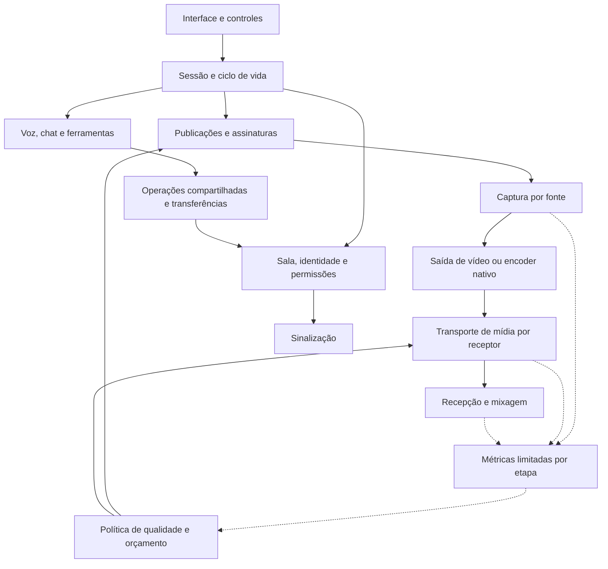

# Estrutura de implementação do Xennex Live

Atualizado em **04/11/2026**. Decisão do usuário: manter todas as melhorias do
[plano](STREAMING_PLAN.md), construir a estrutura integrada antes de retomar
rodadas de desempenho e acabamento. Este documento define a arquitetura alvo;
**não afirma que os módulos futuros já estão implementados ou estáveis**.

## 1. Ordem de construção

1. **Estrutura:** responsabilidades, contratos, donos dos recursos, dependências,
   compatibilidade e limites para as 48 tarefas. Consolidar os caminhos existentes.
2. **Integração funcional do conjunto:** construir versões básicas conectadas
   dos módulos nos pontos definidos abaixo, com alternativas compatíveis,
   cancelamento e tratamento de falhas. Não terminar ou aperfeiçoar um módulo
   inteiro antes de começar os demais. Compilar e verificar os contratos a cada
   incremento; não acumular código impossível de integrar.
3. **Estabilidade integrada:** testar entrada/saída, falhas, recuperação e limpeza
   entre módulos. Módulos opcionais indisponíveis não derrubam sala nem mídia.
4. **Uso e desempenho:** app/site, fullscreen, foco/segundo plano, redes e hardware
   do grupo. Voltar ao módulo responsável quando houver evidência de problema.
5. **Acabamento:** refinamentos visuais, animações, presets e pequenos detalhes;
   depois entrega versionada com rollback.

Compilação, testes determinísticos e revisão de segurança acompanham a construção.
Ensaios manuais repetidos de FPS, troca de janela e ajustes estéticos deixam de
conduzir a sequência. Acessibilidade, consentimento e erros compreensíveis são
requisitos funcionais, não detalhes para retirar nesta fase.

**Regra de execução horizontal:** uma pendência local não prende o trabalho
naquele componente. Registrar sintoma, impacto e módulo relacionado, seguir
conectando o conjunto e reavaliar com o fluxo completo. Por exemplo, integrar
encoder/transporte nativo pode eliminar etapas JPEG em vez de exigir que elas
sejam aperfeiçoadas primeiro. Bloquear integração somente por contrato quebrado,
falha de compilação, segurança, perda de dados ou ciclo de vida inseguro. Limitação
conhecida mantém o recurso experimental/indisponível, sem bloquear módulos
independentes. Cada rodada termina com um conjunto mais completo, não apenas
com uma peça mais polida. Não inventar implementações vazias para contar progresso.

## 2. Mapa da arquitetura

O Cloudflare continua distribuindo o site e atendendo apenas os endpoints
explicitamente implementados. Não passa a transportar a mídia por causa dessa
organização. WebRTC P2P continua padrão; TURN/SFU/transporte alternativo não são
dependências obrigatórias das demais melhorias.

| Módulo | Responsabilidade e dono | Código atual / destino da implementação |
| --- | --- | --- |
| Sessão | Iniciar/cancelar/parar publicações, invalidar callbacks atrasados, sair da sala | `useRoom.ts` hoje; extrair controlador de sessão ao integrar mais serviços, mantendo hook como adaptador React |
| Sala | Participantes, coordenação, presença, eleição, protocolo e autorização | `RoomClient.ts`, `RoomCoordinator.ts`, `protocol.ts`; separar mídia e módulos antes de acrescentar lógica social nessas classes |
| Captura | Fonte escolhida, permissões, aquisição nativa, áudio associado | `capture.ts`, `captureStartup.ts`, `captureSocket.ts`; serviços nativos existentes em `src/Services/` e `src/CaptureWorker/` |
| Quadros JPEG | Decode, saída, ownership e métricas do consumidor | `captureFramePipeline.ts` integra decoder/output; `LatestCaptureFrame` limita fila; worker opcional isolado |
| Encoder nativo | Probe, conversão, encode, keyframes e recursos GPU | Protótipo em `scripts/tests/NativeEncoderTests/`; migrar peças aprovadas ao worker nativo por contratos, não referenciar projeto de testes em produção |
| Mídia | Negociar, publicar, assinar e encerrar conexões por receptor | PeerJS/WebRTC hoje em `RoomClient`; futuro adaptador nativo com o mesmo controle de publicação, mas contrato de mídia distinto de `MediaStream` |
| Qualidade | Intenção do usuário, capacidade por ponta, orçamento e recomendação | `quality.ts`, `streamCapabilities.ts`; medidas vêm de `streamStats.ts`/`captureMetrics.ts` |
| Áudio/chamada | Voz independente, som da fonte, mixagem e dispositivos | Áudio da fonte já existe; voz e mixagem futuras em módulos próprios dentro de `features/stream/` |
| Ferramentas | Chat, documentos, player, arquivos, gravação e legenda | Novos módulos por domínio em `features/stream/`; operações validadas, sem comandos nativos vindos dos pares |
| Apresentação | Layout, controle, estados e preferências locais | `StreamWorkspace`, `StreamStage`, `StreamVideo` e painéis existentes; skins/tokens preservados |
| Diagnóstico/entrega | Relatórios seguros, builds, assinaturas, CI e rollback | Diagnósticos existentes, `scripts/`, Worker Cloudflare e documentação |

Não mover todos os arquivos só para criar pastas. Extrair um módulo quando houver
responsabilidade real e consumidor; evitar interfaces sem uso, serviços vazios,
duplicação de estado ou um barramento global que contorne os contratos.

## 3. Contratos e regras comuns

### Sessão e publicação

- Cada tentativa tem uma geração; resultados de geração encerrada são descartados
  e seus recursos liberados. A geração é local, não concede autorização remota.
- Cada publicação tem ID e dono verificado pela conexão da sala. Uma falha de
  publicação não deve chamar a saída global da sala.
- Aquisição segue `idle → starting → ready → stopping → stopped`, com falha
  explícita em qualquer etapa; cancelamento também funciona antes de `ready`.
- O controlador só anuncia publicação após saída utilizável. Encerramento é
  idempotente e libera recursos na ordem inversa da aquisição.
- Separar estado da sessão de apresentação: fechar painel, mudar layout, minimizar
  ou perder foco não deve encerrar a transmissão nem alterar o áudio escolhido.

### Fonte, quadros e encoder

- Fonte recebe seleção explícita, qualidade alvo e cancelamento; devolve sessão
  dona de seus recursos. Nunca substituir janela por monitor silenciosamente.
- Contrato JPEG implementado: `CaptureFramePipeline.write(ArrayBuffer)` consome
  um quadro e retorna decode/submissão/comunicação; `stream` só fica disponível
  após o primeiro quadro aceito. `stop()` encerra apenas a saída correspondente.
- `LatestCaptureFrame` mantém um quadro ativo e um pendente substituível. O
  consumidor worker pode transferir/destacar o buffer: o chamador não o reutiliza.
- Canvas é padrão atual; generator/worker são experimentais explícitos. Falha
  antes da publicação pode usar alternativa prevista; depois de publicar não
  trocar a trilha sem coordenar transporte e usuário.
- **H.264 nativo não cabe nesse contrato JPEG.** Precisa de sessão de encoder com
  perfil negociado, timestamps, unidades de acesso limitadas, keyframe solicitado,
  fechamento e métricas; transporte nativo recebe dados codificados, não tenta
  transformá-los artificialmente em `MediaStream` na UI.
- A promoção do protótipo precisa separar fonte, encoder e peer nativo. Nenhum
  deles deve carregar UI, escolher outra GPU/fonte por nome ou depender do foco.

### Transporte e interoperabilidade

- Distinguir presença/sinalização, controle da sala, mídia e transferência de
  arquivos. Uma falha precisa indicar qual camada falhou.
- Publicação futura declara capacidades opcionais negociáveis. Cliente anterior
  continua usando o protocolo/caminho compatível; não enviar mensagens novas
  obrigatórias para peers que não anunciaram suporte.
- O transporte recebe a publicação, receptor, perfil e cancelamento; fornece
  estado, métricas e encerramento. Limitar negociações concorrentes e tentativas.
- Backend nativo deve oferecer oferta/resposta/ICE/DTLS/RTCP e validação de dono
  compatíveis com a sala antes de substituir o adaptador atual.
- TURN é alternativa por participante/necessidade, permanece desligado; orçamento
  e ativação são decisões separadas. Não corrigir erro de sinalização com relay.

### Qualidade e segundo plano

- Intenção solicitada, capacidade estimada, formato negociado e desempenho medido
  são campos diferentes. Ausência de métrica é `unknown`, nunca zero inventado.
- Primeiro observar; depois recomendar/aplicar política com histerese e orçamento
  total. Fabricante não equivale a suporte; não executar benchmark pesado ao entrar.
- Estado `visible/hidden` e foco devem acompanhar medidas. Não usar FPS exibido
  de vídeo oculto como prova de queda de FPS recebido.
- Fonte ativa e áudio não dependem de `requestAnimationFrame` da interface.
  Isso é requisito a verificar, não prova de que o caminho atual já o cumpre.
- Vídeo oculto pode ter política econômica no receptor sem pausar o áudio escolhido.
  Voltar ao foco deve recuperar apresentação sem recriar toda a sala.

### Voz, conteúdo e permissões

- Voz é publicação independente, com opt-in, mute e dispositivo próprios. Som de
  jogo não passa automaticamente por processamento de voz.
- Permissão usa identidade da conexão, não nome exibido, flag do payload ou
  simples posse do código da sala. Eleição do coordenador não transfere direitos
  administrativos silenciosamente; modo privado precisa definir identidade real.
- Operações compartilhadas incluem versão, ID, domínio, revisão/época e dados
  validados. A identidade é vinculada pelo transporte. Duplicatas são idempotentes;
  conflitos, expiração e ressincronização têm respostas explícitas e limites.
- Começar documentos/notas com operações serializadas pelo coordenador e snapshots
  limitados. Não alegar edição offline/CRDT; avaliar essa necessidade separadamente.
- Chat/reação não executa HTML. Editor de código não executa conteúdo. Arquivos
  exigem aceite, hash, chunks com backpressure e cancelamento independente da mídia.
- Gravação/transcrição só iniciam por ação explícita, com indicador e política de
  retenção. Exportações locais não viram uploads automáticos.
- Player sincroniza intenção/posição/revisão e corrige drift observado; não supor
  relógios iguais ou que todo provedor admite os mesmos controles.

### Segurança, erros e recursos

- Limites concretos de tamanho/frequência/fila serão definidos no contrato de
  cada recurso antes de ligar seu tráfego. Payload inválido é recusado no receptor.
- Recursos locais: origem exata, loopback, token em memória e bridge declarativa.
  Mensagem de outro participante nunca equivale a autorização de comando Windows.
- Dono do recurso fecha tracks, decoders, frames, sockets, writers, texturas e
  processos. Testes determinísticos verificam resultados tardios e dupla parada.
- Logs e diagnósticos não carregam quadros, chat, tokens, SDP, IPs ou nomes de
  janelas. Não reutilizar logs privados para telemetria compartilhada.

## 4. Cobertura de todo o plano e sequência de integração

| Lote estrutural | IDs preservados | Entrega funcional antes do acabamento |
| --- | --- | --- |
| S1 · Sessão e fronteiras | R01, R02, R05, D03, D04 | Ciclo de vida, isolamento de erros, autorização e diagnóstico por etapa |
| S2 · Mídia e captura | E01–E06 | Adaptadores de fonte/saída/encoder/transporte, negociação e alternativa compatível |
| S3 · Qualidade e recepção | R03, Q01–Q05 | Medidas e orçamento por ponta, política de foco/segundo plano, controle estável |
| S4 · Áudio | A01–A04 | Voz separada, dispositivos, mute/deafen e áudio de processo no app |
| S5 · Operações de sala | C01, C02, C05, C07 | Identidade/permissão, chat, notas/tarefas e edição compartilhada limitada |
| S6 · Mídia e ferramentas | C03, C04, C06, C08–C10 | Player/arquivo/lousa/transferência/gravação/legenda conectados à mesma sessão |
| S7 · Interface funcional | U01–U04, C11 | Controles dos módulos, recuperação, acessibilidade e preferências coerentes |
| S8 · Compatibilidade e entrega | R04, R06, D01, D02, D05 | Matriz real, alternativa de rede opcional, regressões, pacote/site e rollback |
| S9 · Capacidades avançadas | X01–X07 | Pontos de extensão por encoder/receptor/transporte; habilitar só implementações comprovadas |

Os lotes são frentes de responsabilidade, não uma fila de módulos a concluir
individualmente. Construir primeiro a conexão mínima entre eles e só depois
ampliar suas capacidades. S1/S2 sustentam as outras integrações. S5 antecede ferramentas compartilhadas de
S6; S4 antecede mixagem de gravação/transcrição. S3 recebe métricas dos caminhos
realmente integrados. Interface funcional acompanha cada módulo; acabamento vem
após estabilidade. S9 está no escopo, mas suporte não pode ser fabricado: cada
ideia mantém o gate técnico e os limites de custo do plano.

## 5. Marco de estrutura estável

Só considerar a estrutura integrada quando:

- todo módulo implementado tiver consumidor, contrato e dono da limpeza;
- frontend app/web e backend compilarem, e CI/contratos passarem;
- cancelamento, erro parcial e eventos atrasados não vazarem entre sessões;
- versão anterior e ambiente sem APIs opcionais tiverem comportamento definido;
- estado de implementação estiver explícito: especificado, implementado isolado,
  integrado, validado localmente, validado no grupo, entregue;
- caminhos experimentais não forem apresentados como capacidade disponível;
- tarefas ainda não integradas continuarem abertas, sem confundir mapa completo
  com implementação completa.

**Estado em 04/11:** mapa completo especificado; primeira consolidação realizada
na saída JPEG (`captureFramePipeline.ts`). Restante da extração/integração de
sessão, encoder, transporte e módulos sociais continua pendente. A redução de
lag fora de foco ainda não foi comprovada no produto.
